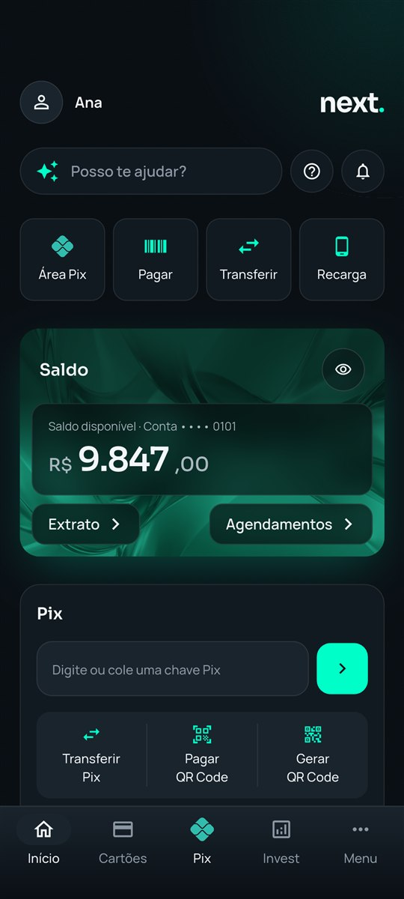
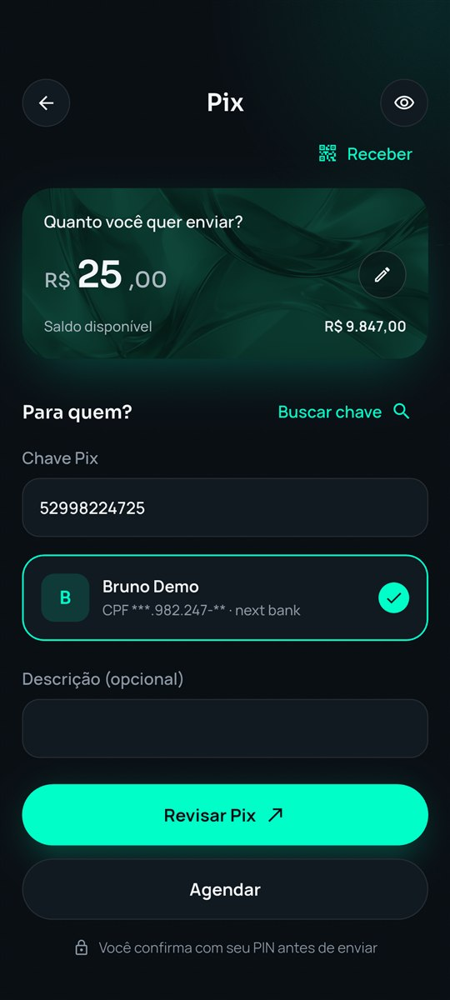
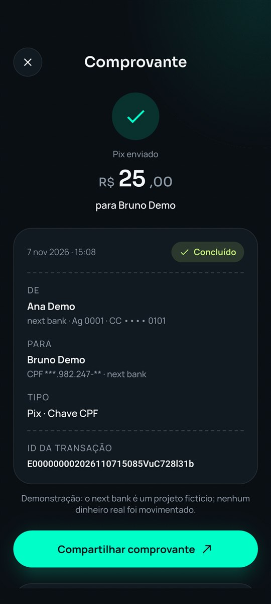
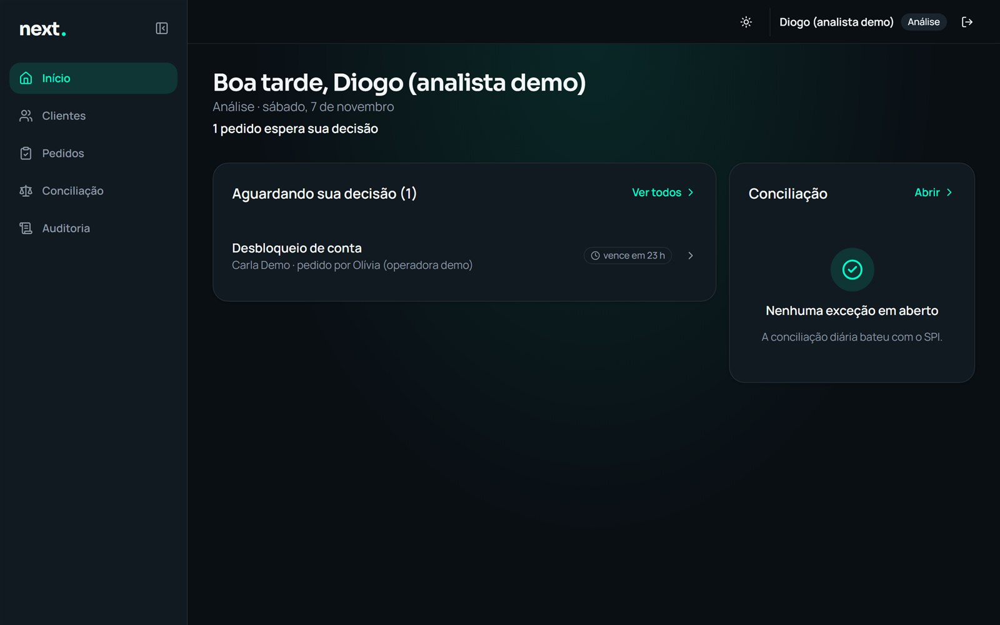
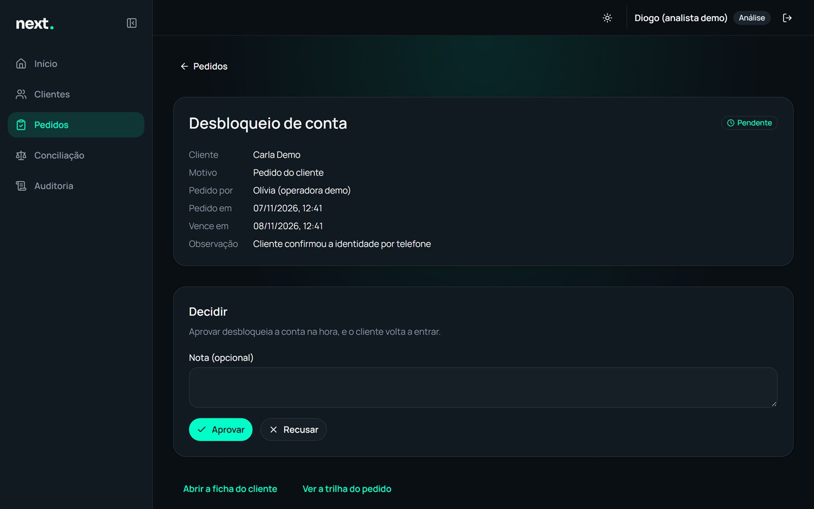
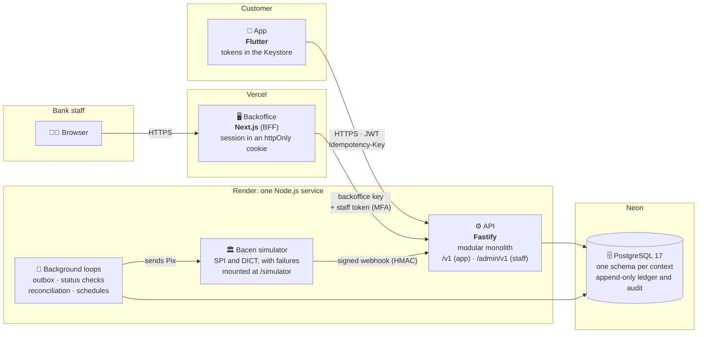

# next bank

[🇧🇷 Português](README.md) · 🇺🇸 English

[](https://github.com/renatomf/next-bank/actions/workflows/ci.yml)
[](https://github.com/renatomf/next-bank/actions/workflows/e2e.yml)

### Your money, one step ahead.

**next bank** is a portfolio digital bank built as if for production: a **Flutter app** for the customer, a **TypeScript API** that keeps the money in a double-entry ledger, a **Bacen simulator** (Brazil's central bank) that fails on purpose, and a **Next.js backoffice** where the bank's staff works under two-person approval. All of it published, with a public demo, at no cost and with fictitious data only.

<p align="center">
  
  
  
</p>
<p align="center"><sub>The app: home, Pix and receipt. <a href="docs/screenshots/README.md"><b>See every screen of the app and the backoffice →</b></a></sub></p>

## By the numbers

| | |
|---|---|
| **Released versions** | 4: `v1.0.0` (core), `v1.1.0` (everyday products), `v1.2.0` (asynchronous Pix) and `v1.3.0` (backoffice) |
| **Applications** | Android app (Flutter), API (Fastify), backoffice (Next.js) and the Bacen simulator |
| **Tests** | Over 3,300: 1,627 in the API (integration against real Postgres), over 1,280 in the app and 396 in the backoffice, plus E2E on an Android emulator and in the browser |
| **Documented decisions** | 20 ADRs, each with its alternatives and negative consequences |
| **Security** | A threat model with 91 threats, each with the test that proves it; OWASP ASVS L2 and MASVS as the baseline; 53 recorded findings, with the process rule each one led to |

## See it working

The app on the published demo (1 min 40 s, no sound):

https://github.com/user-attachments/assets/a2748bde-302c-45a7-a953-d19fa6b02b93

### The bank from the inside: the backoffice

<table>
  <tr>
    <td width="50%"></td>
    <td width="50%"></td>
  </tr>
  <tr>
    <td><sub><b>The analyst's home:</b> the queue of requests, oldest first, with the time left before each one expires.</sub></td>
    <td><sub><b>Two-person approval:</b> the operator asks, the analyst decides. Whoever asks never approves, neither on screen nor through the API.</sub></td>
  </tr>
</table>

**[Full gallery →](docs/screenshots/README.md)** 37 screens of the app and 21 of the backoffice, organized by area (Pix, statement, profile; customers, requests, reconciliation, audit, staff), each with what it shows and what is behind it. The screens and the captions are in Portuguese.

## Try it in a minute

**App:**
1. Download the APK from the [latest Release](https://github.com/renatomf/next-bank/releases/latest) (Android 7.0 or newer) and check the file: compare the output of `Get-FileHash` (Windows) or `sha256sum` (Linux and macOS) with the `.sha256` of the same Release.
2. Install it and sign in with a demo account. Play Protect may block the install because it does not know the developer: tap **More details › Install anyway**.

| Account | E-mail | Password | PIN |
|---|---|---|---|
| Ana | `ana.demo@example.com` | `demo-ana-next-bank` | `2580` |
| Bruno | `bruno.demo@example.com` | `demo-bruno-next-bank` | `1470` |

3. **A Pix in 30 seconds:** sign in as Ana, tap **Pix**, use Bruno's CPF key (`529.982.247-25`), choose the amount and confirm with PIN `2580`. The receipt shows up at once, and the Pix is already in both statements.
4. **A Pix to another bank:** use the key `clara.aurora@example.com`, Clara's, at Banco Aurora (made up). The Pix goes through the Bacen simulator and stays processing for a few seconds, until the "SPI" answers; the app follows it to the receipt on its own.

**Backoffice** ([next-bank-backoffice.vercel.app](https://next-bank-backoffice.vercel.app)): the code comes from an authenticator app (Google Authenticator, Microsoft Authenticator, 1Password). Add the key by hand, as TOTP.

| Staff | E-mail | Password | Authenticator key |
|---|---|---|---|
| Olívia (operator) | `olivia.demo@example.com` | `demo-olivia-next-bank` | `N5WGS5TJMEQGIZLNN4QG4ZLYOQQGEYLONM` |
| Diogo (analyst) | `diogo.demo@example.com` | `demo-diogo-next-bank` | `MRUW6Z3PEBSGK3LPEBXGK6DUEBRGC3TL` |

**A two-person approval walkthrough:** as Olívia, find **Carla Demo**, block the account and ask to unblock it. In a private window, as Diogo, the request shows up in the queue on the home; open it and approve. The request's trail names both. A Pix reversal follows the same path, from the customer's statement.

<details>
<summary><b>Good to know</b></summary>

- **First launch:** the API runs on a free server that sleeps when idle. The first answer can take up to a minute.
- **Shared accounts:** the demo accounts cannot change their password or PIN, nor end sessions, so no visitor can lock the others out.
- **Demo staff:** Olívia and Diogo only see the demo customers; accounts created by visitors never show up in the published backoffice. Ana and Bruno, whom every app visitor uses, cannot be blocked by the demo staff.
- **Reconciliation:** **Conciliação** holds the differences the daily reconciliation found against the SPI. For a Pix stuck without an answer, Olívia asks to settle or refund it, and Diogo approves; any other, Diogo marks as explained.
- **Everything resets daily at 06:00 UTC:** accounts created by visitors and all Pix are removed, and Ana and Bruno get their starting balance back.
- **Your own account:** sign-up generates a valid fictitious CPF (Brazil's taxpayer id). Do not use real data.
- **Play money:** Pix happens between next bank accounts and three made-up banks (Aurora, Horizonte and Raiz), through the project's own Bacen simulator. No real money moves, and nothing talks to the real Pix.
- **Android only:** there is no iOS release, since it cannot be tested without a Mac.

</details>

---

## Architecture

### Overview



A single Node.js service on Render runs the API, the background loops and the simulator: a zero-cost choice, with its consequences recorded ([ADR 0012](docs/adr/0012-hospedagem-da-v1.md), [0016](docs/adr/0016-outbox-e-inbox.md) and [0017](docs/adr/0017-simulador-no-servico-da-api.md)). The backoffice lives on Vercel and reaches the `/admin` routes through layers: a credential only the backoffice's server holds, a staff token with its own `audience`, and MFA ([ADR 0011](docs/adr/0011-bff.md)).

### A modular monolith, by context

The API is a **modular monolith** with **DDD** and **hexagonal architecture**: each bounded context has its domain, application, infrastructure and HTTP layers, and a module only talks to another through ports the caller defines ([ADR 0002](docs/adr/0002-monolito-modular-ddd-hexagonal.md), [0010](docs/adr/0010-orquestracao-entre-contextos.md)). dependency-cruiser checks the boundaries in CI: a forbidden import breaks the build.

| Context | Responsibility |
|---|---|
| **Identity** | Sign-up, sign-in, sessions with refresh token rotation, transaction PIN |
| **Accounts** | Account, available and ledger balance, blocking |
| **Ledger** | Double-entry ledger: every entry sums to zero and is never edited |
| **Payments** | Internal and external Pix, QR Code, scheduling and recurrence, outbox and inbox |
| **Top-ups** | Mobile top-up |
| **Reconciliation** | Daily reconciliation against the SPI's settlement file, and the exceptions queue |
| **Staff** | The bank's staff: sign-in with MFA, roles (operator, analyst, admin), management |
| **Operations** | Staff commands under two-person approval: unblocking, Pix reversal, exception resolution |
| **Audit** | An append-only audit trail, written in the command's own transaction |

### The path of a Pix to another bank

```mermaid
sequenceDiagram
    autonumber
    participant App
    participant API
    participant DB as Postgres
    participant W as Outbox worker
    participant SPI as SPI simulator

    App->>API: POST /v1/pix/transfers (Idempotency-Key)
    App->>API: authorizes with the PIN
    API->>DB: one transaction: hold in the transit account + outbox message
    API-->>App: Processing
    W->>DB: reads the outbox
    W->>SPI: sends the Pix (at least once)
    SPI-->>API: signed webhook (HMAC-SHA256 + timestamp)
    API->>DB: inbox: applies the answer once and settles in the ledger
    App->>API: follows it to the receipt
    Note over API,SPI: With no answer, the status check decides;<br/>never refund blindly. At 03:00 (São Paulo),<br/>reconciliation checks the day against the SPI.
```

The debit and the message to the SPI are written together (**outbox**), and the SPI's answer is applied once (**inbox**), whether it arrives by webhook or by status check ([ADR 0016](docs/adr/0016-outbox-e-inbox.md), [0018](docs/adr/0018-pix-assincrono-e-conciliacao.md)). A **chaos test** in CI sends a thousand Pix under 30% injected failures and an hour without the SPI, and checks that not a cent is lost or duplicated.

### The app

**Clean Architecture by feature**: `domain/` in pure Dart, `data/` implementing its interfaces, `presentation/` with Riverpod depending on the domain only, and no feature ever imports another. The project's own **design system** package holds the tokens, the theme and the components, and an architecture test in Dart bars literal colors and styles out of place ([ADR 0003](docs/adr/0003-flutter-riverpod.md), [0014](docs/adr/0014-fronteiras-de-ui.md)).

### One contract

The API describes each route with **Zod**, and the **OpenAPI** comes from it: the app's Dart client and the backoffice's TypeScript types are generated from it, and CI fails if the published contract drifts from the code ([ADR 0008](docs/adr/0008-contrato-unico-openapi.md)).

## Engineering

**💰 Financial integrity**
- Money only as integer cents (`Money`), never floating point ([ADR 0006](docs/adr/0006-value-object-money.md)).
- An append-only double-entry ledger: fixing is reversing, never editing ([ADR 0005](docs/adr/0005-ledger-partidas-dobradas.md)).
- Every financial command is idempotent, transactional and locks its resources in a deterministic order; concurrency tests prove that simultaneous requests never leave a negative balance nor duplicate a payment ([ADR 0007](docs/adr/0007-idempotencia-concorrencia.md), [0015](docs/adr/0015-idempotencia-compartilhada.md)).

**🔒 Security by design**
- Every slice starts from the [threat model](docs/security/threat-model.md): a new threat becomes a row **and** a test, written before the defense.
- Argon2id passwords; JWT with `jose`; refresh token rotation with reuse detection; a server-side PIN with progressive lockout; app tokens only in the Keystore.
- Staff with mandatory MFA, roles checked on the server (deny by default) and **two-person approval** enforced in the domain and in a database `CHECK`.
- An IDOR test for every resource; strict CSP, HSTS, and CSRF checked on Server Actions; rate limits on sensitive routes.
- CPF, tokens, passwords and PIN redacted from logs and Sentry (LGPD, Brazil's data protection law).
- Merge-blocking gates: **gitleaks**, **Semgrep** and **osv-scanner**; OWASP ZAP baseline against the published API and backoffice, with no failures.

**✅ Quality**
- TDD, with the commits showing the order (`test:` before `feat:`); a 90% minimum coverage on domain and application code.
- Integration tests against **real Postgres** in Docker, never an in-memory database.
- E2E of the critical flow on an **Android emulator** (sign-in → Pix → receipt → statement) and of the backoffice with **Playwright**, on every PR.
- TypeScript `strict`, ESLint with no warnings; Dart with strict lints and zero warnings from `flutter analyze`.

**🔭 Observability and operations**
- A `requestId` from the app to the database, structured JSON logs, unexpected errors in Sentry with release and environment.
- End-to-end tracing with **OpenTelemetry**, with no personal data in the attributes ([ADR 0019](docs/adr/0019-trace-com-opentelemetry.md)).
- Deploys run migrations before the code, wait for the new release and run a smoke test; `/health` shows the published commit.
- Performance measured in production, route by route, against a p95 budget (200 ms for reads, 400 ms for Pix), with an honest reading of the result: the trip from Brazil to the server in Virginia weighs more than the API itself ([performance.md](docs/performance.md)).

## Stack

| Layer | Technologies |
|---|---|
| **App** | Flutter 3.47 (Dart 3.13), Riverpod, GoRouter, Dio, flutter_secure_storage, local_auth, mobile_scanner, Sentry |
| **API** | Node.js 24, TypeScript 6, Fastify 5, Zod 4, PostgreSQL 17 with plain SQL (`pg`) and dbmate migrations, Argon2, jose, Pino, OpenTelemetry, Sentry |
| **Backoffice** | Next.js 16 (App Router, Server Components and Server Actions), React 19, Tailwind CSS 4, shadcn/ui (Radix), openapi-typescript |
| **Testing** | Vitest, Playwright, flutter_test and integration_test, dependency-cruiser |
| **Infra and CI** | pnpm workspaces, Docker, GitHub Actions, Render, Neon, Vercel, gitleaks, Semgrep, osv-scanner, Dependabot |

## Versions

| Version | Delivered |
|---|---|
| **`v1.0.0`** | Sign-up, sign-in, account, ledger, internal Pix with PIN, receipt and statement; CI, deploy and the public demo |
| **`v1.1.0`** | Pix by QR Code, mobile top-up, biometrics, shareable receipt and a filtered statement |
| **`v1.2.0`** | Pix to other banks through the Bacen simulator, scheduling and recurrence, daily reconciliation, tracing and a chaos test |
| **`v1.3.0`** | Backoffice: staff with MFA and roles, customers, blocking, Pix reversal and reconciliation under two-person approval, and the audit trail |
| *Unreleased* | The backoffice home, with each role's work queue |
| *Next* | `v1.4.0`: my Pix keys and dynamic QR Code · `v1.5.0`: asynchronous top-up, bank slips and utility bills · `v2.0.0`: credit card and statement |

Each version's details are in the [CHANGELOG](CHANGELOG.md) (in Portuguese), and each one's plan in [docs/plans](docs/plans).

## Running locally

Prerequisites: Node.js 24, pnpm (through `corepack enable`), Docker and, for the app, Flutter 3.47 with an Android emulator.

```bash
# Postgres (copy infra/.env.example to infra/.env and change the passwords)
docker compose -f infra/docker-compose.yml up -d

# Dependencies and database
pnpm install
cp apps/api/.env.example apps/api/.env      # fill in the values
pnpm --filter @nextbank/api db:migrate
pnpm --filter @nextbank/simulator db:migrate
pnpm --filter @nextbank/api seed:demo

# API (port 3000) and backoffice (port 3001)
pnpm --filter @nextbank/api dev
pnpm --filter @nextbank/backoffice dev      # API_URL and BACKOFFICE_API_KEY in apps/backoffice/.env.local

# The app on the emulator, pointing at the local API
cd apps/mobile && flutter run --dart-define=API_BASE_URL=http://10.0.2.2:3000

# Tests
pnpm --filter @nextbank/api test
pnpm --filter @nextbank/backoffice test
cd apps/mobile && flutter test
```

The backoffice's demo staff (`staff:create`), the E2E and publishing are walked through step by step in [operations.md](docs/operations.md) (in Portuguese).

## Documentation

The documentation is in Portuguese.

- [Project evolution](docs/evolucao.md): how we got here, and why
- [Roadmap and architecture design](docs/roadmap.md)
- [Architecture decisions (ADRs)](docs/adr/README.md)
- [Domain model](docs/architecture/domain-model.md) and [database](docs/architecture/database.md)
- [C4 diagrams](docs/architecture/c4.md) and [sequence diagrams](docs/architecture/sequences.md)
- [Threat model](docs/security/threat-model.md), [controls and findings](docs/security/controles-de-seguranca.md) and [OWASP ASVS/MASVS checklist](docs/security/checklist-asvs-masvs.md)
- [Visual brief and design tokens](docs/design/brief.md)
- [Operations](docs/operations.md) and [measured performance](docs/performance.md)
- [Changelog](CHANGELOG.md)

---

Made by **Renato Marques** · [github.com/renatomf](https://github.com/renatomf)

<sub>A portfolio project for study and demonstration. It is not a financial institution, moves no real money and uses fictitious data only. See the [LICENSE](LICENSE).</sub>

<sub>Pix is a trademark of Banco Central do Brasil. next bank is a fictitious project, with no link to the Central Bank, and uses the Pix symbol only to identify the feature in the app.</sub>
