# next bank

🇧🇷 Português · [🇺🇸 English](README.en.md)

[](https://github.com/renatomf/next-bank/actions/workflows/ci.yml)
[](https://github.com/renatomf/next-bank/actions/workflows/e2e.yml)

### Seu dinheiro, um passo à frente.

O **next bank** é um banco digital de portfólio construído como se fosse para produção: um **app Flutter** para o cliente, uma **API em TypeScript** que guarda o dinheiro num livro-razão de partidas dobradas, um **simulador do Bacen** que falha de propósito e um **backoffice em Next.js** onde a equipe do banco trabalha com dupla aprovação. Tudo publicado, com demo pública, sem custo e só com dados fictícios.

<p align="center">
  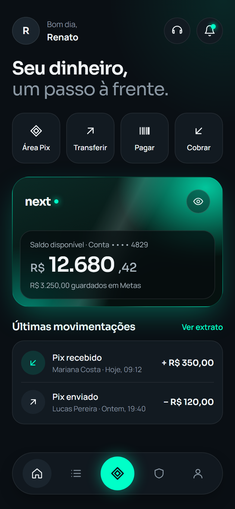
  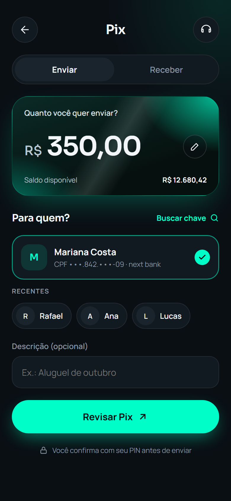
  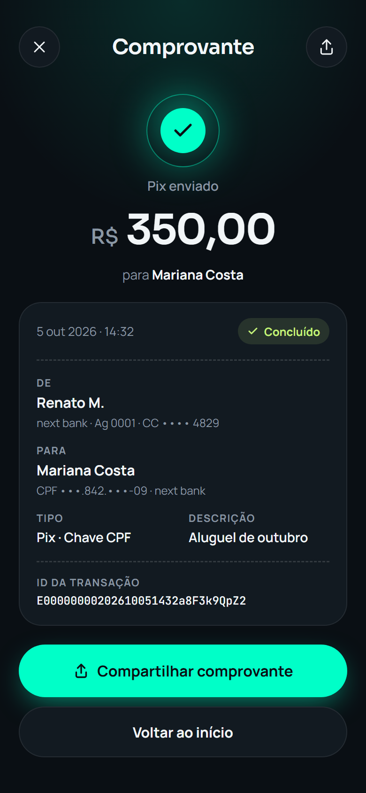
</p>
<p align="center"><sub>O app: conceito visual da V1, do qual as telas evoluíram.</sub></p>

## Em números

| | |
|---|---|
| **Versões publicadas** | 4: `v1.0.0` (core), `v1.1.0` (produtos do dia a dia), `v1.2.0` (Pix assíncrono) e `v1.3.0` (backoffice) |
| **Aplicações** | App Android (Flutter), API (Fastify), backoffice (Next.js) e simulador do Bacen |
| **Testes** | Mais de 3.300: 1.627 na API (integração contra Postgres real), mais de 1.280 no app e 396 no backoffice, além de E2E no emulador Android e no navegador |
| **Decisões documentadas** | 20 ADRs, cada um com alternativas e consequências negativas |
| **Segurança** | Threat model com 91 ameaças, cada uma com o teste que a prova; OWASP ASVS L2 e MASVS como referência; 53 achados registrados, com a regra de processo que cada um gerou |

## Veja funcionando

O app na demo publicada (1 min 40 s, sem áudio):

https://github.com/user-attachments/assets/a2748bde-302c-45a7-a953-d19fa6b02b93

### O banco por dentro: o backoffice

<table>
  <tr>
    <td width="50%">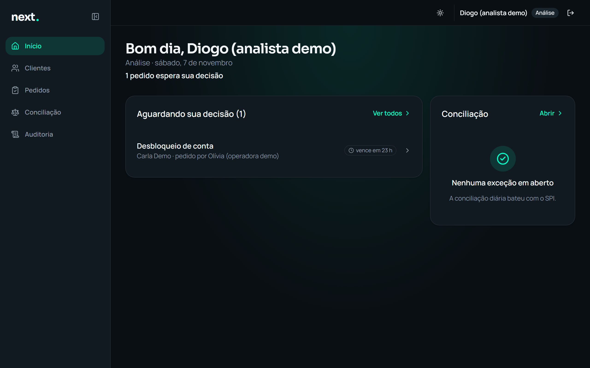</td>
    <td width="50%">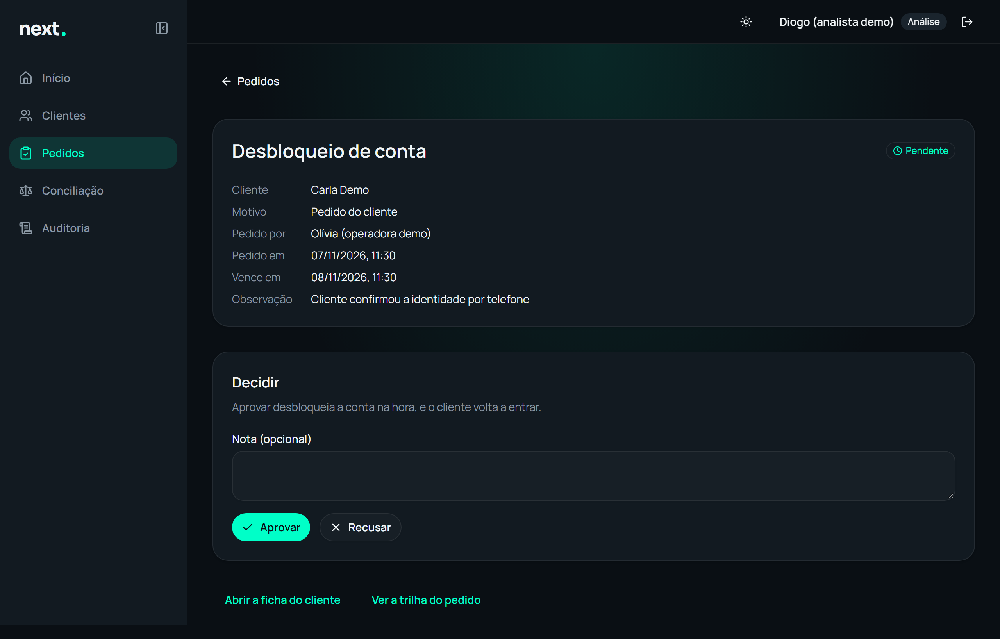</td>
  </tr>
  <tr>
    <td><sub><b>Home do analista:</b> a fila de pedidos, do mais antigo ao mais novo, com o tempo que falta para cada um vencer.</sub></td>
    <td><sub><b>Dupla aprovação:</b> a operadora pede, o analista decide. Quem pede nunca aprova, nem pela tela nem pela API.</sub></td>
  </tr>
  <tr>
    <td>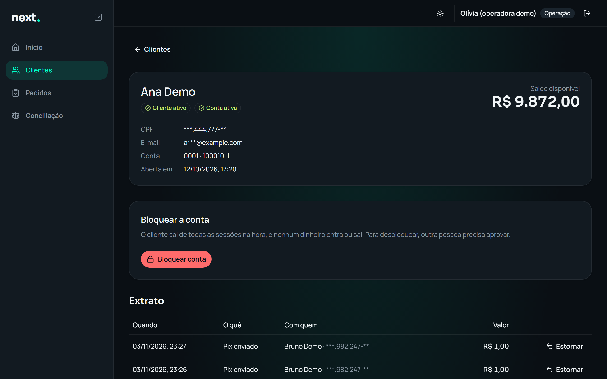</td>
    <td>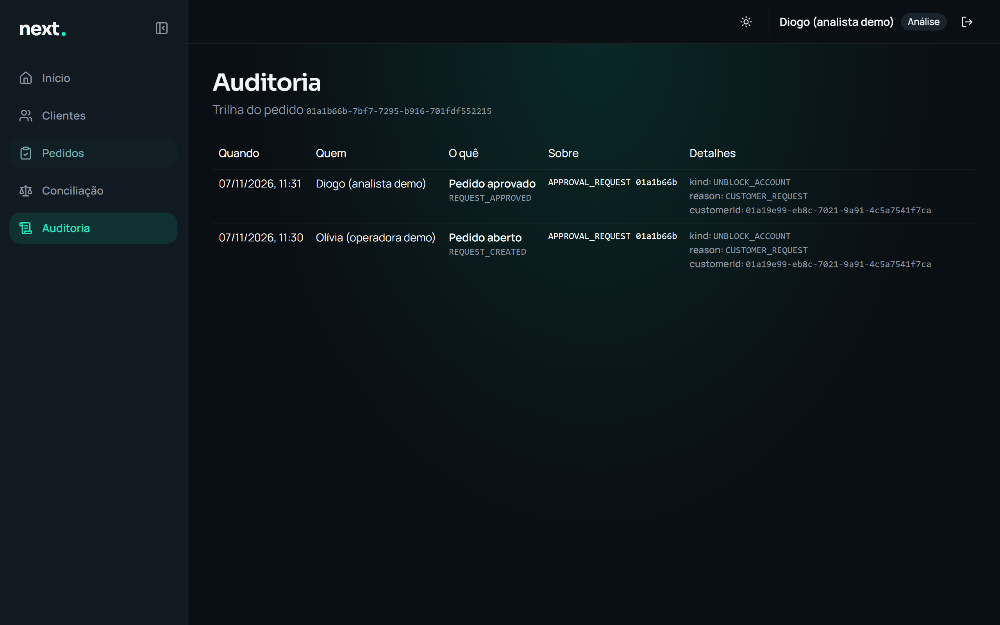</td>
  </tr>
  <tr>
    <td><sub><b>Ficha do cliente:</b> CPF e e-mail mascarados, bloqueio imediato e estorno de Pix a partir do extrato. Cada consulta fica na trilha.</sub></td>
    <td><sub><b>Trilha de auditoria:</b> quem fez o quê e quando, por cliente, por membro da equipe ou por pedido. Só por inclusão.</sub></td>
  </tr>
  <tr>
    <td>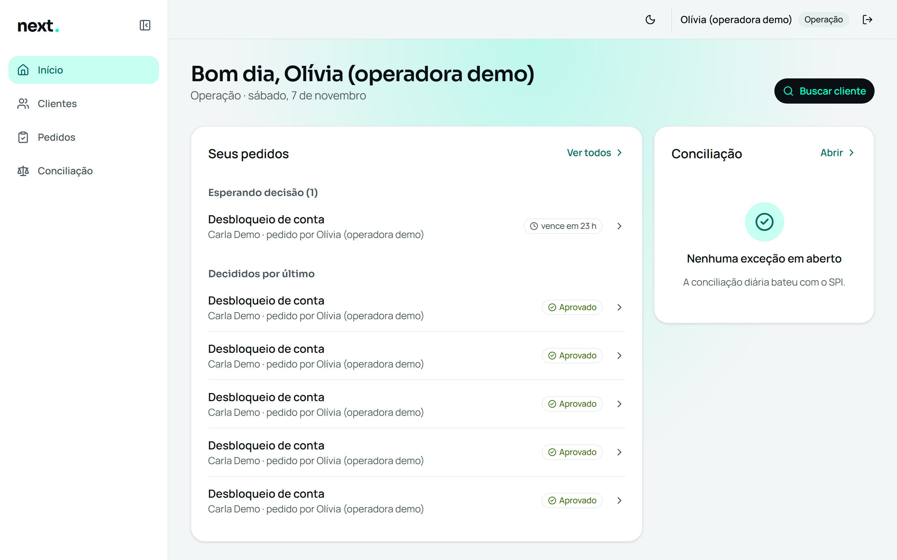</td>
    <td>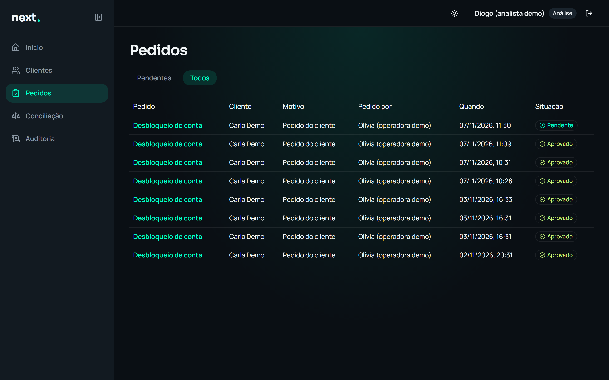</td>
  </tr>
  <tr>
    <td><sub><b>Home da operadora</b> (tema claro): os pedidos que ela abriu e como terminaram.</sub></td>
    <td><sub><b>Pedidos:</b> desbloqueios, estornos de Pix e resoluções da conciliação, com a situação de cada um.</sub></td>
  </tr>
</table>

<p align="center">
  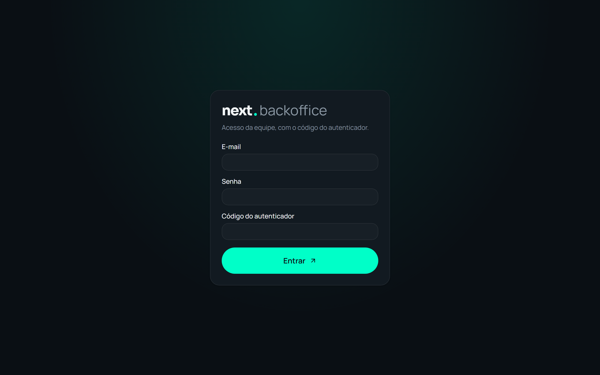
  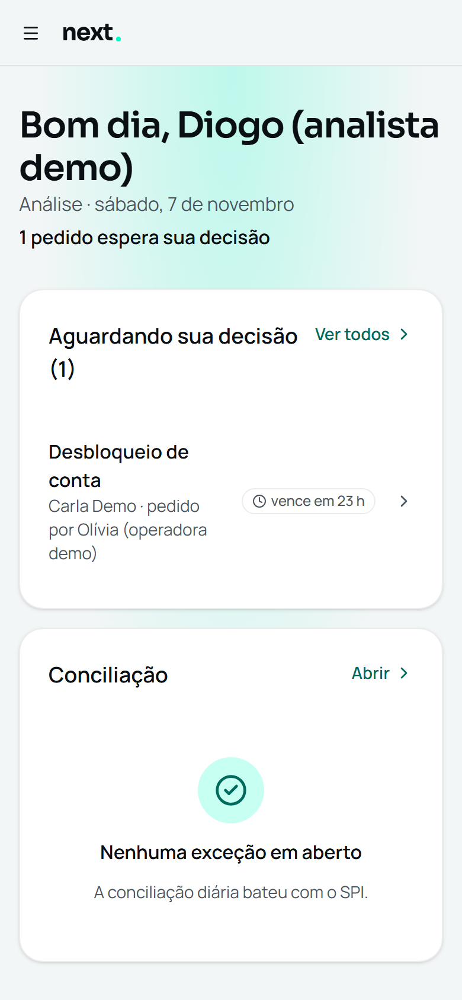
</p>
<p align="center"><sub>Login com MFA (TOTP) obrigatório e a mesma home no celular.</sub></p>

## Experimente em um minuto

**App:**
1. Baixe o APK na [última Release](https://github.com/renatomf/next-bank/releases/latest) (Android 7.0 ou mais recente) e confira o arquivo: compare o resultado de `Get-FileHash` (Windows) ou `sha256sum` (Linux e macOS) com o `.sha256` da mesma Release.
2. Instale e entre com uma conta de demonstração. O Play Protect pode bloquear a instalação por não conhecer o desenvolvedor: toque em **Mais detalhes › Instalar assim mesmo**.

| Conta | E-mail | Senha | PIN |
|---|---|---|---|
| Ana | `ana.demo@example.com` | `demo-ana-next-bank` | `2580` |
| Bruno | `bruno.demo@example.com` | `demo-bruno-next-bank` | `1470` |

3. **Um Pix em 30 segundos:** entre como Ana, toque em **Pix**, use a chave CPF de Bruno (`529.982.247-25`), escolha o valor e confirme com o PIN `2580`. O comprovante aparece na hora, e o Pix já está no extrato dos dois.
4. **Um Pix para outro banco:** use a chave `clara.aurora@example.com`, de Clara, do Banco Aurora (fictício). O Pix passa pelo simulador do Bacen e fica alguns segundos em processamento, até o "SPI" responder; o app acompanha sozinho até o comprovante.

**Backoffice** ([next-bank-backoffice.vercel.app](https://next-bank-backoffice.vercel.app)): o código vem de um aplicativo autenticador (Google Authenticator, Microsoft Authenticator, 1Password). Cadastre a chave manualmente, como TOTP.

| Equipe | E-mail | Senha | Chave do autenticador |
|---|---|---|---|
| Olívia (operadora) | `olivia.demo@example.com` | `demo-olivia-next-bank` | `N5WGS5TJMEQGIZLNN4QG4ZLYOQQGEYLONM` |
| Diogo (analista) | `diogo.demo@example.com` | `demo-diogo-next-bank` | `MRUW6Z3PEBSGK3LPEBXGK6DUEBRGC3TL` |

**Um roteiro de dupla aprovação:** como Olívia, busque a **Carla Demo**, bloqueie a conta e peça o desbloqueio. Numa janela anônima, como Diogo, o pedido aparece na fila da home; abra e aprove. A trilha do pedido mostra os dois. O estorno de um Pix segue o mesmo caminho, a partir do extrato da ficha.

<details>
<summary><b>Bom saber</b></summary>

- **Primeira abertura:** a API roda num servidor gratuito que dorme sem uso. A primeira resposta pode levar até 1 minuto.
- **Contas compartilhadas:** as contas de demonstração não trocam senha nem PIN e não encerram sessões, para que nenhum visitante tranque os outros do lado de fora.
- **Equipe de demonstração:** Olívia e Diogo só enxergam os clientes de demonstração; os cadastros de visitantes nunca aparecem no backoffice publicado. Ana e Bruno, que todo visitante do app usa, não podem ser bloqueados pela equipe de demonstração.
- **Conciliação:** em **Conciliação** ficam as divergências que a conciliação diária encontrou com o SPI. Um Pix parado sem resposta, Olívia pede para liquidar ou estornar, e Diogo aprova; qualquer outra, Diogo dá como explicada.
- **Tudo volta ao começo todo dia, às 03:00 (horário de Brasília):** as contas criadas por visitantes e os Pix somem, e Ana e Bruno voltam com o saldo inicial.
- **Sua própria conta:** o cadastro gera um CPF fictício válido. Não use dados reais.
- **Dinheiro de mentira:** o Pix acontece entre contas do next bank e de três bancos fictícios (Aurora, Horizonte e Raiz), por um simulador do Bacen do próprio projeto. Nenhum valor real é movimentado, e nada fala com o Pix de verdade.
- **Só Android:** a versão para iOS não é publicada, porque não há como testá-la sem um Mac.

</details>

---

## Arquitetura

### Visão geral

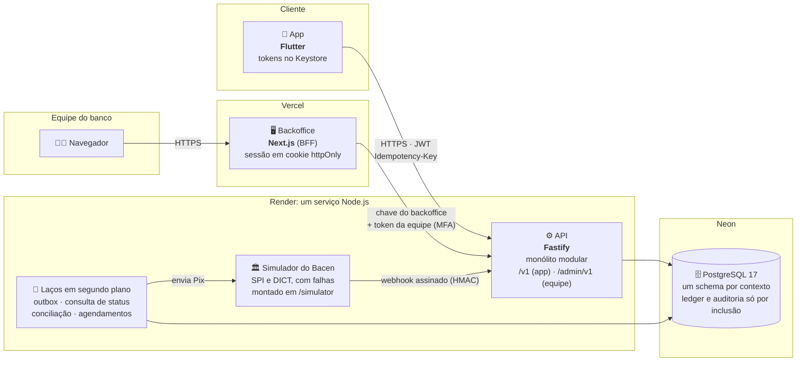

Um único serviço Node.js no Render roda a API, os laços em segundo plano e o simulador, numa decisão de custo zero com as consequências registradas ([ADR 0012](docs/adr/0012-hospedagem-da-v1.md), [0016](docs/adr/0016-outbox-e-inbox.md) e [0017](docs/adr/0017-simulador-no-servico-da-api.md)). O backoffice fica na Vercel e fala com as rotas `/admin` em camadas: a credencial que só o servidor do backoffice tem, o token da equipe com `audience` próprio e o MFA ([ADR 0011](docs/adr/0011-bff.md)).

### Monólito modular, por contexto

A API é um **monólito modular** com **DDD** e **arquitetura hexagonal**: cada contexto delimitado tem domínio, aplicação, infraestrutura e HTTP, e um módulo só fala com outro por portas que o chamador define ([ADR 0002](docs/adr/0002-monolito-modular-ddd-hexagonal.md), [0010](docs/adr/0010-orquestracao-entre-contextos.md)). As fronteiras são verificadas no CI pelo dependency-cruiser: uma importação proibida quebra o build.

| Contexto | Responsabilidade |
|---|---|
| **Identity** | Cadastro, login, sessões com rotação de refresh token, PIN de transação |
| **Accounts** | Conta, saldo disponível e contabilizado, bloqueio |
| **Ledger** | Livro-razão de partidas dobradas: cada lançamento soma zero, nunca é editado |
| **Payments** | Pix interno e externo, QR Code, agendamento e recorrência, outbox e inbox |
| **Top-ups** | Recarga de celular |
| **Reconciliation** | Conciliação diária contra o arquivo de liquidação do SPI e a fila de exceções |
| **Staff** | Equipe do banco: login com MFA, papéis (operador, analista, admin), gestão |
| **Operations** | Comandos da equipe com dupla aprovação: desbloqueio, estorno de Pix, resolução de exceções |
| **Audit** | Trilha de auditoria só por inclusão, gravada na mesma transação do comando |

### O caminho de um Pix para outro banco

```mermaid
sequenceDiagram
    autonumber
    participant App
    participant API
    participant DB as Postgres
    participant W as Worker do outbox
    participant SPI as Simulador do SPI

    App->>API: POST /v1/pix/transfers (Idempotency-Key)
    App->>API: autoriza com o PIN
    API->>DB: uma transação: reserva na conta transitória + mensagem no outbox
    API-->>App: Em processamento
    W->>DB: lê o outbox
    W->>SPI: envia o Pix (pelo menos uma vez)
    SPI-->>API: webhook assinado (HMAC-SHA256 + carimbo de tempo)
    API->>DB: inbox: aplica a resposta uma vez só e liquida no ledger
    App->>API: acompanha até o comprovante
    Note over API,SPI: Sem resposta, a consulta de status decide;<br/>nunca estorna às cegas. Às 03:00, a conciliação<br/>confere o dia contra o SPI.
```

O débito e a mensagem para o SPI são gravados juntos (**outbox**), e a resposta do SPI é aplicada uma vez só (**inbox**), venha por webhook ou por consulta de status ([ADR 0016](docs/adr/0016-outbox-e-inbox.md), [0018](docs/adr/0018-pix-assincrono-e-conciliacao.md)). Um **teste de caos** no CI manda mil Pix sob 30% de falhas injetadas e uma hora sem SPI, e confere que nenhum centavo some nem duplica.

### O app

**Clean Architecture por feature**: `domain/` em Dart puro, `data/` implementando as interfaces, `presentation/` com Riverpod dependendo só do domínio, e uma feature nunca importa outra. Um pacote de **design system** próprio guarda os tokens, o tema e os componentes, e um teste de arquitetura em Dart barra cor literal e estilo fora do lugar ([ADR 0003](docs/adr/0003-flutter-riverpod.md), [0014](docs/adr/0014-fronteiras-de-ui.md)).

### Um contrato só

A API descreve cada rota com **Zod**, e daí sai o **OpenAPI**: o cliente Dart do app e os tipos TypeScript do backoffice são gerados dele, e o CI falha se o contrato publicado divergir do código ([ADR 0008](docs/adr/0008-contrato-unico-openapi.md)).

## Engenharia

**💰 Integridade financeira**
- Dinheiro só como inteiro em centavos (`Money`), nunca ponto flutuante ([ADR 0006](docs/adr/0006-value-object-money.md)).
- Ledger de partidas dobradas, só por inclusão: corrigir é estornar, nunca editar ([ADR 0005](docs/adr/0005-ledger-partidas-dobradas.md)).
- Todo comando financeiro é idempotente, transacional e trava os recursos em ordem determinística; testes de concorrência provam que requisições simultâneas nunca deixam saldo negativo nem duplicam ([ADR 0007](docs/adr/0007-idempotencia-concorrencia.md), [0015](docs/adr/0015-idempotencia-compartilhada.md)).

**🔒 Segurança desde o projeto**
- Toda fatia começa pelo [threat model](docs/security/threat-model.md): ameaça nova vira linha **e** teste, escrito antes da defesa.
- Senhas com Argon2id; JWT com `jose`; rotação de refresh token com detecção de reuso; PIN validado no servidor, com bloqueio progressivo; tokens do app só no Keystore.
- Equipe com MFA obrigatório, papéis verificados no servidor (negar por padrão) e **dupla aprovação** garantida no domínio e num `CHECK` do banco.
- Teste de IDOR em todo recurso; CSP estrita, HSTS e CSRF conferido nas Server Actions; rate limit nas rotas sensíveis.
- CPF, tokens, senhas e PIN redigidos nos logs e no Sentry (LGPD).
- Gates que bloqueiam o merge: **gitleaks**, **Semgrep** e **osv-scanner**; OWASP ZAP baseline contra a API e o backoffice publicados, sem falhas.

**✅ Qualidade**
- TDD, com os commits mostrando a sequência (`test:` antes de `feat:`); cobertura mínima de 90% no domínio e na aplicação.
- Testes de integração contra **Postgres real** em Docker, nunca banco em memória.
- E2E do fluxo crítico num **emulador Android** (login → Pix → comprovante → extrato) e do backoffice no **Playwright**, em todo PR.
- TypeScript `strict`, ESLint sem warnings; Dart com lints estritos e zero warnings no `flutter analyze`.

**🔭 Observabilidade e operação**
- `requestId` do app ao banco, logs estruturados em JSON, erros inesperados no Sentry com release e ambiente.
- Trace de ponta a ponta com **OpenTelemetry**, sem dado pessoal nos atributos ([ADR 0019](docs/adr/0019-trace-com-opentelemetry.md)).
- Deploy com migrações antes do código, espera pela versão nova e smoke test; `/health` mostra o commit publicado.
- Performance medida em produção, rota por rota, contra um orçamento de p95 (200 ms nas leituras, 400 ms no Pix), com a leitura honesta do resultado: a viagem do Brasil até o servidor na Virgínia pesa mais que a API ([performance.md](docs/performance.md)).

## Stack

| Camada | Tecnologias |
|---|---|
| **App** | Flutter 3.47 (Dart 3.13), Riverpod, GoRouter, Dio, flutter_secure_storage, local_auth, mobile_scanner, Sentry |
| **API** | Node.js 24, TypeScript 6, Fastify 5, Zod 4, PostgreSQL 17 com SQL puro (`pg`) e migrações com dbmate, Argon2, jose, Pino, OpenTelemetry, Sentry |
| **Backoffice** | Next.js 16 (App Router, Server Components e Server Actions), React 19, Tailwind CSS 4, shadcn/ui (Radix), openapi-typescript |
| **Testes** | Vitest, Playwright, flutter_test e integration_test, dependency-cruiser |
| **Infra e CI** | pnpm workspaces, Docker, GitHub Actions, Render, Neon, Vercel, gitleaks, Semgrep, osv-scanner, Dependabot |

## Versões

| Versão | Entrega |
|---|---|
| **`v1.0.0`** | Cadastro, login, conta, ledger, Pix interno com PIN, comprovante e extrato; CI, deploy e demo pública |
| **`v1.1.0`** | Pix por QR Code, recarga de celular, biometria, comprovante compartilhado e extrato com filtros |
| **`v1.2.0`** | Pix para outros bancos pelo simulador do Bacen, agendamento e recorrência, conciliação diária, trace e teste de caos |
| **`v1.3.0`** | Backoffice: equipe com MFA e papéis, clientes, bloqueio, estorno de Pix e conciliação com dupla aprovação, e trilha de auditoria |
| *Não publicado* | Home do backoffice com a fila de trabalho de cada papel |
| *Próximas* | `v1.4.0`: minhas chaves Pix e QR Code dinâmico · `v1.5.0`: recarga assíncrona, boleto e contas de consumo · `v2.0.0`: cartão de crédito e fatura |

O detalhe de cada versão está no [CHANGELOG](CHANGELOG.md), e o plano de cada uma em [docs/plans](docs/plans).

## Rodando localmente

Pré-requisitos: Node.js 24, pnpm (via `corepack enable`), Docker e, para o app, Flutter 3.47 com um emulador Android.

```bash
# Postgres (copie infra/.env.example para infra/.env e troque as senhas)
docker compose -f infra/docker-compose.yml up -d

# Dependências e banco
pnpm install
cp apps/api/.env.example apps/api/.env      # preencha os valores
pnpm --filter @nextbank/api db:migrate
pnpm --filter @nextbank/simulator db:migrate
pnpm --filter @nextbank/api seed:demo

# API (porta 3000) e backoffice (porta 3001)
pnpm --filter @nextbank/api dev
pnpm --filter @nextbank/backoffice dev      # API_URL e BACKOFFICE_API_KEY em apps/backoffice/.env.local

# App no emulador, apontando para a API local
cd apps/mobile && flutter run --dart-define=API_BASE_URL=http://10.0.2.2:3000

# Testes
pnpm --filter @nextbank/api test
pnpm --filter @nextbank/backoffice test
cd apps/mobile && flutter test
```

A equipe demo do backoffice (`staff:create`), o E2E e a publicação estão passo a passo em [operations.md](docs/operations.md).

## Documentação

- [Evolução do projeto](docs/evolucao.md): como chegamos aqui e por quê
- [Roadmap e design de arquitetura](docs/roadmap.md)
- [Decisões de arquitetura (ADRs)](docs/adr/README.md)
- [Modelo de domínio](docs/architecture/domain-model.md) e [banco de dados](docs/architecture/database.md)
- [Diagramas C4](docs/architecture/c4.md) e [diagramas de sequência](docs/architecture/sequences.md)
- [Threat model](docs/security/threat-model.md), [controles e achados](docs/security/controles-de-seguranca.md) e [checklist OWASP ASVS/MASVS](docs/security/checklist-asvs-masvs.md)
- [Brief visual e design tokens](docs/design/brief.md)
- [Operação](docs/operations.md) e [performance medida](docs/performance.md)
- [Changelog](CHANGELOG.md)

---

Feito por **Renato Marques** · [github.com/renatomf](https://github.com/renatomf)

<sub>Projeto de portfólio com fins de estudo e demonstração. Não é uma instituição financeira, não movimenta dinheiro real e utiliza apenas dados fictícios. Veja a [LICENSE](LICENSE).</sub>

<sub>Pix é marca do Banco Central do Brasil. O next bank é um projeto fictício, sem vínculo com o Banco Central, e usa o símbolo do Pix só para identificar a função no app.</sub>
