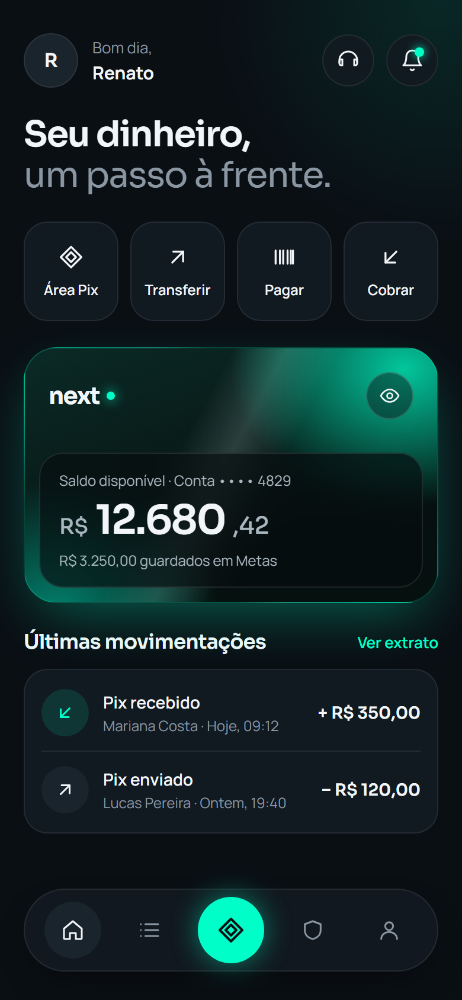
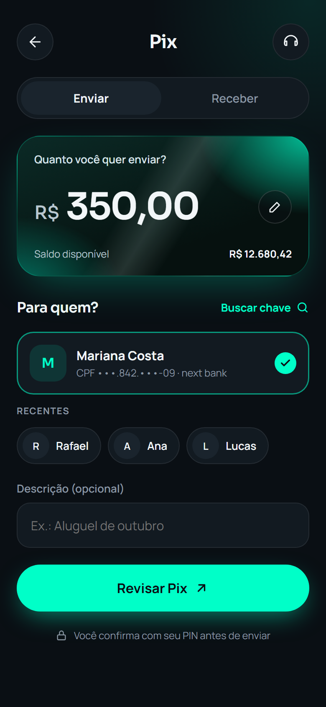
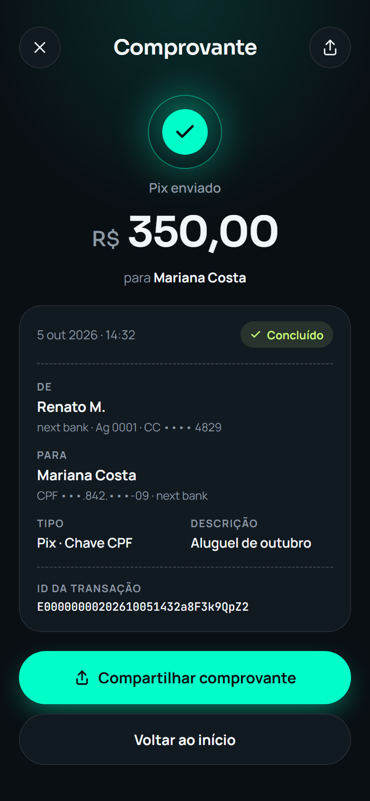

# next bank

🇧🇷 Português · [🇺🇸 English](README.en.md)

### Seu dinheiro, um passo à frente.

  
  
  

Conceito visual da V1. As telas do app evoluíram a partir dele.

O **next bank** é um banco digital pensado para quem quer controle total do próprio dinheiro, sem filas, sem letras miúdas e sem surpresas.

Abra sua conta em minutos, acompanhe cada centavo em tempo real e envie Pix com a tranquilidade de saber que **cada operação é registrada, conferida e protegida** do primeiro toque até o comprovante.

## Por que next bank

- **⚡ Pix na hora, sem duplicidade.** Caiu a internet no meio do envio? Tente de novo sem medo: o seu Pix é processado uma única vez.
- **🔒 Segurança em cada camada.** PIN de transação validado no servidor, bloqueio automático contra tentativas suspeitas e sessões protegidas contra roubo de credenciais.
- **📊 Cada centavo no lugar certo.** Saldo e extrato vêm de um livro-razão que nunca é editado, só acrescentado. O que aparece no app sempre fecha com a conta.
- **✨ Simples por fora, sólido por dentro.** Uma experiência leve e escura, com o brilho da cor Menta, sobre uma engenharia construída para não falhar.

> ✅ **V1 publicada:** cadastro, login, conta, Pix com PIN, comprovante e extrato, num app Android ligado a uma API publicada.

## Veja funcionando

O app de verdade, na demo publicada (1 min 40 s, sem áudio):

https://github.com/user-attachments/assets/a2748bde-302c-45a7-a953-d19fa6b02b93

## Experimente em um minuto

1. Baixe o APK na [última Release](https://github.com/renatomf/next-bank/releases/latest) (Android 7.0 ou mais recente).
2. Confira se o arquivo é o publicado: compare o resultado de `Get-FileHash next-bank-v1.0.0.apk` (Windows) ou `sha256sum next-bank-v1.0.0.apk` (Linux e macOS) com o arquivo `.sha256` da mesma Release.
3. Instale e entre com uma conta de demonstração. O Android pede para permitir a instalação deste arquivo, e o Play Protect pode bloqueá-la por não conhecer o desenvolvedor: toque em **Mais detalhes › Instalar assim mesmo**.

| Conta | E-mail | Senha | PIN |
|---|---|---|---|
| Ana | `ana.demo@example.com` | `demo-ana-next-bank` | `2580` |
| Bruno | `bruno.demo@example.com` | `demo-bruno-next-bank` | `1470` |

4. **Um Pix em 30 segundos:** entre como Ana, toque em **Pix**, use a chave CPF de Bruno (`529.982.247-25`), escolha o valor e confirme com o PIN `2580`. O comprovante aparece na hora, e o Pix já está no extrato dos dois.

**Bom saber**

- **Primeira abertura:** a API roda num servidor gratuito que dorme sem uso. Se ele estiver dormindo, a primeira resposta pode levar até 1 minuto.
- **Contas compartilhadas:** as contas de demonstração não trocam senha nem PIN e não encerram sessões, para que nenhum visitante tranque os outros do lado de fora.
- **Tudo volta ao começo todo dia, às 03:00 (horário de Brasília):** as contas criadas por visitantes e os Pix somem, e Ana e Bruno voltam com o saldo inicial.
- **Sua própria conta:** o cadastro gera um CPF fictício válido. Não use dados reais.
- **Dinheiro de mentira:** o Pix acontece entre contas do next bank; nenhum valor real é movimentado.
- **Só Android:** a versão para iOS não é publicada, porque não há como testá-la sem um Mac.

---

## Por dentro da engenharia

O next bank é construído com as práticas de um banco em produção:

- **Integridade financeira:** ledger de partidas dobradas, idempotência em toda operação financeira e controle de concorrência que impede saldo negativo.
- **Segurança desde o projeto:** threat model, OWASP ASVS L2 e MASVS como referência, rotação de tokens com detecção de reuso e proteção de dados pessoais (LGPD).
- **Arquitetura:** DDD, arquitetura hexagonal e monólito modular, com fronteiras verificadas automaticamente.
- **Qualidade:** TDD, testes de integração contra banco real, testes de segurança e de concorrência, e gates de segurança no CI.

### Stack

| Camada | Tecnologias |
|---|---|
| Mobile | Flutter, Riverpod, GoRouter, Dio, Freezed |
| API | Node.js, TypeScript, Fastify, Zod, PostgreSQL (SQL puro com `pg` e dbmate) |
| Backoffice | Next.js, TypeScript |
| Infra | Docker, GitHub Actions, Turborepo, Sentry |

### Roadmap

| Fase | Entrega |
|---|---|
| **1 — Core** | Cadastro, login, conta, ledger, Pix, extrato, testes, CI e deploy |
| **2 — Pix assíncrono** | Integração com um simulador do sistema de pagamentos, com falhas injetadas e conciliação |
| **3 — Backoffice** | Painel interno com perfis de acesso e dupla aprovação |

### Documentação

- [Evolução do projeto](docs/evolucao.md): como chegamos aqui e para onde a arquitetura vai
- [Roadmap e design de arquitetura](docs/roadmap.md)
- [Decisões de arquitetura (ADRs)](docs/adr/README.md)
- [Modelo de domínio](docs/architecture/domain-model.md)
- [Banco de dados](docs/architecture/database.md)
- [Diagramas C4](docs/architecture/c4.md) e [diagramas de sequência](docs/architecture/sequences.md)
- [Threat model](docs/security/threat-model.md) e [checklist OWASP ASVS/MASVS](docs/security/checklist-asvs-masvs.md)
- [Brief visual e design tokens](docs/design/brief.md)
- [Operação: publicar e manter a demo](docs/operations.md) e [performance medida](docs/performance.md)
- [Plano da semana 8, a última da V1](docs/plans/semana-08-qualidade-producao.md)
- [Changelog](CHANGELOG.md)

---

Feito por **Renato Marques** · [github.com/renatomf](https://github.com/renatomf)

Projeto de portfólio com fins de estudo e demonstração. Não é uma instituição financeira, não movimenta dinheiro real e utiliza apenas dados fictícios. Veja a [LICENSE](LICENSE).

Pix é marca do Banco Central do Brasil. O next bank é um projeto fictício, sem vínculo com o Banco Central, e usa o símbolo do Pix só para identificar a função no app.
