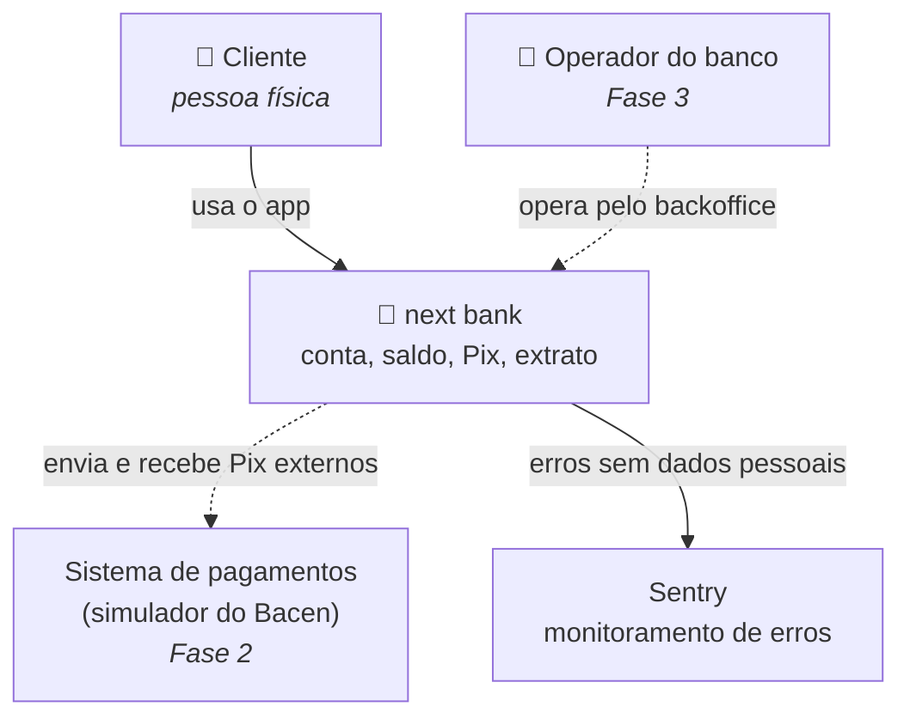
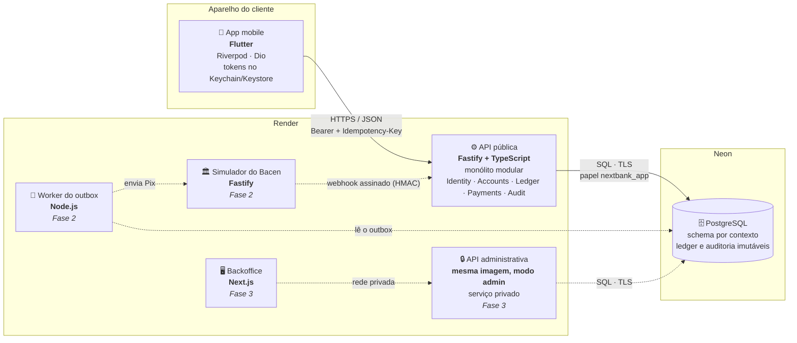
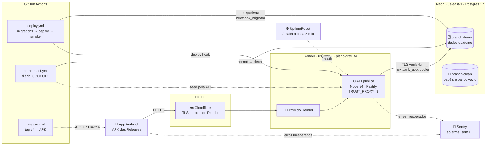

# next bank — Diagramas C4

Visão da arquitetura em dois níveis do modelo C4: **contexto** (quem usa o sistema e com o que ele conversa) e **containers** (as peças que rodam e como se comunicam). O nível de componentes está no [modelo de domínio](domain-model.md) (contextos e agregados) e no [ADR 0002](../adr/0002-monolito-modular-ddd-hexagonal.md).

## Nível 1 — Contexto

| Elemento | Papel | Fase |
|---|---|---|
| Cliente | Abre conta, consulta saldo e extrato, faz Pix | 1 |
| Operador | Investiga, bloqueia contas e aprova estornos com dupla aprovação | 3 |
| Sistema de pagamentos | Liquida Pix entre instituições, de forma assíncrona e sujeita a falhas | 2 |
| Sentry | Recebe erros e falhas, sem dados pessoais | 1 |

## Nível 2 — Containers

| Container | Tecnologia | Responsabilidade | Fase |
|---|---|---|---|
| App mobile | Flutter | Interface do cliente; nunca decide saldo nem autorização | 1 |
| API pública | Fastify + TypeScript | Regras de negócio e integridade financeira, em módulos por contexto | 1 |
| PostgreSQL | Neon | Fonte da verdade; última barreira das invariantes financeiras | 1 |
| Worker do outbox | Node.js | Entrega confiável de eventos ao sistema externo, com retry e backoff | 2 |
| Simulador do Bacen | Fastify | Imita o sistema de pagamentos: latência, falhas e confirmação assíncrona | 2 |
| Backoffice | Next.js | Ferramenta interna dos operadores | 3 |
| API administrativa | Mesma imagem da API | Endpoints `/admin/*`, sem URL pública | 3 |

**Linhas sólidas:** Fase 1 (V1). **Linhas tracejadas:** fases seguintes.

## Implantação da V1

Como a V1 roda em produção, sem custo (ADR 0012; passo a passo em `docs/operations.md`):

**Neste diagrama, tudo já está em produção.** Linhas sólidas: o caminho de cada requisição e de cada mudança. Linhas tracejadas: chamadas agendadas ou assíncronas.

| Peça | Papel |
|---|---|
| Cloudflare e proxy do Render | Terminam o TLS e repassam ao serviço; a API confia em exatamente três saltos para achar o IP do cliente (API-14) |
| Branch `clean` | Papéis, permissões e banco vazio; nunca recebe dados |
| Branch `demo` | Recriado a partir do `clean` todo dia; nenhum código apaga lançamentos do ledger |
| GitHub Actions | Único caminho de mudança em produção: migrations antes do código, smoke test depois |
| Sentry | Erros inesperados da API e do app, limpos de dados pessoais antes de sair |
