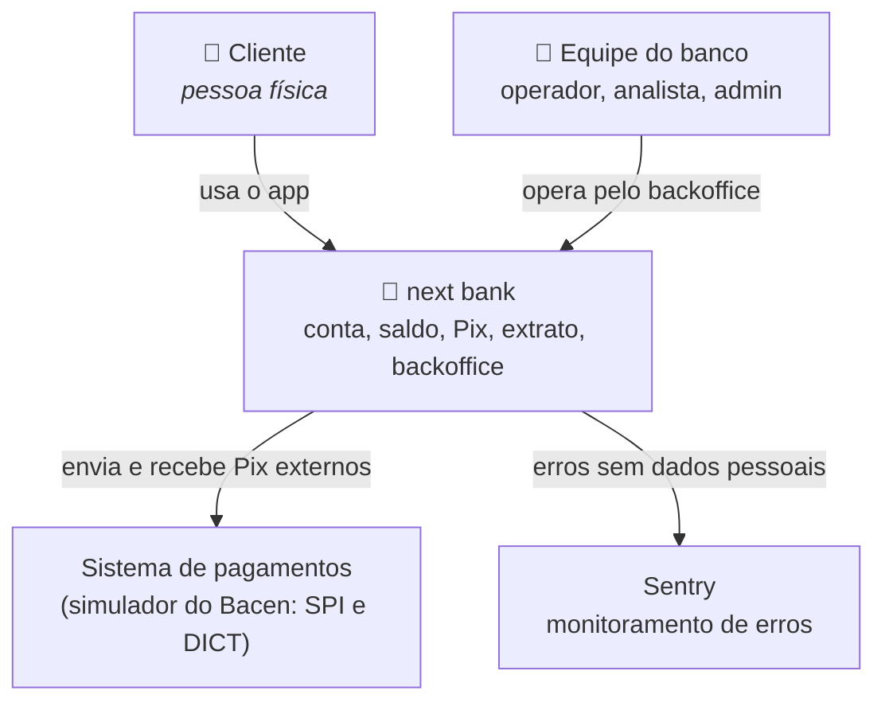
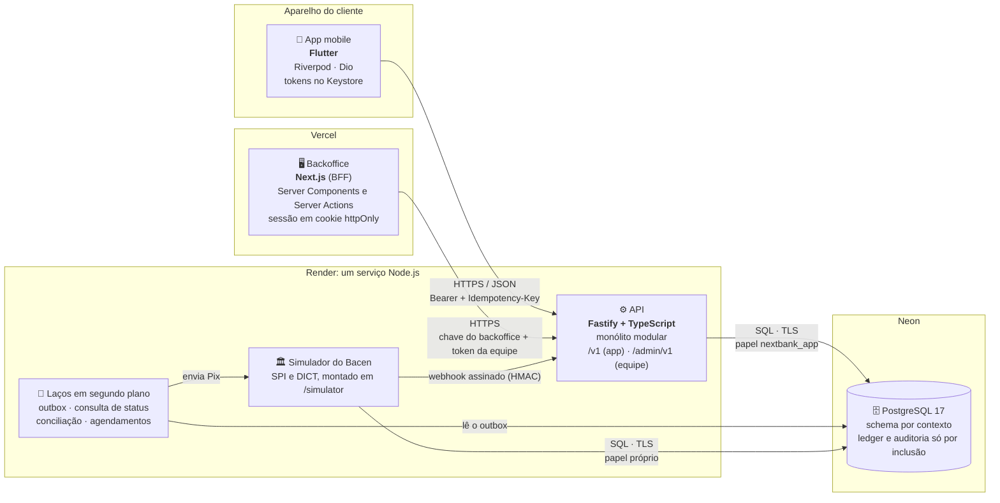
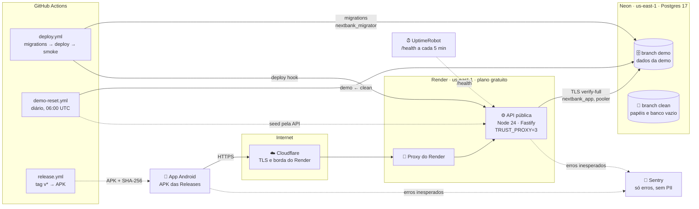

# next bank — Diagramas C4

Visão da arquitetura em dois níveis do modelo C4: **contexto** (quem usa o sistema e com o que ele conversa) e **containers** (as peças que rodam e como se comunicam). O nível de componentes está no [modelo de domínio](domain-model.md) (contextos e agregados) e no [ADR 0002](../adr/0002-monolito-modular-ddd-hexagonal.md).

## Nível 1 — Contexto

| Elemento | Papel | Desde |
|---|---|---|
| Cliente | Abre conta, consulta saldo e extrato, faz Pix, paga por QR Code, recarrega o celular | `v1.0.0` |
| Equipe do banco | Consulta clientes com dados mascarados, bloqueia contas, estorna Pix e resolve a conciliação, com dupla aprovação | `v1.3.0` |
| Sistema de pagamentos | Liquida Pix entre instituições, de forma assíncrona e sujeita a falhas; o simulador falha de propósito | `v1.2.0` |
| Sentry | Recebe erros e falhas, sem dados pessoais | `v1.0.0` |

## Nível 2 — Containers

| Container | Tecnologia | Responsabilidade | Desde |
|---|---|---|---|
| App mobile | Flutter | Interface do cliente; nunca decide saldo nem autorização | `v1.0.0` |
| API | Fastify + TypeScript | Regras de negócio e integridade financeira, em módulos por contexto; as rotas `/admin` da equipe ficam no mesmo serviço, protegidas em camadas (STF-08) | `v1.0.0` |
| PostgreSQL | Neon | Fonte da verdade; última barreira das invariantes financeiras | `v1.0.0` |
| Laços em segundo plano | Node.js, no processo da API | Entrega do outbox ao SPI, consulta de status, conciliação diária e agendamentos ([ADR 0016](../adr/0016-outbox-e-inbox.md), [0018](../adr/0018-pix-assincrono-e-conciliacao.md)) | `v1.2.0` |
| Simulador do Bacen | Fastify, no serviço da API | Imita o SPI e o DICT: latência, falhas e confirmação assíncrona ([ADR 0017](../adr/0017-simulador-no-servico-da-api.md)) | `v1.2.0` |
| Backoffice | Next.js na Vercel | Ferramenta interna da equipe; BFF com sessão em cookie ([ADR 0011](../adr/0011-bff.md), [0020](../adr/0020-ui-do-backoffice.md)) | `v1.3.0` |

O desenho original previa o worker, a API administrativa e o backoffice como serviços separados no Render. A hospedagem gratuita mudou isso: um segundo serviço dividiria as horas gratuitas da API, e o serviço privado é pago. As consequências estão nos ADRs 0012, 0016 e 0017 e no plano da `v1.3.0` (B1).

## Implantação da V1

Como a V1 roda em produção, sem custo (ADR 0012; passo a passo em `docs/operations.md`):

**Neste diagrama, tudo já está em produção.** Linhas sólidas: o caminho de cada requisição e de cada mudança. Linhas tracejadas: chamadas agendadas ou assíncronas.

| Peça | Papel |
|---|---|
| Cloudflare e proxy do Render | Terminam o TLS e repassam ao serviço; a API confia em exatamente três saltos para achar o IP do cliente (API-14) |
| Branch `clean` | Papéis, permissões e banco vazio; nunca recebe dados |
| Branch `demo` | Recriado a partir do `clean` todo dia; nenhum código apaga lançamentos do ledger |
| GitHub Actions | Único caminho de mudança em produção: migrations antes do código, smoke test depois |
| Sentry | Erros inesperados da API e do app, limpos de dados pessoais antes de sair |
