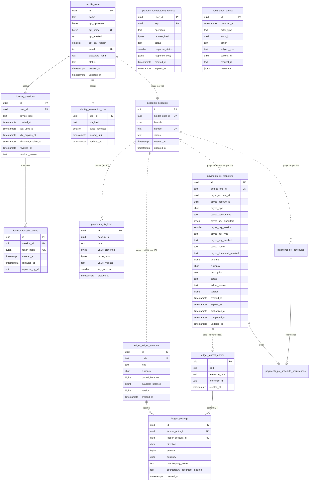

# next bank — Banco de Dados (V1)

- **Status:** Rascunho para revisão
- **Base:** `docs/architecture/domain-model.md`
- **Banco:** PostgreSQL 16+ (local via Docker; publicado no Neon)

## 1. Princípios

1. **O banco é a última barreira.** Toda invariante financeira é garantida no domínio **e** por uma restrição no banco. Se um bug passar pelo código, o banco recusa.
2. **Um schema por contexto:** `identity`, `accounts`, `ledger`, `payments`, `audit`. Cada módulo da API só acessa o próprio schema.
3. **Sem chave estrangeira entre schemas.** Referências entre contextos são por ID. Isso mantém os módulos extraíveis (Fase futura). A integridade entre contextos é garantida pela Unit of Work (tudo na mesma transação), por testes de integração e pela reconciliação.
4. **Ledger e auditoria são append-only no próprio banco:** o usuário da aplicação não tem permissão de `UPDATE`/`DELETE`, e triggers recusam alterações mesmo para quem tiver.
5. **Dados pessoais sensíveis são criptografados na aplicação**, não só "em repouso" pelo provedor.

## 2. Classificação de dados

| Classe | Exemplos | Tratamento |
|---|---|---|
| **Segredo** | senha, PIN, refresh token | Só hash (Argon2id para senha/PIN; SHA-256 para refresh token de alta entropia). Nunca recuperável |
| **Pessoal sensível** | CPF, valor de chave Pix, número de uma recarga | Criptografado (AES-256-GCM) + índice cego (HMAC-SHA256) para busca e unicidade + versão mascarada para exibição. O número da recarga não tem índice cego: nunca se busca por ele |
| **Pessoal** | nome, e-mail | Texto puro; acesso restrito; nunca em logs |
| **Financeiro** | saldos, lançamentos, Pix | Texto puro; append-only quando aplicável; auditado |
| **Técnico** | IDs, timestamps, status | Texto puro |

**Por que criptografar CPF na aplicação se o Neon já criptografa o disco?** A criptografia de disco protege contra roubo do disco. A da aplicação protege contra **vazamento de dump, backup, réplica ou query mal escrita**: quem tem só o banco não lê o CPF.

**Chaves (variáveis de ambiente, nunca no repositório):**
- `PII_ENCRYPTION_KEY` (32 bytes): cifra AES-256-GCM. Cada valor cifrado guarda `key_version`, o que permite rotação gradual.
- `PII_HMAC_KEY` (32 bytes): índice cego. Rotacionar exige recalcular os índices (procedimento documentado no runbook, fora da V1).
- `TOP_UP_PHONE_KEY` (32 bytes, v1.1.0): cifra o número das recargas, separada da do CPF (TOP-01, decisão R6), para vazar ou trocar uma não afetar a outra.

**Risco aceito na V1 e caminho de evolução:** em bancos reais, essas chaves não ficam em variáveis de ambiente: ficam num **KMS/HSM**, com *envelope encryption* (uma chave mestra no KMS cifra as chaves de dados, e a aplicação nunca vê a chave mestra). Na V1, a criptografia fica atrás da porta `CpfProtector` (o token de acesso, atrás da `AccessTokenIssuer`). Com KMS, a chave nunca sai do serviço, então é a implementação dessas portas que muda; o restante do código não muda.

## 3. Convenções

| Item | Convenção |
|---|---|
| Nomes | `snake_case`, tabelas no plural |
| Chave primária | `id uuid` gerado na aplicação (UUIDv7, ordenável no tempo) |
| Dinheiro | `bigint` em centavos + `currency char(3)` (`'BRL'`) |
| Datas | `timestamptz`, sempre UTC |
| Enums | `text` + `CHECK` (mais fácil de evoluir com migrations expand/contract que `ENUM` nativo) |
| Concorrência otimista | `version bigint` onde há atualização concorrente |
| Auditoria de linha | `created_at`; `updated_at` só em tabelas mutáveis |

## 4. Diagrama (ERD)

As linhas tracejadas são **referências por ID entre contextos, sem chave estrangeira**.



## 5. Tabelas e restrições

### 5.1 `identity`

**`users`**
- `email`: `CHECK (email = lower(email))`, `UNIQUE`
- `cpf_hmac`: `UNIQUE` (unicidade do CPF sem guardá-lo em claro)
- `name`: `CHECK (char_length(name) BETWEEN 2 AND 120)`
- `status`: `CHECK (status IN ('ACTIVE','LOCKED'))`

**`sessions`** — cada sessão é uma **família** de refresh tokens
- `CHECK (absolute_expires_at > created_at)`
- Índice: `(user_id) WHERE revoked_at IS NULL` (lista de sessões ativas na tela Segurança)

**`refresh_tokens`** — histórico da rotação (necessário para detectar reuso)
- `token_hash`: `UNIQUE` (SHA-256 do token opaco de 256 bits)
- Reuso = token encontrado com `replaced_at` preenchido **e** fora da janela de 10 s → revoga a sessão inteira
- Limpeza: tokens de sessões expiradas há mais de 30 dias são removidos por job (não são dados financeiros)

**`transaction_pins`**
- `CHECK (failed_attempts BETWEEN 0 AND 5)`

### 5.2 `accounts`

**`accounts`**
- `holder_user_id`: `UNIQUE` (uma conta por cliente na V1)
- `UNIQUE (branch, number)`; `number` no formato `NNNNNN-D`, com dígito verificador módulo 11 calculado no domínio
- Número vindo da sequência `accounts.account_number_seq` (100000 a 999999): segura sob concorrência sem lock; um número perdido num rollback só deixa um buraco
- `status`: `CHECK (status IN ('ACTIVE','BLOCKED','CLOSED'))`
- O papel da API só pode alterar `status` e `updated_at` (`GRANT UPDATE` por coluna)

### 5.3 `ledger`

**`ledger_accounts`**
- `code`: `UNIQUE` (`customer:<accountId>`, `system:funding`, …)
- `kind`: `CHECK (kind IN ('CUSTOMER','SYSTEM'))`
- **`CHECK (kind = 'SYSTEM' OR available_balance >= 0)`** — saldo de cliente nunca negativo
- **`CHECK (kind = 'SYSTEM' OR available_balance <= posted_balance)`** — reservas nunca criam saldo
- `version` incrementado a cada atualização de saldo
- `CHECK` de coerência entre `code` e `kind` (`customer:` ↔ `CUSTOMER`); só `BRL`
- O papel da API só pode alterar `posted_balance`, `available_balance` e `version` (`GRANT UPDATE` por coluna)
- `system:funding` é criada pela própria migration, com UUID fixo
- **Contas `SYSTEM` não têm saldo materializado**, garantido por **`CHECK (kind = 'CUSTOMER' OR (posted_balance = 0 AND available_balance = 0))`** (as colunas ficam em zero e não são atualizadas). O saldo delas é calculado pela soma dos lançamentos, no job de reconciliação ou sob demanda. Motivo: contas como `system:funding` e `system:pix_clearing` participam de **todas** as operações do seu tipo. Se cada operação travasse e atualizasse essa linha, ela viraria um gargalo único (*hot account*) e todas as operações fariam fila nela. Contas de cliente continuam materializadas, porque o saldo disponível precisa ser verificado com lock antes de cada débito.

**`journal_entries`** (append-only)
- `kind`: `CHECK (kind IN ('FUNDING','PIX_INTERNAL'))` na V1, ampliado por migration: `TOP_UP` (v1.1.0) e `PIX_EXTERNAL` (v1.2.0, tarefa 3), o Pix para outro banco, que debita o cliente e credita `system:pix_clearing` (UUID fixo, criada pela migration) até o SPI responder; depois, `PIX_EXTERNAL_SETTLEMENT` (de `pix_clearing` para `system:bacen_settlement`, só contas de sistema) ou `PIX_EXTERNAL_REFUND` (de `pix_clearing` de volta ao cliente), na tarefa 4
- **`UNIQUE (reference_type, reference_id, kind)`** — um mesmo Pix nunca gera dois lançamentos do mesmo tipo. É uma segunda camada de idempotência, independente da chave enviada pelo cliente

**`postings`** (append-only)
- `CHECK (amount > 0)`; `CHECK (direction IN ('D','C'))`
- FK para `journal_entries` e `ledger_accounts` (mesmo schema)
- **Constraint triggers `DEFERRABLE INITIALLY DEFERRED`:** no commit, cada lançamento tem pelo menos 2 partidas, Σ débitos = Σ créditos e moeda única. Rodar no commit (e não a cada linha) permite inserir as partidas uma a uma dentro da transação. Há um trigger em `postings` **e outro em `journal_entries`**: sem o segundo, um lançamento sem nenhuma partida passaria, porque o trigger de `postings` nunca dispararia (T-DB-02b)
- Índice `(journal_entry_id)`: sustenta a soma das partidas na verificação do commit
- `counterparty_name` / `counterparty_document_masked`: snapshot de quem está do outro lado, para o extrato não precisar ler o schema `payments`
- Índice do extrato: `(ledger_account_id, created_at DESC, id DESC)`, criado na semana 6 com a consulta que o usa

**Saldo projetado × lançamentos:** `posted_balance` é atualizado na mesma transação dos lançamentos. O job de reconciliação compara com `SUM(CASE direction WHEN 'C' THEN amount ELSE -amount END)` por conta e registra qualquer divergência como incidente.

### 5.4 `payments`

**`pix_keys`**
- `type`: `CHECK (type IN ('CPF','EMAIL','PHONE','RANDOM'))`
- **`UNIQUE (type, value_hmac)`** — uma chave pertence a uma única conta
- Valor cifrado com o protetor compartilhado (dado associado `payments.pix_keys.value`, índice cego com o prefixo `pix-key:<tipo>`), separado do CPF do usuário (semana 5, D7)
- **Índice único parcial `pix_keys_one_random_per_account (account_id) WHERE type = 'RANDOM'`** (v1.1.0, tarefa 3) — uma chave aleatória por conta, a do QR Code de receber. É o árbitro do `INSERT … ON CONFLICT DO NOTHING` (chamadas simultâneas: uma grava, as outras leem a dela) e serve a leitura da chave aleatória da conta
- Máximo de 5 por conta: garantido na aplicação, com lock na conta durante a criação de chave (entra com "Minhas chaves"; hoje cada conta tem no máximo a CPF e a aleatória)
- `GRANT`: só `SELECT, INSERT` para a API
- Índice `(account_id)` para todas as chaves: entra com "Minhas chaves", a primeira consulta que o usa (a chave aleatória já tem o índice parcial acima)

**`pix_transfers`**
- `CHECK (amount > 0)`; `CHECK (payer_account_id <> payee_account_id)`; `CHECK (char_length(description) <= 140)`; `currency = 'BRL'`; `expires_at > created_at`
- `status`: `CHECK (status IN ('AWAITING_AUTH','PROCESSING','COMPLETED','FAILED','CANCELLED'))`
- **Coerência de estado** (escrita como igualdades, sem `OR` sobre colunas anuláveis):
  - `CHECK ((status = 'COMPLETED') = (completed_at IS NOT NULL))`
  - `CHECK ((status = 'COMPLETED') = (end_to_end_id IS NOT NULL))`, com o formato do Bacen
  - `CHECK ((status IN ('PROCESSING','COMPLETED','FAILED')) = (authorized_at IS NOT NULL))`
  - `CHECK ((status = 'FAILED') = (failure_reason IS NOT NULL))`, com os motivos conhecidos
- `end_to_end_id`: `UNIQUE`
- `GRANT`: `SELECT, INSERT` e `UPDATE` só nas colunas de estado: o que foi pedido (pagador, recebedor, valor, descrição) nunca muda
- Índices `(payer_account_id, created_at DESC)` e `(expires_at) WHERE status = 'AWAITING_AUTH'`: entram com a lista de Pix e com o job de expiração (semana 8). Na semana 5 toda consulta é pela PK, sempre com o filtro do pagador
- **Recebedor em outro banco** (v1.2.0, tarefa 3, P3): `payee_account_id` passa a aceitar nulo, e o Pix ganha `payee_ispb` (8 dígitos), `payee_bank_name` e a chave do recebedor cifrada (`payee_key_ciphertext`, `payee_key_version`, com o mesmo protetor das chaves Pix), porque ela vai para o SPI
  - `CHECK ((payee_account_id IS NULL) <> (payee_ispb IS NULL))`: exatamente um lado, conta do next bank ou outro banco; as quatro colunas do outro banco vêm juntas ou não vêm
  - `end_to_end_id` no Pix externo: existe em `PROCESSING` e `COMPLETED` (nasce na autorização e vai em toda tentativa, EXT-03) e nunca em `AWAITING_AUTH` ou `CANCELLED`; em `FAILED` pode existir ou não, porque um Pix que falha na autorização nunca chegou ao SPI (migration de correção `20261022190000`)
  - O worker lê o Pix e a chave cifrada pela PK (`EXPLAIN ANALYZE`: `Index Scan using pix_transfers_pkey`, 0,03 ms), sem o filtro do pagador: só o worker faz essa leitura, nunca uma requisição de cliente

**`platform.idempotency_records`** (desde a v1.1.0, ADR 0015: num schema comum, para o Pix e a recarga usarem a mesma tabela sem um módulo escrever no schema do outro)
- PK `(user_id, key)` — escopo por usuário; uma requisição concorrente com a mesma chave espera no `INSERT … ON CONFLICT DO NOTHING` até a primeira terminar
- `operation`: o comando protegido (`pix.create`, `pix.authorize`, `top-up.create` e, desde a v1.2.0, `pix.schedule`); mesma chave em operação diferente é recusada
- `request_hash`: HMAC-SHA256 da requisição com chave do servidor, nunca com o PIN (semana 5, D4)
- `status`: `CHECK (status IN ('IN_PROGRESS','COMPLETED'))`; resposta presente exatamente quando concluída; validade de até 24 h (`CHECK`)
- `response_body` só contém dados já mascarados (é a resposta enviada ao cliente) ou a recusa gravada (PIN incorreto, bloqueado, Pix expirado)
- Índice `(expires_at)`: entra com o job de limpeza (semana 8)

**`platform.inbox_events`** (v1.2.0, tarefa 4; ADR 0016, EXT-02): cada evento de webhook recebido, gravado na transação que o aplica
- PK `event_id`: um evento repetido acha a linha (`ON CONFLICT DO NOTHING`) e não muda nada; `source` (`spi`) e `outcome` (`APPLIED` ou `IGNORED`) com `CHECK`; nunca o corpo, que identifica o Pix
- `GRANT`: só `SELECT, INSERT` para a API; o que foi recebido não muda nem some (`EXPLAIN ANALYZE` da inclusão: árbitro `inbox_events_pkey`, 0,97 ms)
- Consultas da tarefa 4 em `pix_transfers`: a trava pelo id de ponta a ponta usa `pix_transfers_end_to_end_id_key` (0,08 ms); a consulta de status usa o índice parcial `pix_transfers_external_processing_idx (authorized_at) WHERE status = 'PROCESSING' AND payee_ispb IS NOT NULL` (0,04 ms); `failure_reason` ganha `PAYEE_BANK_REJECTED`

**`platform.outbox_messages`** (v1.2.0, tarefa 2; ADR 0016): o que um comando ainda precisa avisar fora do banco, gravado na mesma transação dele e entregue pelo menos uma vez pelo worker da API
- `payload`: objeto JSON de até 2 KB, só com ids e códigos (nada pessoal, API-04); `type` no formato `módulo.ação`; `status` `PENDING`, `DONE` ou `DEAD`, com `processed_at` exatamente quando entregue; `last_error` só com o nome do erro
- O worker reserva com `FOR UPDATE SKIP LOCKED` e `locked_until`, roda o tratador sem transação aberta e registra o resultado em outra; depois de 10 tentativas (esperas que dobram a partir de 1 s), `DEAD` e relato no Sentry (EXT-08)
- Índice parcial `(available_at) WHERE status = 'PENDING'` (`EXPLAIN ANALYZE`: `Index Scan using outbox_messages_available_idx`, 0,05 ms)
- `GRANT`: `SELECT, INSERT` e `UPDATE` só das colunas de entrega para a API; sem `DELETE` (a limpeza das entregues é um job futuro)

**`pix_schedules`** (v1.2.0, tarefa 7): o Pix agendado (uma data) ou recorrente (todo mês), autorizado com o PIN ao agendar
- O recebedor fica guardado como no Pix (S1): `payee_account_id` **ou** banco e chave cifrada, nunca os dois (`pix_schedules_one_payee_check` e `pix_schedules_external_payee_check`), com o snapshot do nome, do documento e da chave mascarados; pagador ≠ recebedor
- `first_date`, `next_occurrence_date`: dias de São Paulo (`date`), lidos como texto pela API, para o dia não mudar com o fuso de quem lê
- `frequency` e `times` com `CHECK`: `ONCE` é 1 vez, `MONTHLY` de 2 a 24 (S2)
- `next_sequence` e `next_occurrence_date` existem exatamente enquanto `ACTIVE`, com `next_sequence` entre 1 e `times`; `cancelled_at` exatamente quando `CANCELLED`
- `GRANT`: `SELECT, INSERT` e `UPDATE` só de `status`, `next_sequence`, `next_occurrence_date`, `cancelled_at`, `version` e `updated_at`; o que foi agendado nunca muda e nada é apagado
- Índices: `pix_schedules_due_idx (next_occurrence_date) WHERE status = 'ACTIVE'` para a rodada do executor, e `pix_schedules_payer_idx (payer_account_id, created_at DESC, id DESC)` para a lista do cliente por cursor

**`pix_schedule_occurrences`** (v1.2.0, tarefa 7; EXT-05): cada ocorrência paga, por um Pix só dela
- `UNIQUE (schedule_id, occurrence_date)`, `UNIQUE (schedule_id, sequence)` e `UNIQUE (transfer_id)`; FKs para o agendamento e para o Pix (mesmo contexto)
- Inclusão simples, depois do lançamento e na mesma transação: uma ocorrência repetida falha e desfaz o débito junto
- O estado e o motivo da falha são os do Pix, a fonte da verdade
- `GRANT`: só `SELECT, INSERT`

**Consultas da tarefa 7** (`EXPLAIN ANALYZE` no banco de testes):

| Consulta | Índice usado | Tempo |
|---|---|---|
| Próximo agendamento vencido, `FOR UPDATE SKIP LOCKED` | `pix_schedules_due_idx`, parcial | 0,09 ms |
| Agendamentos do cliente por cursor | `pix_schedules_payer_idx` (Index Only Scan) | 0,02 ms |
| Ocorrências de um agendamento com o estado do Pix | `pix_schedule_occurrences_schedule_id_sequence_key` e `pix_transfers_pkey` | 0,08 ms |

### 5.4.1 `top_ups` (v1.1.0, tarefa 5)

**`top_ups`** (só inclusão: toda recarga nasce concluída nesta versão, D5)
- `operator_id`: `CHECK` com as três operadoras; `amount`: `CHECK (amount IN (1500, 2000, 3000, 5000))`; `currency = 'BRL'`; `status = 'COMPLETED'`
- Número cifrado (`phone_ciphertext`, `phone_key_version`) com a chave própria e o dado associado `top_ups.top_ups.phone`; `phone_masked` com `CHECK` do formato `(DD) *****-NNNN`, o único que sai nas respostas, no extrato e no comprovante
- `provider_reference`: a referência da operadora, com tamanho limitado
- **Índice `(account_id, created_at)`**: sustenta a soma do dia para o limite (`account_id = $1 AND created_at >= $2`) — `EXPLAIN ANALYZE`: `Index Scan using top_ups_account_id_created_at_idx`, 0,16 ms. O comprovante é pela PK com o filtro do dono (`Index Scan using top_ups_pkey`, 0,01 ms)
- `GRANT`: só `SELECT, INSERT` para a API
- No ledger: três contas de sistema `system:top-up-<operadora>` e o tipo `TOP_UP` em `journal_entries.kind`; o débito do cliente leva a operadora e o número mascarado como contraparte

### 5.4.2 `simulator` (v1.2.0, tarefa 1)

O schema do simulador do Bacen e dos outros parceiros (plano `v1.2.0-pix-assincrono.md`, D13). Só o papel `nextbank_simulator` o alcança, e ele não alcança nenhum schema da API: o simulador conversa com a API só por HTTP, como o Bacen conversaria. Migrations próprias (`apps/simulator/db/migrations`), com a tabela de controle `simulator_migrations`.

- **`banks`** e **`dict_keys`:** os bancos fictícios e as chaves dos seus clientes fictícios, com o documento já mascarado; só leitura para o papel.
- **`payments`:** PK `end_to_end_id` (formato do Bacen), que torna o envio idempotente (`INSERT … ON CONFLICT DO NOTHING`); `request_hash` distingue a repetição de um pedido diferente com o mesmo id; `CHECK`s de valor, moeda, status e de coerência entre status, `reason`, `decided_at` e `settled_at`. O papel nunca altera o que foi pedido, só o desfecho.
- **`webhook_deliveries`:** o webhook devido a cada pagamento; sem corpo guardado, porque ele é montado do pagamento, e assim uma nova tentativa manda o mesmo evento. O despachante reserva as entregas vencidas numa transação curta (`SKIP LOCKED` e `locked_until`), envia sem transação aberta e registra o resultado em outra: nenhuma trava fica presa esperando a rede, e a reserva de um despachante que morreu vence em 30 s.
- **Índices** (`EXPLAIN ANALYZE` no banco de testes): o DICT pela PK (`dict_keys_pkey`, 0,05 ms); o arquivo de liquidação por `payments_settled_at_idx`, parcial em `SETTLED` (0,03 ms); o despachante por `webhook_deliveries_due_idx`, parcial em `PENDING`, com `FOR UPDATE … SKIP LOCKED` (0,02 ms).

### 5.5 `audit`

**`audit_events`** (append-only)
- `actor_type`: `CHECK (actor_type IN ('USER','SYSTEM','STAFF'))`
- `metadata`: `CHECK (pg_column_size(metadata) <= 4096)`; conteúdo validado na aplicação contra uma lista de campos permitidos (nunca CPF, token, PIN ou chave Pix completa)
- Índices: `(subject_type, subject_id, occurred_at DESC)`, `(actor_id, occurred_at DESC)`
- Retenção: sem exclusão na V1. Particionamento mensal fica como evolução quando o volume justificar

### 5.6 `reconciliation` (v1.2.0, tarefa 6; ADR 0018)

A conciliação diária, num contexto e num schema próprios. Ela só lê os outros schemas, pelos módulos deles.

**`runs`** (PK `run_date`, dia de São Paulo)
- Inserir o `run` reserva o dia (`ON CONFLICT DO NOTHING`). Um `run` deixado em `RUNNING` há mais de 30 min por uma instância que morreu é retomado pela mesma PK.
- `CHECK` de `status` (`RUNNING` ou `DONE`), e `finished_at` e as contagens existem exatamente quando `DONE`.
- `GRANT`: `SELECT, INSERT` e `UPDATE` só de `status`, `started_at`, `finished_at` e das contagens; nunca `DELETE`.

**`exceptions`** (só inclusão, R5)
- `kind` com `CHECK` dos seis tipos.
- `end_to_end_id` no formato do Bacen, nulo só no `CLEARING_MISMATCH`.
- `expected_cents` e `actual_cents` (o lado do SPI e o do next bank); nunca nome nem chave.
- **`UNIQUE NULLS NOT DISTINCT (run_date, kind, end_to_end_id)`:** refazer um dia não duplica exceção, nem a do saldo de `pix_clearing`, que não tem Pix.
- `GRANT`: só `SELECT, INSERT` para a API.

**Consultas** (`EXPLAIN ANALYZE`):

| Consulta | Índice usado | Tempo |
|---|---|---|
| Pix externos concluídos num dia | `pix_transfers_external_completed_idx`, parcial (nova) | 0,02 ms |
| Pix em espera antes de uma data | `pix_transfers_external_processing_idx` | 0,01 ms |
| Soma dos Pix em espera | `pix_transfers_external_processing_idx` | 0,03 ms |
| Pix pelos ids do arquivo | `pix_transfers_end_to_end_id_key` | 0,11 ms |
| Saldo de `pix_clearing` pela soma das partidas | `postings_statement_idx`, que começa pela conta | 0,02 ms |
| Reserva do dia | árbitro `runs_pkey` | 0,18 ms |

O saldo de `pix_clearing` e a soma dos Pix em espera são lidos na mesma transação `REPEATABLE READ`, para um Pix que termina no meio não acusar diferença falsa.

## 6. Permissões no banco (menor privilégio)

| Papel | Uso | Permissões |
|---|---|---|
| `nextbank_migrator` | Só no pipeline de migrations | Dono dos schemas; DDL |
| `nextbank_simulator` | O simulador (v1.2.0) | Só o schema `simulator`: leitura dos bancos e das chaves, `SELECT, INSERT` e `UPDATE` só das colunas de desfecho nos pagamentos e nas entregas; nenhum schema da API, que também não alcança o dele; os mesmos tempos limite da API |
| `nextbank_app` | API em execução | `SELECT, INSERT, UPDATE` nas tabelas mutáveis; **apenas `SELECT, INSERT`** em `ledger.journal_entries`, `ledger.postings` e `audit.audit_events`; `DELETE` só em `identity.refresh_tokens` e `platform.idempotency_records` (jobs de limpeza); sem DDL, sem `TRUNCATE` |

**Defesa em profundidade:** além dos `GRANT`s, triggers `BEFORE UPDATE OR DELETE` em `journal_entries`, `postings` e `audit_events` lançam erro. Assim, nem um acesso com papel errado altera o histórico.

Conexões sempre com TLS (`sslmode=verify-full` no ambiente publicado). O papel da aplicação tem `statement_timeout = 5s`, `lock_timeout = 3s` e `idle_in_transaction_session_timeout = 10s` (API-12), configurados na criação do papel, já que o migrator não pode alterar papéis.

**Papel novo num Postgres local que já existe:** o bootstrap (`infra/postgres/init-roles.sh`) só roda quando o volume é criado. Para o `nextbank_simulator`, acrescente `NEXTBANK_SIMULATOR_PASSWORD` ao `infra/.env` e rode, como `postgres`, o `CREATE ROLE`, os três `ALTER ROLE` e o `GRANT CONNECT` do bootstrap; ou recrie o volume (`docker compose down -v`, que apaga os dados locais).

**Criação dos papéis:** sempre via SQL, nunca pelo painel do provedor. No Neon, papéis criados pelo painel ou pela API entram no `neon_superuser`, que tem `pg_write_all_data` e ignora os `GRANT`s, anulando o menor privilégio (API-11, demonstrado no spike; ver ADR 0009).

## 7. Concorrência

**Isolamento:** `READ COMMITTED` (padrão do Postgres) **com locks explícitos** nas linhas que importam. `SERIALIZABLE` resolveria o mesmo problema, mas exigiria repetir transações inteiras em caso de conflito, o que complica operações financeiras com efeitos auditados. Locks explícitos deixam o comportamento previsível e testável.

**`AuthorizePix` — ordem das operações numa única transação:**

1. `idempotency_records`: insere `(user_id, key)`. Se a chave já existe, outra requisição igual espera aqui até a primeira terminar, e depois recebe a resposta guardada
2. `pix_transfers WHERE id = $1 FOR UPDATE` — impede autorizar o mesmo Pix duas vezes; confere status e expiração
3. `transaction_pins WHERE user_id = $1 FOR UPDATE` — tentativas de PIN contadas de forma atômica
4. `accounts WHERE id IN (pagador, recebedor) FOR SHARE` — status das contas não muda durante a operação
5. `ledger_accounts WHERE id IN (a, b) ORDER BY id FOR UPDATE` — só contas de cliente (contas de sistema nunca são travadas); **ordem fixa por ID evita deadlock** entre um Pix A→B e outro B→A simultâneos
6. Verifica saldo disponível e limites (com o horário do `Clock`)
7. Insere `journal_entries` + `postings`; atualiza saldos e `version`
8. Atualiza o Pix para `COMPLETED` (ou `FAILED`, sem lançamentos)
9. Insere eventos de auditoria; grava a resposta em `idempotency_records`
10. `COMMIT` (aqui roda a verificação diferida de Σ débitos = Σ créditos)

**`RunDueSchedules` (v1.2.0, tarefa 7)**, uma transação por ocorrência: `pix_schedules … FOR UPDATE SKIP LOCKED` (outro executor pula o agendamento travado, EXT-05; o cancelamento trava a mesma linha e espera, EXT-06); depois a ordem do `AuthorizePix` a partir do passo 4 (contas `FOR SHARE`, contas do ledger por id), sem PIN, porque a autorização foi dada ao agendar; o Pix, a ocorrência, o agendamento avançado e a auditoria; `COMMIT`. Uma falha técnica desfaz tudo, e a próxima rodada tenta de novo.

**`CreateTopUp` (v1.1.0)** segue a mesma ordem, sem o passo 2 (não há recurso anterior a travar): idempotência; PIN `FOR UPDATE`; conta `FOR SHARE`; a conta do ledger do cliente `FOR UPDATE`; só então lê o saldo e a **soma das recargas do dia**, de modo que duas recargas simultâneas do mesmo cliente não passam juntas pelo saldo nem pelo limite diário; lançamento, recarga, auditoria e resposta.

Erros de negócio (PIN incorreto, saldo insuficiente) **também fazem commit** do que mudou (tentativas, status `FAILED`, auditoria, resposta idempotente). Só falhas técnicas fazem rollback, e aí a chave de idempotência some junto, permitindo nova tentativa.

## 8. Extrato: consulta e índice

O extrato lê **só o schema `ledger`**, graças ao snapshot da contraparte nas partidas.

```sql
SELECT p.id, p.direction, p.amount, p.currency,
       p.counterparty_name, p.counterparty_document_masked,
       je.kind, je.reference_type, je.reference_id, p.created_at
FROM ledger.postings p
JOIN ledger.journal_entries je ON je.id = p.journal_entry_id
WHERE p.ledger_account_id = $1                 -- resolvido no servidor a partir do usuário autenticado
  AND (p.created_at, p.id) < ($2, $3)          -- cursor (omitido na primeira página)
ORDER BY p.created_at DESC, p.id DESC
LIMIT 21;                                      -- 20 itens + 1 para saber se há próxima página
```

- **Índice:** `postings (ledger_account_id, created_at DESC, id DESC)` — a consulta lê só as linhas da página, independentemente do tamanho do histórico. Verificado com `EXPLAIN ANALYZE` na semana 6 (#81, migration `add_statement_index`): `Bitmap Index Scan on postings_statement_idx`, 0,73 ms numa conta com 217 partidas.
- **Cursor:** `(created_at, id)` codificado em base64url, com o `created_at` como texto do Postgres em microssegundos, nunca um `Date` do JavaScript arredondado em milissegundos. Não precisa ser assinado: o filtro por conta é feito no servidor, então um cursor adulterado só navega no próprio extrato. O formato é validado, e o horário precisa ser um instante real (F-20); um cursor inválido retorna 422.
- **Paginação estável:** um Pix novo durante a navegação não duplica nem pula itens (diferente de `OFFSET`).
- **Filtro e busca (v1.1.0, tarefa 4.1):** duas condições opcionais na mesma consulta, refeitas em cada página: o tipo (`IN`/`OUT` pela direção da partida, `PIX` só os `PIX_INTERNAL` desde a tarefa 5, para uma recarga não aparecer como Pix, e também os `PIX_EXTERNAL` desde a v1.2.0 (`EXPLAIN ANALYZE`: `Index Scan using postings_statement_idx` e `journal_entries_pkey`, 1,1 ms); `RECEIPT` os Pix enviados e as recargas) e `counterparty_name ILIKE` com o termo entre `%`, escapando `\`, `%` e `_` do cliente (`ESCAPE`). Sem migration: o mesmo índice escolhe as partidas da conta e o filtro descarta as demais (`EXPLAIN ANALYZE`: `Bitmap Index Scan on postings_statement_idx`, 0,41 ms com filtro e busca). Busca sem acento (`unaccent`) e índice de trigramas ficam fora (X4).

## 9. Migrations

- **Arquivos `.sql` puros, escritos e revisados à mão**, aplicados pelo **dbmate** (ADR 0009). Tabelas, triggers, `GRANT`s e constraints diferidas ficam todos no mesmo formato.
- **Só para frente:** nenhuma migration é editada depois de publicada; correção é uma nova migration.
- **Expand/contract** para mudanças incompatíveis: adiciona o novo → migra os dados → passa a usar → remove o antigo (em migrations separadas).
- Executadas pelo papel `nextbank_migrator` no pipeline, nunca pela API em execução.
- CI: sobe Postgres limpo, aplica todas as migrations e roda os testes de integração com o papel `nextbank_app` (falham se alguma query não bater com o schema).

## 10. Invariantes: onde cada uma é garantida

| Invariante | Domínio | Banco | Teste |
|---|---|---|---|
| Saldo de cliente nunca negativo | ✅ | `CHECK available_balance >= 0` | T-DB-01, T-DB-08 |
| Σ débitos = Σ créditos por lançamento | ✅ | constraint triggers diferidas (partidas e lançamento) | T-DB-02, T-DB-02b |
| Conta de sistema sem saldo materializado | — | `CHECK` de saldo zero em conta `SYSTEM` | `db-ledger-schema.test.ts` |
| Lançamentos e auditoria imutáveis | ✅ | `GRANT` + trigger | T-DB-03, T-DB-04 |
| Um Pix gera no máximo um lançamento | ✅ (máquina de estados) | `UNIQUE (reference_type, reference_id, kind)` | T-DB-05 |
| Requisição repetida não repete a operação | ✅ (aplicação) | PK `(user_id, key)` | T-DB-06 |
| Chave Pix pertence a uma única conta | ✅ | `UNIQUE (type, value_hmac)` | T-DB-07 |
| Sem deadlock entre transferências opostas | — | locks ordenados por ID | T-DB-09 |
| Status do Pix coerente com as datas | ✅ | `CHECK`s de estado | T-DB-10 |
| CPF único sem armazenar em claro | ✅ | `UNIQUE cpf_hmac` | T-DB-11 |
| Paginação do extrato estável | — | cursor + índice | T-DB-12 |
| Usuário A não lê dados de B | ✅ (aplicação) | — | T-API (IDOR), Tarefa 3 |

## 11. Testes de integração do banco (TDD das semanas 4 a 6)

Todos rodam contra **Postgres real** (Docker), com o papel `nextbank_app`.

| ID | Cenário | Resultado esperado |
|---|---|---|
| T-DB-01 | Atualizar saldo de cliente para valor negativo | Recusado pelo `CHECK` |
| T-DB-02 | Gravar lançamento com débitos ≠ créditos | Recusado no `COMMIT` |
| T-DB-02b | Gravar lançamento sem nenhuma partida | Recusado no `COMMIT` |
| T-DB-03 | `UPDATE` ou `DELETE` em `postings` | Recusado (permissão e trigger) |
| T-DB-04 | `UPDATE` ou `DELETE` em `audit_events` | Recusado (permissão e trigger) |
| T-DB-05 | Dois lançamentos `PIX_INTERNAL` para o mesmo Pix | O segundo é recusado |
| T-DB-06 | Mesma chave de idempotência em paralelo | Uma operação; a outra recebe a mesma resposta |
| T-DB-07 | Mesma chave Pix em duas contas | A segunda é recusada |
| T-DB-08 | Dois Pix de R$ 80 em paralelo com saldo de R$ 100 | Um `COMPLETED`, um `FAILED (INSUFFICIENT_FUNDS)`; saldo final R$ 20 |
| T-DB-09 | 50 Pix A→B e 50 B→A em paralelo | Nenhum deadlock; reconciliação bate |
| T-DB-10 | Pix `COMPLETED` sem `completed_at` | Recusado pelo `CHECK` |
| T-DB-11 | Dois usuários com o mesmo CPF | O segundo é recusado |
| T-DB-12 | Pix novo entre a página 1 e a 2 do extrato, inclusive itens no mesmo milissegundo | Nenhum item duplicado ou pulado (semana 6, `statement-route.test.ts`) |
| T-DB-13 | Papel da aplicação tenta `CREATE TABLE` / `TRUNCATE` | Recusado |
| T-DB-14 | Reconciliação após 1.000 Pix aleatórios concorrentes | Saldo projetado = Σ lançamentos em todas as contas |

## 12. Escalabilidade e caminho de evolução

O desenho segue os **mesmos princípios** de ledgers de bancos e fintechs (partidas dobradas, imutabilidade, idempotência, saldo disponível × contabilizado, contexto com dados próprios). O que muda em escala é a **topologia física**. Um único Postgres bem indexado atende com folga o volume de um banco pequeno a médio; acima disso, o caminho é:

| Gargalo | Quando aparece | Evolução | Preparado desde a V1 por |
|---|---|---|---|
| Conta muito movimentada (*hot account*) | Desde o primeiro volume relevante | Contas de sistema sem saldo materializado; se preciso, subcontas (`system:pix_clearing:00..15`) | Contas `SYSTEM` não travadas (seção 5.3) |
| Tabela `postings` muito grande | Centenas de milhões de linhas | Particionamento por mês (`PARTITION BY RANGE (created_at)`) | Toda consulta filtra por conta + data |
| Leituras (extrato, saldo) disputando com escritas | Muito acesso simultâneo | Réplicas de leitura para o lado de consulta (CQRS) | Extrato já é um read model separado |
| Um banco de dados não basta | Milhões de clientes ativos | **Sharding por cliente/conta** ("células": cada uma com seu banco, atendendo uma fatia dos clientes) | Tudo é chaveado por conta; sem FK entre contextos |
| Pix entre clientes de shards diferentes | Junto com o sharding | Transferência em duas etapas via conta transitória, como o Pix externo | **É o mesmo padrão da Fase 2** (`pix_clearing` + conciliação) |
| Módulo precisa escalar sozinho | Times e cargas independentes | Extrair o contexto para um serviço com banco próprio | Um schema por contexto, comunicação por portas, Outbox |
| Auditoria em volume regulatório | Anos de retenção | Armazenamento imutável dedicado (ex.: object storage com bloqueio de escrita) | Auditoria append-only e isolada no schema `audit` |
| Chaves de criptografia | Produção real | KMS/HSM com envelope encryption | Portas `CpfProtector` e `AccessTokenIssuer` (seção 2) |

**O que não foi copiado de propósito:** bancos grandes operam com dezenas de serviços, mensageria (Kafka) e, nos tradicionais, núcleos legados em mainframe. Essa complexidade resolve problemas de escala e de organização que a V1 não tem. A V1 adota os princípios e deixa os pontos de extensão prontos, sem pagar o custo operacional antes da hora.

## 13. Decisões desta tarefa

| Decisão | Escolha | Alternativa descartada |
|---|---|---|
| Schemas | Um por contexto, sem FK entre schemas | Schema único (mais simples, mas acopla os módulos) |
| CPF e chaves Pix | Criptografia na aplicação + índice cego | Texto puro confiando só na criptografia de disco |
| Isolamento | `READ COMMITTED` + locks explícitos | `SERIALIZABLE` (retry de transações inteiras) |
| Σ débitos = Σ créditos | Constraint trigger diferida + domínio | Só no domínio (sem barreira no banco) |
| Enums | `text` + `CHECK` | `ENUM` nativo (difícil de alterar) |
| Extrato | Snapshot da contraparte nas partidas | Join entre schemas `ledger` e `payments` |
| Paginação | Cursor `(created_at, id)` | `OFFSET` (lento e instável) |
| Contas de sistema | Saldo não materializado, sem lock | Saldo atualizado a cada operação (gargalo de *hot account*) |
| Chaves de criptografia | Variável de ambiente, usada atrás das portas `CpfProtector` e `AccessTokenIssuer` (risco aceito) | KMS já na V1 (custo e complexidade de infraestrutura sem ganho para a demo) |
| Isolamento por dono | Filtro por dono em toda query + teste de IDOR obrigatório | RLS (só a API acessa o banco; o Pix cruza donos na mesma transação, o que exigiria políticas permissivas no código mais crítico; o `neon_superuser` tem `BYPASSRLS`). Reavaliar se outro cliente acessar o banco diretamente |
