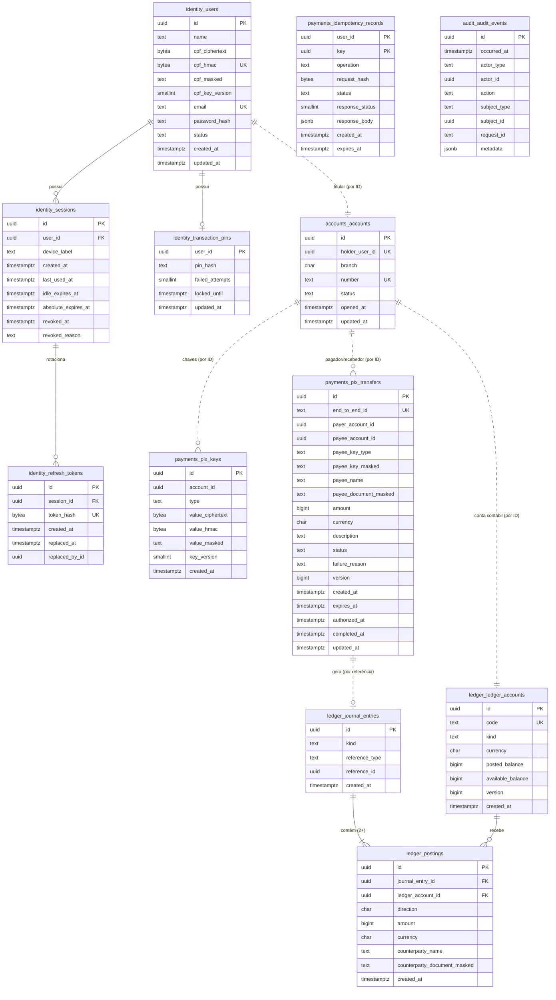

# next bank — Banco de Dados (V1)

- **Status:** Rascunho para revisão
- **Base:** `docs/architecture/domain-model.md`
- **Banco:** PostgreSQL 16+ (local via Docker; publicado no Neon)

## 1. Princípios

1. **O banco é a última barreira.** Toda invariante financeira é garantida no domínio **e** por uma restrição no banco. Se um bug passar pelo código, o banco recusa.
2. **Um schema por contexto:** `identity`, `accounts`, `ledger`, `payments`, `audit`. Cada módulo da API só acessa o próprio schema.
3. **Sem chave estrangeira entre schemas.** Referências entre contextos são por ID. Isso mantém os módulos extraíveis (Fase futura). A integridade entre contextos é garantida pela Unit of Work (tudo na mesma transação), por testes de integração e pela reconciliação.
4. **Ledger e auditoria são append-only no próprio banco:** o usuário da aplicação não tem permissão de `UPDATE`/`DELETE`, e triggers recusam alterações mesmo para quem tiver.
5. **Dados pessoais sensíveis são criptografados na aplicação**, não só "em repouso" pelo provedor.

## 2. Classificação de dados

| Classe | Exemplos | Tratamento |
|---|---|---|
| **Segredo** | senha, PIN, refresh token | Só hash (Argon2id para senha/PIN; SHA-256 para refresh token de alta entropia). Nunca recuperável |
| **Pessoal sensível** | CPF, valor de chave Pix | Criptografado (AES-256-GCM) + índice cego (HMAC-SHA256) para busca e unicidade + versão mascarada para exibição |
| **Pessoal** | nome, e-mail | Texto puro; acesso restrito; nunca em logs |
| **Financeiro** | saldos, lançamentos, Pix | Texto puro; append-only quando aplicável; auditado |
| **Técnico** | IDs, timestamps, status | Texto puro |

**Por que criptografar CPF na aplicação se o Neon já criptografa o disco?** A criptografia de disco protege contra roubo do disco. A da aplicação protege contra **vazamento de dump, backup, réplica ou query mal escrita**: quem tem só o banco não lê o CPF.

**Chaves (variáveis de ambiente, nunca no repositório):**
- `PII_ENCRYPTION_KEY` (32 bytes): cifra AES-256-GCM. Cada valor cifrado guarda `key_version`, o que permite rotação gradual.
- `PII_HMAC_KEY` (32 bytes): índice cego. Rotacionar exige recalcular os índices (procedimento documentado no runbook, fora da V1).

**Risco aceito na V1 e caminho de evolução:** em bancos reais, essas chaves não ficam em variáveis de ambiente: ficam num **KMS/HSM**, com *envelope encryption* (uma chave mestra no KMS cifra as chaves de dados, e a aplicação nunca vê a chave mestra). Na V1, a criptografia é acessada por uma porta `KeyProvider`; trocar a implementação de "variável de ambiente" para KMS não muda o restante do código.

## 3. Convenções

| Item | Convenção |
|---|---|
| Nomes | `snake_case`, tabelas no plural |
| Chave primária | `id uuid` gerado na aplicação (UUIDv7, ordenável no tempo) |
| Dinheiro | `bigint` em centavos + `currency char(3)` (`'BRL'`) |
| Datas | `timestamptz`, sempre UTC |
| Enums | `text` + `CHECK` (mais fácil de evoluir com migrations expand/contract que `ENUM` nativo) |
| Concorrência otimista | `version bigint` onde há atualização concorrente |
| Auditoria de linha | `created_at`; `updated_at` só em tabelas mutáveis |

## 4. Diagrama (ERD)

As linhas tracejadas são **referências por ID entre contextos, sem chave estrangeira**.



## 5. Tabelas e restrições

### 5.1 `identity`

**`users`**
- `email`: `CHECK (email = lower(email))`, `UNIQUE`
- `cpf_hmac`: `UNIQUE` (unicidade do CPF sem guardá-lo em claro)
- `name`: `CHECK (char_length(name) BETWEEN 2 AND 120)`
- `status`: `CHECK (status IN ('ACTIVE','LOCKED'))`

**`sessions`** — cada sessão é uma **família** de refresh tokens
- `CHECK (absolute_expires_at > created_at)`
- Índice: `(user_id) WHERE revoked_at IS NULL` (lista de sessões ativas na tela Segurança)

**`refresh_tokens`** — histórico da rotação (necessário para detectar reuso)
- `token_hash`: `UNIQUE` (SHA-256 do token opaco de 256 bits)
- Reuso = token encontrado com `replaced_at` preenchido **e** fora da janela de 10 s → revoga a sessão inteira
- Limpeza: tokens de sessões expiradas há mais de 30 dias são removidos por job (não são dados financeiros)

**`transaction_pins`**
- `CHECK (failed_attempts BETWEEN 0 AND 5)`

### 5.2 `accounts`

**`accounts`**
- `holder_user_id`: `UNIQUE` (uma conta por cliente na V1)
- `UNIQUE (branch, number)`; `number` com dígito verificador (módulo 11)
- `status`: `CHECK (status IN ('ACTIVE','BLOCKED','CLOSED'))`

### 5.3 `ledger`

**`ledger_accounts`**
- `code`: `UNIQUE` (`customer:<accountId>`, `system:funding`, …)
- `kind`: `CHECK (kind IN ('CUSTOMER','SYSTEM'))`
- **`CHECK (kind = 'SYSTEM' OR available_balance >= 0)`** — saldo de cliente nunca negativo
- **`CHECK (kind = 'SYSTEM' OR available_balance <= posted_balance)`** — reservas nunca criam saldo
- `version` incrementado a cada atualização de saldo
- **Contas `SYSTEM` não têm saldo materializado** (as colunas ficam em zero e não são atualizadas). O saldo delas é calculado pela soma dos lançamentos, no job de reconciliação ou sob demanda. Motivo: contas como `system:funding` e `system:pix_clearing` participam de **todas** as operações do seu tipo. Se cada operação travasse e atualizasse essa linha, ela viraria um gargalo único (*hot account*) e todas as operações fariam fila nela. Contas de cliente continuam materializadas, porque o saldo disponível precisa ser verificado com lock antes de cada débito.

**`journal_entries`** (append-only)
- `kind`: `CHECK (kind IN ('FUNDING','PIX_INTERNAL'))` na V1 (ampliado por migration nas fases seguintes)
- **`UNIQUE (reference_type, reference_id, kind)`** — um mesmo Pix nunca gera dois lançamentos do mesmo tipo. É uma segunda camada de idempotência, independente da chave enviada pelo cliente

**`postings`** (append-only)
- `CHECK (amount > 0)`; `CHECK (direction IN ('D','C'))`
- FK para `journal_entries` e `ledger_accounts` (mesmo schema)
- **Constraint trigger `DEFERRABLE INITIALLY DEFERRED`:** no commit, cada lançamento tem pelo menos 2 partidas, Σ débitos = Σ créditos e moeda única. Rodar no commit (e não a cada linha) permite inserir as partidas uma a uma dentro da transação
- `counterparty_name` / `counterparty_document_masked`: snapshot de quem está do outro lado, para o extrato não precisar ler o schema `payments`
- Índice do extrato: `(ledger_account_id, created_at DESC, id DESC)`

**Saldo projetado × lançamentos:** `posted_balance` é atualizado na mesma transação dos lançamentos. O job de reconciliação compara com `SUM(CASE direction WHEN 'C' THEN amount ELSE -amount END)` por conta e registra qualquer divergência como incidente.

### 5.4 `payments`

**`pix_keys`**
- `type`: `CHECK (type IN ('CPF','EMAIL','PHONE','RANDOM'))`
- **`UNIQUE (type, value_hmac)`** — uma chave pertence a uma única conta
- Máximo de 5 por conta: garantido na aplicação, com lock na conta durante a criação de chave
- Índice: `(account_id)`

**`pix_transfers`**
- `CHECK (amount > 0)`; `CHECK (payer_account_id <> payee_account_id)`; `CHECK (char_length(description) <= 140)`
- `status`: `CHECK (status IN ('AWAITING_AUTH','PROCESSING','COMPLETED','FAILED','CANCELLED'))`
- **Coerência de estado:**
  - `CHECK ((status = 'COMPLETED') = (completed_at IS NOT NULL))`
  - `CHECK (status <> 'FAILED' OR failure_reason IS NOT NULL)`
  - `CHECK (authorized_at IS NULL OR status IN ('PROCESSING','COMPLETED','FAILED'))`
- `end_to_end_id`: `UNIQUE`
- Índices: `(payer_account_id, created_at DESC)`; `(expires_at) WHERE status = 'AWAITING_AUTH'` (job de expiração)

**`idempotency_records`**
- PK `(user_id, key)` — escopo por usuário
- `operation`: o comando protegido (ex.: `pix.create`, `pix.authorize`); mesma chave em operação diferente é recusada
- `status`: `CHECK (status IN ('IN_PROGRESS','COMPLETED'))`
- `response_body` só contém dados já mascarados (é a resposta enviada ao cliente)
- Índice: `(expires_at)` para o job de limpeza (24h)

### 5.5 `audit`

**`audit_events`** (append-only)
- `actor_type`: `CHECK (actor_type IN ('USER','SYSTEM','STAFF'))`
- `metadata`: `CHECK (pg_column_size(metadata) <= 4096)`; conteúdo validado na aplicação contra uma lista de campos permitidos (nunca CPF, token, PIN ou chave Pix completa)
- Índices: `(subject_type, subject_id, occurred_at DESC)`, `(actor_id, occurred_at DESC)`
- Retenção: sem exclusão na V1. Particionamento mensal fica como evolução quando o volume justificar

## 6. Permissões no banco (menor privilégio)

| Papel | Uso | Permissões |
|---|---|---|
| `nextbank_migrator` | Só no pipeline de migrations | Dono dos schemas; DDL |
| `nextbank_app` | API em execução | `SELECT, INSERT, UPDATE` nas tabelas mutáveis; **apenas `SELECT, INSERT`** em `ledger.journal_entries`, `ledger.postings` e `audit.audit_events`; `DELETE` só em `identity.refresh_tokens` e `payments.idempotency_records` (jobs de limpeza); sem DDL, sem `TRUNCATE` |

**Defesa em profundidade:** além dos `GRANT`s, triggers `BEFORE UPDATE OR DELETE` em `journal_entries`, `postings` e `audit_events` lançam erro. Assim, nem um acesso com papel errado altera o histórico.

Conexões sempre com TLS (`sslmode=verify-full` no ambiente publicado), `statement_timeout = 5s` e `lock_timeout = 3s` para o papel da aplicação.

## 7. Concorrência

**Isolamento:** `READ COMMITTED` (padrão do Postgres) **com locks explícitos** nas linhas que importam. `SERIALIZABLE` resolveria o mesmo problema, mas exigiria repetir transações inteiras em caso de conflito, o que complica operações financeiras com efeitos auditados. Locks explícitos deixam o comportamento previsível e testável.

**`AuthorizePix` — ordem das operações numa única transação:**

1. `idempotency_records`: insere `(user_id, key)`. Se a chave já existe, outra requisição igual espera aqui até a primeira terminar, e depois recebe a resposta guardada
2. `pix_transfers WHERE id = $1 FOR UPDATE` — impede autorizar o mesmo Pix duas vezes; confere status e expiração
3. `transaction_pins WHERE user_id = $1 FOR UPDATE` — tentativas de PIN contadas de forma atômica
4. `accounts WHERE id IN (pagador, recebedor) FOR SHARE` — status das contas não muda durante a operação
5. `ledger_accounts WHERE id IN (a, b) ORDER BY id FOR UPDATE` — só contas de cliente (contas de sistema nunca são travadas); **ordem fixa por ID evita deadlock** entre um Pix A→B e outro B→A simultâneos
6. Verifica saldo disponível e limites (com o horário do `Clock`)
7. Insere `journal_entries` + `postings`; atualiza saldos e `version`
8. Atualiza o Pix para `COMPLETED` (ou `FAILED`, sem lançamentos)
9. Insere eventos de auditoria; grava a resposta em `idempotency_records`
10. `COMMIT` (aqui roda a verificação diferida de Σ débitos = Σ créditos)

Erros de negócio (PIN incorreto, saldo insuficiente) **também fazem commit** do que mudou (tentativas, status `FAILED`, auditoria, resposta idempotente). Só falhas técnicas fazem rollback, e aí a chave de idempotência some junto, permitindo nova tentativa.

## 8. Extrato: consulta e índice

O extrato lê **só o schema `ledger`**, graças ao snapshot da contraparte nas partidas.

```sql
SELECT p.id, p.direction, p.amount, p.currency,
       p.counterparty_name, p.counterparty_document_masked,
       je.kind, je.reference_type, je.reference_id, p.created_at
FROM ledger.postings p
JOIN ledger.journal_entries je ON je.id = p.journal_entry_id
WHERE p.ledger_account_id = $1                 -- resolvido no servidor a partir do usuário autenticado
  AND (p.created_at, p.id) < ($2, $3)          -- cursor (omitido na primeira página)
ORDER BY p.created_at DESC, p.id DESC
LIMIT 21;                                      -- 20 itens + 1 para saber se há próxima página
```

- **Índice:** `postings (ledger_account_id, created_at DESC, id DESC)` — a consulta lê só as linhas da página, independentemente do tamanho do histórico (verificado com `EXPLAIN ANALYZE` na implementação).
- **Cursor:** `(created_at, id)` codificado em base64url. Não precisa ser assinado: o filtro por conta é feito no servidor, então um cursor adulterado só navega no próprio extrato. O formato é validado e um cursor inválido retorna 422.
- **Paginação estável:** um Pix novo durante a navegação não duplica nem pula itens (diferente de `OFFSET`).

## 9. Migrations

- Geradas pelo `drizzle-kit`, **revisadas e commitadas** como SQL. Triggers, `GRANT`s e constraints diferidas ficam em migrations SQL escritas à mão.
- **Só para frente:** nenhuma migration é editada depois de publicada; correção é uma nova migration.
- **Expand/contract** para mudanças incompatíveis: adiciona o novo → migra os dados → passa a usar → remove o antigo (em migrations separadas).
- Executadas pelo papel `nextbank_migrator` no pipeline, nunca pela API em execução.
- CI: sobe Postgres limpo, aplica todas as migrations e roda os testes de integração.

## 10. Invariantes: onde cada uma é garantida

| Invariante | Domínio | Banco | Teste |
|---|---|---|---|
| Saldo de cliente nunca negativo | ✅ | `CHECK available_balance >= 0` | T-DB-01, T-DB-08 |
| Σ débitos = Σ créditos por lançamento | ✅ | constraint trigger diferida | T-DB-02 |
| Lançamentos e auditoria imutáveis | ✅ | `GRANT` + trigger | T-DB-03, T-DB-04 |
| Um Pix gera no máximo um lançamento | ✅ (máquina de estados) | `UNIQUE (reference_type, reference_id, kind)` | T-DB-05 |
| Requisição repetida não repete a operação | ✅ (aplicação) | PK `(user_id, key)` | T-DB-06 |
| Chave Pix pertence a uma única conta | ✅ | `UNIQUE (type, value_hmac)` | T-DB-07 |
| Sem deadlock entre transferências opostas | — | locks ordenados por ID | T-DB-09 |
| Status do Pix coerente com as datas | ✅ | `CHECK`s de estado | T-DB-10 |
| CPF único sem armazenar em claro | ✅ | `UNIQUE cpf_hmac` | T-DB-11 |
| Paginação do extrato estável | — | cursor + índice | T-DB-12 |
| Usuário A não lê dados de B | ✅ (aplicação) | — | T-API (IDOR), Tarefa 3 |

## 11. Testes de integração do banco (TDD da semana 4–5)

Todos rodam contra **Postgres real** (Docker), com o papel `nextbank_app`.

| ID | Cenário | Resultado esperado |
|---|---|---|
| T-DB-01 | Atualizar saldo de cliente para valor negativo | Recusado pelo `CHECK` |
| T-DB-02 | Gravar lançamento com débitos ≠ créditos | Recusado no `COMMIT` |
| T-DB-03 | `UPDATE` ou `DELETE` em `postings` | Recusado (permissão e trigger) |
| T-DB-04 | `UPDATE` ou `DELETE` em `audit_events` | Recusado (permissão e trigger) |
| T-DB-05 | Dois lançamentos `PIX_INTERNAL` para o mesmo Pix | O segundo é recusado |
| T-DB-06 | Mesma chave de idempotência em paralelo | Uma operação; a outra recebe a mesma resposta |
| T-DB-07 | Mesma chave Pix em duas contas | A segunda é recusada |
| T-DB-08 | Dois Pix de R$ 80 em paralelo com saldo de R$ 100 | Um `COMPLETED`, um `FAILED (INSUFFICIENT_FUNDS)`; saldo final R$ 20 |
| T-DB-09 | 50 Pix A→B e 50 B→A em paralelo | Nenhum deadlock; reconciliação bate |
| T-DB-10 | Pix `COMPLETED` sem `completed_at` | Recusado pelo `CHECK` |
| T-DB-11 | Dois usuários com o mesmo CPF | O segundo é recusado |
| T-DB-12 | Pix novo entre a página 1 e a 2 do extrato | Nenhum item duplicado ou pulado |
| T-DB-13 | Papel da aplicação tenta `CREATE TABLE` / `TRUNCATE` | Recusado |
| T-DB-14 | Reconciliação após 1.000 Pix aleatórios concorrentes | Saldo projetado = Σ lançamentos em todas as contas |

## 12. Escalabilidade e caminho de evolução

O desenho segue os **mesmos princípios** de ledgers de bancos e fintechs (partidas dobradas, imutabilidade, idempotência, saldo disponível × contabilizado, contexto com dados próprios). O que muda em escala é a **topologia física**. Um único Postgres bem indexado atende com folga o volume de um banco pequeno a médio; acima disso, o caminho é:

| Gargalo | Quando aparece | Evolução | Preparado desde a V1 por |
|---|---|---|---|
| Conta muito movimentada (*hot account*) | Desde o primeiro volume relevante | Contas de sistema sem saldo materializado; se preciso, subcontas (`system:pix_clearing:00..15`) | Contas `SYSTEM` não travadas (seção 5.3) |
| Tabela `postings` muito grande | Centenas de milhões de linhas | Particionamento por mês (`PARTITION BY RANGE (created_at)`) | Toda consulta filtra por conta + data |
| Leituras (extrato, saldo) disputando com escritas | Muito acesso simultâneo | Réplicas de leitura para o lado de consulta (CQRS) | Extrato já é um read model separado |
| Um banco de dados não basta | Milhões de clientes ativos | **Sharding por cliente/conta** ("células": cada uma com seu banco, atendendo uma fatia dos clientes) | Tudo é chaveado por conta; sem FK entre contextos |
| Pix entre clientes de shards diferentes | Junto com o sharding | Transferência em duas etapas via conta transitória, como o Pix externo | **É o mesmo padrão da Fase 2** (`pix_clearing` + conciliação) |
| Módulo precisa escalar sozinho | Times e cargas independentes | Extrair o contexto para um serviço com banco próprio | Um schema por contexto, comunicação por portas, Outbox |
| Auditoria em volume regulatório | Anos de retenção | Armazenamento imutável dedicado (ex.: object storage com bloqueio de escrita) | Auditoria append-only e isolada no schema `audit` |
| Chaves de criptografia | Produção real | KMS/HSM com envelope encryption | Porta `KeyProvider` (seção 2) |

**O que não foi copiado de propósito:** bancos grandes operam com dezenas de serviços, mensageria (Kafka) e, nos tradicionais, núcleos legados em mainframe. Essa complexidade resolve problemas de escala e de organização que a V1 não tem. A V1 adota os princípios e deixa os pontos de extensão prontos, sem pagar o custo operacional antes da hora.

## 13. Decisões desta tarefa

| Decisão | Escolha | Alternativa descartada |
|---|---|---|
| Schemas | Um por contexto, sem FK entre schemas | Schema único (mais simples, mas acopla os módulos) |
| CPF e chaves Pix | Criptografia na aplicação + índice cego | Texto puro confiando só na criptografia de disco |
| Isolamento | `READ COMMITTED` + locks explícitos | `SERIALIZABLE` (retry de transações inteiras) |
| Σ débitos = Σ créditos | Constraint trigger diferida + domínio | Só no domínio (sem barreira no banco) |
| Enums | `text` + `CHECK` | `ENUM` nativo (difícil de alterar) |
| Extrato | Snapshot da contraparte nas partidas | Join entre schemas `ledger` e `payments` |
| Paginação | Cursor `(created_at, id)` | `OFFSET` (lento e instável) |
| Contas de sistema | Saldo não materializado, sem lock | Saldo atualizado a cada operação (gargalo de *hot account*) |
| Chaves de criptografia | Variável de ambiente atrás da porta `KeyProvider` (risco aceito) | KMS já na V1 (custo e complexidade de infraestrutura sem ganho para a demo) |
