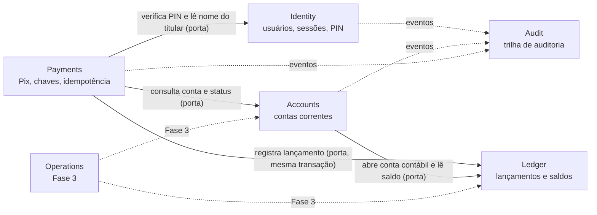
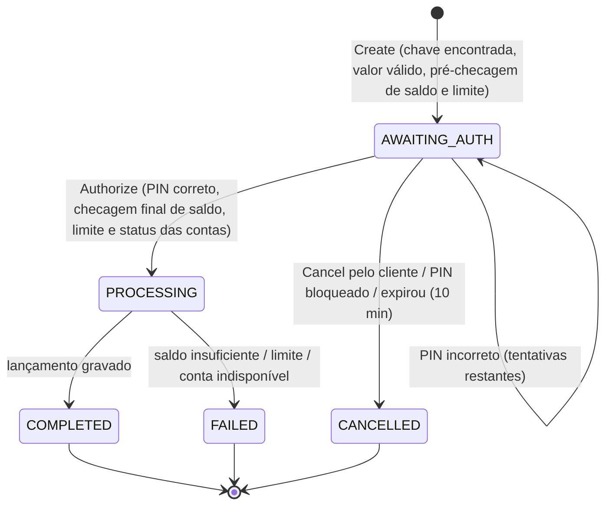
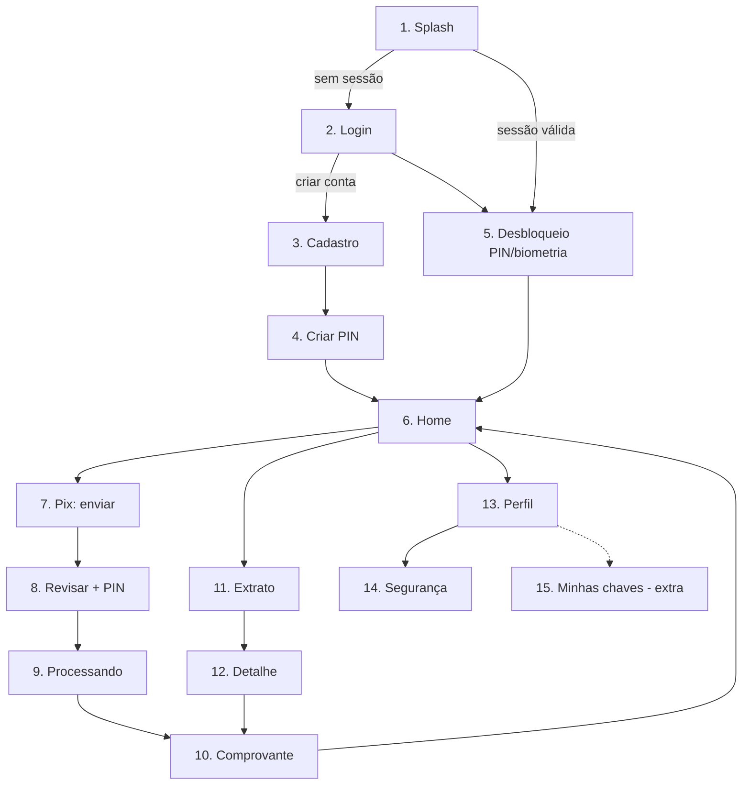

# next bank — Modelo de Domínio (V1)

- **Status:** Aprovado (2026-10-05)
- **Roadmap:** `docs/roadmap.md` (seção 6)

## 1. Linguagem ubíqua

| Termo | Significado |
|---|---|
| **Cliente** | Pessoa física cadastrada (um `User` em Identity) |
| **Conta** | Conta corrente do cliente (`Account` em Accounts). Agência + número |
| **Conta contábil** | Conta do ledger (`LedgerAccount`). Toda conta de cliente tem uma; o banco tem contas de sistema |
| **Lançamento (entry)** | Um fato contábil imutável (`JournalEntry`), composto de duas ou mais partidas |
| **Partida (posting)** | Um débito ou crédito de valor positivo em uma conta contábil |
| **Saldo contabilizado (posted)** | Σ créditos − Σ débitos da conta contábil |
| **Saldo disponível (available)** | Saldo contabilizado − reservas ativas. É o que o cliente pode gastar |
| **Reserva (hold)** | Valor bloqueado e ainda não lançado (usado a partir de Cards; na V1 é sempre zero) |
| **Chave Pix** | Identificador público de uma conta para receber Pix (CPF, e-mail, telefone ou aleatória) |
| **ID de ponta a ponta (E2E)** | Identificador único do Pix, mostrado no comprovante |
| **Chave de idempotência** | UUID enviado pelo cliente para que a repetição de uma requisição não repita a operação |
| **Estorno** | Novo lançamento que anula o efeito de um anterior. Nunca se edita ou apaga um lançamento |
| **Reconciliação** | Conferência de que o saldo projetado bate com a soma dos lançamentos |

## 2. Mapa de contextos

- **Portas:** o contexto que chama define a interface (ex.: `LedgerPort` dentro de Payments); o outro contexto expõe a implementação pelo seu `index.ts`.
- **Na V1, tudo roda na mesma transação de banco** (Unit of Work). Na Fase 2, a comunicação com o mundo externo passa a usar Outbox.
- **Audit é conformista:** recebe os eventos de domínio dos outros contextos e os grava na mesma transação.
- **Falhas também são persistidas.** Um erro de negócio não significa rollback de tudo: PIN incorreto incrementa `failedAttempts`, login falho gera `LOGIN_FAILED`, Pix recusado grava o status `FAILED`. O caso de uso faz commit dessas mudanças e devolve o erro. Só falhas técnicas (exceptions) causam rollback. Sem essa regra, o contador de tentativas do PIN nunca subiria e o bloqueio não funcionaria.

## 3. Agregados

### 3.1 Identity

**`User`**
- Atributos: `id`, `name`, `cpf`, `email`, `passwordHash`, `status` (`ACTIVE`, `LOCKED`), `createdAt`
- Invariantes: CPF válido (dígitos verificadores) e único; e-mail normalizado (minúsculas) e único
- Comandos: `Register`, `Login`, `ChangePassword`
- Eventos: `UserRegistered`, `UserLoggedIn`, `LoginFailed`, `PasswordChanged`

**`Session`** (família de refresh tokens)
- Atributos: `id` (a própria sessão é a família de tokens), `userId`, `refreshTokens[]` (histórico da rotação), `createdAt`, `lastUsedAt`, `idleExpiresAt`, `absoluteExpiresAt`, `revokedAt`, `revokedReason`, `deviceLabel`
- Invariantes:
  - Cada refresh gera um novo token; o anterior deixa de valer
  - **Uso de um token já substituído revoga a família inteira** (sinal de roubo)
  - **Janela de tolerância de 10 s:** se o token anterior for reapresentado até 10 s após a rotação **e o sucessor dele ainda for o token ativo** (ex.: resposta perdida na rede), emite-se um par novo, rotacionado a partir do token ativo, em vez de revogar. O par perdido deixa de valer. Fora dessa janela, ou se a cadeia já avançou, é reuso. Isso evita derrubar o usuário legítimo por uma falha de rede
  - O mesmo par não pode ser reenviado: o servidor guarda só o hash do refresh token
  - Sessão revogada ou expirada não renova
- Comandos: `Create`, `Refresh`, `Revoke`, `RevokeAll`
- Eventos: `SessionCreated`, `SessionRefreshed`, `RefreshTokenReuseDetected`, `SessionRevoked`

**`TransactionPin`**
- Atributos: `userId`, `pinHash`, `failedAttempts`, `lockedUntil`, `recentLocks` (os 2 últimos bloqueios), `resetRequired`
- Invariantes: 4 dígitos, sem sequências triviais (`1234`, `0000`); 5 erros seguidos bloqueiam por 30 minutos; acerto zera as tentativas; o 3º bloqueio em 24 h (janela deslizante) exige redefinir o PIN com a senha (D7)
- Comandos: `Create`, `Verify`, `Change` (exige senha)
- Eventos: `PinCreated`, `PinVerificationFailed`, `PinLocked`, `PinChanged`

### 3.2 Accounts

**`Account`**
- Atributos: `id`, `holderUserId`, `branch` (`0001`), `number` (sequencial + dígito verificador módulo 11), `status` (`ACTIVE`, `BLOCKED`, `CLOSED`), `openedAt`
- Invariantes: um cliente tem exatamente uma conta na V1; só conta `ACTIVE` envia ou recebe dinheiro
- Comandos: `Open` (V1); `Block`, `Unblock` (Fase 3)
- Eventos: `AccountOpened`, `AccountBlocked`, `AccountUnblocked`
- **Não guarda saldo.** Saldo é responsabilidade do Ledger.

### 3.3 Ledger

**`LedgerAccount`**
- Atributos: `id`, `code` (ex.: `customer:<accountId>`, `system:funding`), `kind` (`CUSTOMER`, `SYSTEM`), `postedBalance`, `availableBalance`, `version`
- Invariantes:
  - Conta `CUSTOMER`: `availableBalance >= 0` (garantido também por `CHECK` no banco)
  - Conta `SYSTEM`: pode ficar negativa (ex.: `system:funding` representa a origem do dinheiro de demonstração)
  - Saldos só mudam por lançamento; nunca por atualização direta

**`JournalEntry`**
- Atributos: `id`, `kind` (`FUNDING`, `PIX_INTERNAL`; na Fase 2: `PIX_OUT`, `PIX_OUT_SETTLEMENT`, `PIX_OUT_REVERSAL`, `PIX_IN`; na Fase 3: `REVERSAL`), `referenceType`, `referenceId`, `postings[]`, `createdAt`
- `Posting`: `ledgerAccountId`, `direction` (`DEBIT`, `CREDIT`), `amount` (`Money` > 0), `counterpartyName`, `counterpartyDocumentMasked` (snapshot de quem está do outro lado, usado pelo extrato)
- Invariantes:
  - Pelo menos duas partidas
  - **Σ débitos = Σ créditos**
  - Todas as partidas na mesma moeda
  - Imutável depois de gravado; correção só por um novo lançamento de estorno
- Comandos: `Post`
- Eventos: `JournalEntryPosted`

**Convenção de saldo:** saldo = Σ créditos − Σ débitos. Para uma conta de cliente, **crédito aumenta** o saldo e **débito diminui** (do ponto de vista do banco, o saldo do cliente é uma obrigação).

### 3.4 Payments

**`PixKey`**
- Atributos: `id`, `type` (`CPF`, `EMAIL`, `PHONE`, `RANDOM`), `value` (normalizado), `accountId`, `createdAt`
- Invariantes:
  - (`type`, `value`) único no sistema
  - Chave CPF tem que ser o CPF do titular da conta
  - No máximo 5 chaves por conta (regra do Bacen para pessoa física)
- Na V1, só a chave CPF criada no cadastro é obrigatória. As demais ficam para a tela extra "Minhas chaves".

**`PixTransfer`**
- Atributos: `id`, `endToEndId`, `payerAccountId`, `payeeAccountId`, `payeeKey` (tipo + valor), `payeeName`, `payeeDocumentMasked` (ex.: `•••.842.•••-09`), `amount`, `description` (até 140 caracteres), `status`, `failureReason`, `createdAt`, `expiresAt`, `authorizedAt`, `completedAt`
- **Snapshot do recebedor:** nome e documento mascarado são copiados no momento da criação. O comprovante mostra o que valia na hora do Pix, mesmo que o recebedor mude de nome depois. O CPF completo do recebedor nunca é exposto ao pagador.
- Invariantes:
  - `amount` > 0, com no máximo 2 casas decimais
  - Pagador ≠ recebedor
  - Transições só pela máquina de estados (seção 4)
  - `AWAITING_AUTH` expira em 10 minutos
- Comandos: `Create`, `Authorize`, `Cancel`, `Expire`
- Eventos: `PixTransferCreated`, `PixTransferAuthorized`, `PixTransferCompleted`, `PixTransferFailed`, `PixTransferCancelled`

**`IdempotencyRecord`** *(mecanismo de aplicação, não agregado de domínio)*
- Atributos: `userId`, `key`, `requestHash`, `status` (`IN_PROGRESS`, `COMPLETED`), `responseStatus`, `responseBody`, `expiresAt` (24h)
- Invariantes: (`userId`, `key`) único; mesma chave com payload diferente é rejeitada
- É um mecanismo da camada de aplicação, compartilhado pelos comandos financeiros. Fica em Payments porque, na V1, só ele o usa.

### 3.5 Audit

**`AuditEvent`**
- Atributos: `id`, `occurredAt`, `actorType` (`USER`, `SYSTEM`, `STAFF`), `actorId`, `action`, `subjectType`, `subjectId`, `requestId`, `metadata`
- Invariantes: só inclusão; `metadata` **nunca** contém senha, PIN, token, CPF completo ou valor de chave Pix completo
- Ações da V1: `USER_REGISTERED`, `LOGIN_SUCCEEDED`, `LOGIN_FAILED`, `SESSION_CREATED`, `SESSION_REVOKED`, `REFRESH_REUSE_DETECTED`, `PIN_CREATED`, `PIN_LOCKED`, `PIN_CHANGED`, `PASSWORD_CHANGED`, `ACCOUNT_OPENED`, `PIX_CREATED`, `PIX_COMPLETED`, `PIX_FAILED`, `PIX_CANCELLED`

## 4. Máquina de estados do Pix

- **Ajuste em relação à spec:** o estado `CREATED` deixa de existir como estado persistido. O agregado já nasce em `AWAITING_AUTH`, e "criado" vira só o evento `PixTransferCreated`. Isso evita um estado que ninguém observa.
- **V1 (Pix interno):** `PROCESSING → COMPLETED/FAILED` acontece na mesma transação do `Authorize`. O estado `PROCESSING` existe no modelo, mas o cliente quase nunca o vê.
- **Fase 2 (Pix externo):** `PROCESSING` passa a durar até a confirmação do Bacen simulado.
- **Checagem dupla:** saldo e limite são verificados no `Create` (para avisar cedo) e de novo no `Authorize` (que é o que vale, porque o saldo e o horário podem ter mudado).

## 5. Plano de contas

| Código | Tipo | Fase | Papel |
|---|---|---|---|
| `customer:<accountId>` | CUSTOMER | 1 | Saldo de cada cliente |
| `system:funding` | SYSTEM | 1 | Origem do saldo de demonstração |
| `system:pix_clearing` | SYSTEM | 2 | Conta transitória: Pix enviado aguardando liquidação |
| `system:bacen_settlement` | SYSTEM | 2 | Espelho da conta do banco no Bacen (liquidação) |

## 6. Exemplos de lançamentos

**Cadastro (funding de R$ 10.000,00)**

| Conta | Débito | Crédito |
|---|---|---|
| `system:funding` | 10.000,00 | |
| `customer:A` | | 10.000,00 |

**Pix interno de R$ 80,00 de A para B**

| Conta | Débito | Crédito |
|---|---|---|
| `customer:A` | 80,00 | |
| `customer:B` | | 80,00 |

Se o Pix falhar (saldo insuficiente, limite, conta indisponível), **nenhum lançamento é gravado**: a falha é decidida antes, na mesma transação.

**Fase 2 — Pix externo de R$ 80,00 enviado por A**

1. Envio (status `PROCESSING`):

   | Conta | Débito | Crédito |
   |---|---|---|
   | `customer:A` | 80,00 | |
   | `system:pix_clearing` | | 80,00 |

2a. Bacen confirma (status `COMPLETED`):

   | Conta | Débito | Crédito |
   |---|---|---|
   | `system:pix_clearing` | 80,00 | |
   | `system:bacen_settlement` | | 80,00 |

2b. Bacen recusa (status `FAILED`, estorno):

   | Conta | Débito | Crédito |
   |---|---|---|
   | `system:pix_clearing` | 80,00 | |
   | `customer:A` | | 80,00 |

**Invariante da Fase 2:** ao fim de cada dia conciliado, o saldo de `system:pix_clearing` = soma dos Pix ainda em `PROCESSING`.

## 7. Regras de negócio

| Regra | Valor | Onde é verificada |
|---|---|---|
| Limite por transação (6h–20h) | R$ 5.000,00 | `Create` e `Authorize` |
| Limite por transação (20h–6h) | R$ 1.000,00 | `Create` e `Authorize`; horário em `America/Sao_Paulo` |
| Valor mínimo | R$ 0,01 | `Create` |
| Expiração da autorização | 10 minutos | `Authorize` e job de expiração |
| Tentativas de PIN | 5, depois bloqueio de 30 min | `TransactionPin.Verify` |
| Chaves por conta | até 5 | `PixKey` |
| Consultas de chave | até 30 por hora por cliente; consultas a chaves inexistentes contam em dobro | Rate limit na consulta de chave (evita varredura de dados pessoais) |

O limite noturno é inspirado na regra do Bacen, simplificado para valor por transação. Limite acumulado por período fica como evolução.

## 8. Fluxo de cadastro (orquestração)

Um único caso de uso de aplicação (`RegisterCustomer`), numa só transação:

1. Identity: cria o `User` (Argon2id na senha)
2. Accounts: abre a `Account`
3. Ledger: cria a `LedgerAccount` do cliente e grava o lançamento de funding
4. Payments: cria a chave Pix CPF
5. Audit: `USER_REGISTERED`, `ACCOUNT_OPENED`
6. Identity: cria a `Session` e devolve os tokens

O PIN é criado logo depois, numa tela própria (o cadastro só termina com o PIN criado; até lá, o app não libera o Pix).

## 8.1 Extrato (read model)

O extrato não é um agregado: é uma consulta (lado de leitura do CQRS) que lê **só o ledger**. Os dados da contraparte vêm do snapshot gravado em cada partida, então o extrato não depende do contexto Payments.

| Campo exibido | Origem |
|---|---|
| Data e hora | `Posting.createdAt` |
| Tipo (Pix enviado, Pix recebido, Depósito inicial) | `JournalEntry.kind` + direção da partida |
| Contraparte (nome e documento mascarado) | `Posting.counterpartyName`, `Posting.counterpartyDocumentMasked` |
| Valor com sinal | Partida da conta do cliente: crédito `+`, débito `−` |
| Status | Na V1, só Pix `COMPLETED` geram lançamento; logo, todo item do extrato está concluído |
| Link para comprovante | `JournalEntry.referenceId` (id do Pix) |

- **Paginação por cursor** em (`createdAt`, `id`), do mais recente para o mais antigo, 20 itens por página.
- **Filtros (extra):** período e tipo (entradas/saídas).
- **Fonte da verdade:** o extrato lê do ledger, então o que aparece nele sempre bate com o saldo.

## 9. Catálogo de erros de domínio

| Erro | HTTP | Tela | Mensagem ao cliente |
|---|---|---|---|
| `InvalidRequest` | 422 | Qualquer | "Confira os dados informados." (entrada fora do formato ou com campo desconhecido; o app valida antes, então indica erro de programação ou cliente adulterado) |
| `InvalidCredentials` | 401 | Login | "E-mail ou senha incorretos." |
| `TooManyAttempts` | 429 | Login, Pix | "Muitas tentativas. Tente de novo em alguns minutos." |
| `InvalidCpf` | 422 | Cadastro | "CPF inválido." |
| `WeakPassword` | 422 | Cadastro | "Use pelo menos 10 caracteres e evite senhas comuns." |
| `AlreadyRegistered` | 409 | Cadastro | "Não foi possível concluir o cadastro com esses dados." (genérica de propósito) |
| `Unauthenticated` | 401 | Qualquer | Token de acesso ausente, inválido ou expirado: o app tenta o refresh uma vez; se falhar, volta ao login: "Faça login para continuar." |
| `SessionExpired` | 401 | Qualquer | Volta para o login: "Sua sessão expirou." |
| `RefreshTokenReuseDetected` | 401 | Qualquer | Volta para o login: "Por segurança, entre novamente." |
| `InvalidPin` | 422 | Criar PIN | "Use 4 dígitos que não sejam repetidos nem em sequência." |
| `PinIncorrect` | 422 | Revisar Pix | "PIN incorreto. Restam N tentativas." |
| `PinLocked` | 423 | Revisar Pix | "PIN bloqueado por 30 minutos." |
| `PinResetRequired` | 423 | Revisar Pix, Desbloqueio | "PIN bloqueado por segurança. Redefina o PIN com sua senha em Perfil > Segurança." |
| `PinAlreadyCreated` | 409 | Criar PIN | "Você já tem um PIN. Para trocar, use Perfil > Segurança." |
| `PinNotCreated` | 409 | Pix, Desbloqueio | "Crie seu PIN para continuar." (o app leva à tela "Criar PIN") |
| `PixKeyNotFound` | 404 | Pix | "Não encontramos essa chave Pix." |
| `SamePayerAndPayee` | 422 | Pix | "Você não pode enviar Pix para a própria conta." |
| `InvalidAmount` | 422 | Pix | "Informe um valor válido." |
| `InsufficientFunds` | 422 | Pix, Revisar | "Saldo insuficiente." |
| `LimitExceeded` | 422 | Pix, Revisar | "Valor acima do seu limite (R$ X entre 20h e 6h)." |
| `AccountBlocked` | 422 | Pix | "Sua conta está bloqueada. Fale com o suporte." |
| `PayeeUnavailable` | 422 | Revisar | "A conta de destino não pode receber Pix agora." |
| `TransferExpired` | 409 | Revisar | "O tempo para confirmar acabou. Comece de novo." |
| `InvalidTransferState` | 409 | Revisar | "Este Pix já foi processado." |
| `IdempotencyKeyReused` | 422 | — (erro de programação no app) | "Algo deu errado. Tente de novo." |
| `RequestInProgress` | 409 | — | O app aguarda e consulta o resultado |
| `NotFound` (inclui recurso de outro usuário) | 404 | Qualquer | "Não encontrado." |

Formato da resposta: RFC 7807, com `type`, `title`, `status`, `code` (o nome do erro) e campos extras quando úteis (ex.: `remainingAttempts`, `limit`).

## 10. Mapa de navegação

**Navegação inferior:** Início · Extrato · **Pix** (ação central) · Segurança · Perfil.

**Regras de navegação:**
- Sessão expirada ou reuso de refresh detectado → volta ao Login a partir de qualquer tela.
- App em segundo plano por mais de 5 minutos → volta ao Desbloqueio.
- O botão "voltar" do Comprovante leva à Home, nunca de volta à tela de PIN.

## 11. Estados por tela

| Tela | Estados |
|---|---|
| 1. Splash | verificando sessão · sem conexão (tentar de novo) |
| 2. Login | padrão · enviando · `InvalidCredentials` · `TooManyAttempts` |
| 3. Cadastro | padrão · validação local (CPF, e-mail, senha) · enviando · `InvalidCpf` · `WeakPassword` · `AlreadyRegistered` |
| 4. Criar PIN | digitar · confirmar · PINs diferentes · PIN trivial |
| 5. Desbloqueio | biometria · fallback para PIN · `PinIncorrect` · `PinLocked` |
| 6. Home | skeleton · pronto · saldo oculto · sem movimentações · erro (tentar de novo) |
| 7. Pix: enviar | digitando · buscando chave · chave encontrada (nome completo e documento mascarado) · `PixKeyNotFound` · `SamePayerAndPayee` · `InsufficientFunds` · `LimitExceeded` · `AccountBlocked` |
| 8. Revisar + PIN | resumo · digitando PIN · verificando · `PinIncorrect` · `PinLocked` · `TransferExpired` · `PayeeUnavailable` |
| 9. Processando | processando · falhou (com motivo) |
| 10. Comprovante | concluído · compartilhando |
| 11. Extrato | skeleton · lista · carregando mais · fim da lista · vazio · erro |
| 12. Detalhe | carregando · pronto · `NotFound` |
| 13. Perfil | pronto |
| 14. Segurança | lista de sessões · encerrando sessão (confirmação) · trocar PIN |

## 12. Decisões registradas nesta tarefa

| # | Decisão | Proposta | Status |
|---|---|---|---|
| D1 | Tipos de chave Pix | CPF, e-mail, telefone e aleatória; só CPF obrigatória na V1 (criada no cadastro) | Aprovado |
| D2 | Limites Pix | R$ 5.000 (6h–20h) e R$ 1.000 (20h–6h), por transação | Aprovado |
| D3 | Saldo de demonstração | R$ 10.000,00 via `system:funding` no cadastro | Aprovado |
| D8 | Identificação do cliente | CPF + e-mail; login por e-mail | Aprovado |
