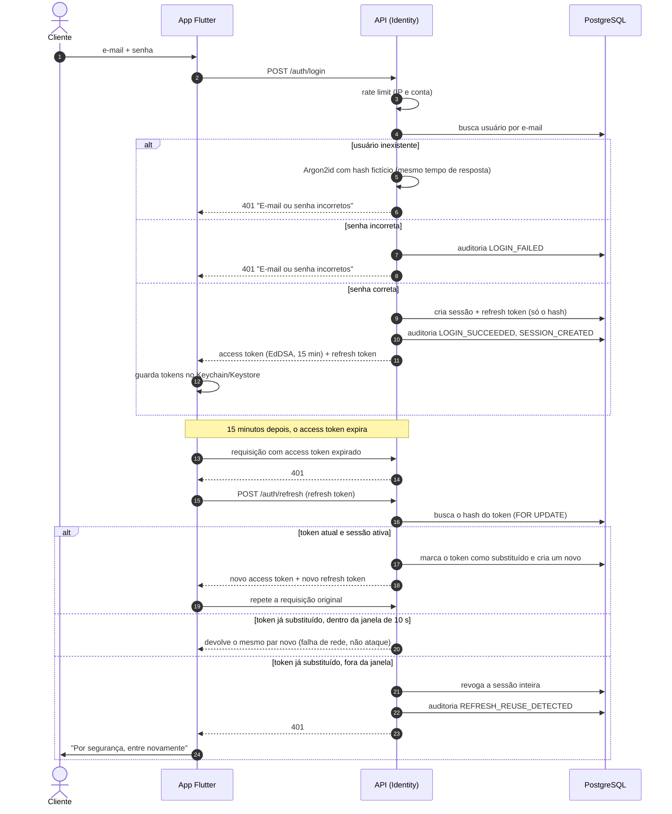
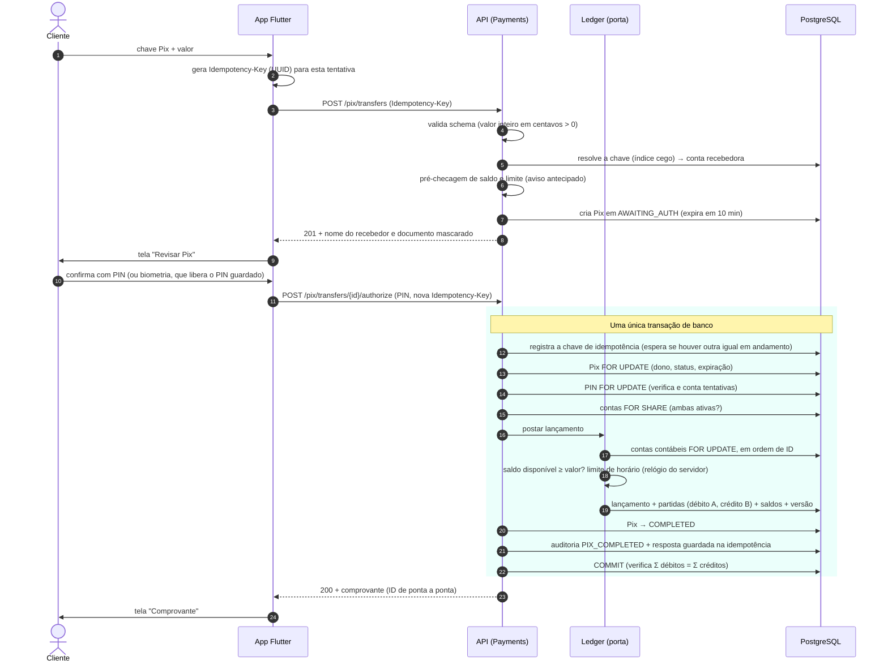

# next bank — Diagramas de sequência

Os dois fluxos mais sensíveis da V1, passo a passo. As regras de cada passo estão no [modelo de domínio](domain-model.md), no [desenho do banco](database.md) e no [threat model](../security/threat-model.md).

## 1. Login e renovação de sessão (com detecção de reuso)

**Pontos de atenção**
- **Passos 5–6:** usuário inexistente e senha errada são indistinguíveis, inclusive no tempo de resposta (AUTH-02).
- **Refresh concorrente no app:** várias requisições com `401` disparam **um único** refresh (fila no interceptor); as demais esperam e reaproveitam o novo token.
- **Reuso detectado:** quem roubou o token e quem é o dono perdem a sessão; o dono entra de novo com a senha, o atacante não.

## 2. Pix interno: criar, autorizar com PIN e concluir

**Caminhos alternativos (todos gravam o efeito e fazem COMMIT, sem lançamento no ledger)**

| Situação | Resultado |
|---|---|
| PIN incorreto | `422 PinIncorrect` com tentativas restantes; Pix continua em `AWAITING_AUTH` |
| 5º erro de PIN | `423 PinLocked`; Pix vai para `CANCELLED` |
| Saldo insuficiente ou limite excedido | Pix vai para `FAILED` com o motivo |
| Mais de 10 minutos | `409 TransferExpired`; Pix vai para `CANCELLED` |
| Mesma requisição repetida (falha de rede) | Mesma resposta da primeira vez; nenhum lançamento novo |
| Pix de outro cliente | `404`, sem revelar que o Pix existe |

**Por que esse desenho**
- **Duas checagens de saldo e limite:** a primeira avisa cedo; a segunda, dentro da transação e com lock, é a que vale.
- **Locks em ordem de ID:** um Pix A→B e outro B→A ao mesmo tempo não travam um ao outro.
- **Só falha técnica faz rollback:** aí a chave de idempotência também some, e o app pode tentar de novo com segurança.
