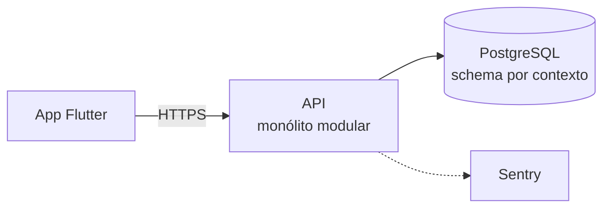
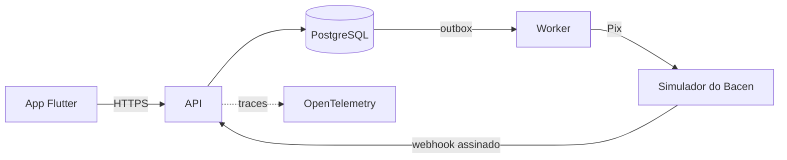
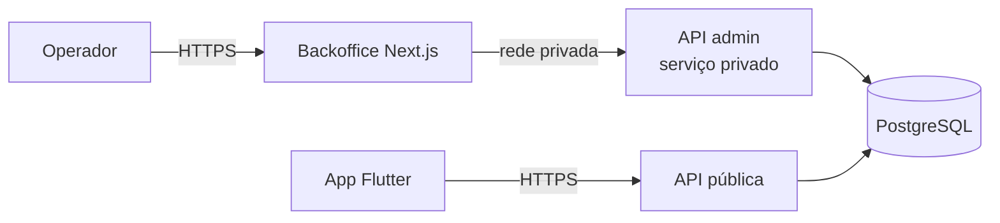

# next bank — Evolução do projeto

Este documento conta **como o projeto chegou ao desenho atual** e **para onde a arquitetura vai evoluir**. As decisões detalhadas estão nos [ADRs](adr/README.md); aqui está o fio da história.

---

## Parte 1 — Como chegamos aqui

### O ponto de partida

O projeto começou com três roadmaps rascunhados: um com 38 fases, outro com versões de V0 a V13 e um terceiro listando tudo o que um banco digital costuma ter (cartões, analytics, offline, notificações, SDUI…). O risco era claro: **construir uma fintech "completa" e nunca terminar**.

### As decisões que moldaram o projeto

| # | Momento | O que mudou | Por quê |
|---|---|---|---|
| 1 | Consolidação | Os três roadmaps viraram um só: **V0 → V1 → releases independentes** | Entregar cedo, evoluir por versões |
| 2 | Ordem de construção | **Fatias verticais** (backend + mobile + testes por funcionalidade) em vez de "todo o backend, depois todo o mobile" | Problemas de integração aparecem cedo; sempre há algo demonstrável |
| 3 | Revisão de arquitetura | Três falhas corrigidas antes de qualquer código: **PIN validado no servidor** (biometria sozinha não é controle), **saldo disponível × contabilizado** (prepara cartões) e auditoria sem gargalo | Um revisor experiente encontraria essas falhas em minutos |
| 4 | Olhar de banco real | O Pix interno e síncrono não exercitava os problemas difíceis. Entrou um **simulador do Bacen** com falhas, conta transitória e conciliação | O difícil num banco é o que acontece fora do próprio banco de dados |
| 5 | Objetivo do projeto | Foco em **vagas fullstack (web + mobile) no setor financeiro**: três fases em vez de nove releases. Entrou o **backoffice Next.js** para mostrar a parte web | Profundidade em poucas coisas convence mais que amplitude |
| 6 | Realismo de prazo | V1 de 6–7 para **8 semanas**, com itens obrigatórios × extras e checkpoints nas semanas 2 e 6 | Projetos solo atrasam 30–50%; o escopo cede antes da qualidade |
| 7 | Design | **Sem Figma:** referência visual → mockups → tokens. Nome **next bank**, cor **Paraíba `#00FFC8`**, dark-first | Mais rápido, e o código das telas nasce direto no Flutter |
| 8 | Telas | **Direto no Flutter, por fatia**, sem mockups das telas restantes | O visual já estava decidido; mockup extra seria trabalho em dobro |
| 9 | Padrões | **Padrões de engenharia inegociáveis**, com segurança em primeiro lugar, TDD onde rende e fluxo de Git com PRs | O projeto é tratado como um banco real em produção |
| 10 | Banco de dados | **Schema por contexto**, banco como última barreira, ledger imutável no próprio banco, CPF criptografado, contas de sistema sem *hot account* | As regras financeiras precisam sobreviver a bugs da aplicação |
| 11 | Segurança | **Threat model com 38 ameaças**, cada uma com teste; proteções do GitHub ativadas | Segurança desde o projeto, não no fim |
| 12 | Monorepo | **Turborepo** no lado TypeScript; Flutter com ferramentas nativas | Ordem de build declarada e CI que roda só o que mudou |
| 13 | Infraestrutura | Backoffice no **Render** com API administrativa **privada**; cache do CI no GitHub Actions | Menos fornecedores e segredos; ferramenta interna fora da internet |
| 14 | Microsserviços | **Não no núcleo.** Monólito modular, com serviços separados só onde há fronteira real | A operação crítica (mover dinheiro) precisa ser atômica |
| 15 | Revisão de fechamento da semana 1 | **Demo pública sem dados reais** (CPF fictício, contas de demonstração, reset semanal), README em inglês com mockups, licença, documentação reorganizada e **escopo da V1 congelado** | Recrutadores precisam ver o app funcionando em um minuto, e uma demo aberta não pode coletar dados pessoais reais |

### O que ficou de fora, de propósito

Cartões, antifraude, notificações, offline, SDUI, multimoeda e segurança avançada viraram **"Próximos passos"** documentados. Eles mostram visão sem consumir semanas, e cada um tem um ponto de extensão preparado na arquitetura atual.

---

## Parte 2 — Para onde a arquitetura evolui

A arquitetura cresce em estágios. **Cada mudança tem um gatilho**: ela só acontece quando um problema real a justifica.

### Estágio 1 — V1: monólito modular

- Um deploy, uma transação ACID por operação financeira
- Fronteiras de módulo verificadas no CI, prontas para extração

### Estágio 2 — Fase 2: primeiro sistema distribuído

- **Novo:** comunicação assíncrona, falhas de rede, duplicatas, retry com backoff, conciliação
- O worker é um processo separado; o simulador é um serviço separado
- Tracing entre processos com OpenTelemetry

### Estágio 3 — Fase 3: ferramenta interna isolada

- **Novo:** RBAC, dupla aprovação, fila de exceções da conciliação
- API administrativa sem URL pública: mesma imagem da API, outro modo de execução

### Estágio 4 — Evoluções futuras (guiadas por gatilhos)

| Evolução | Gatilho | O que já prepara |
|---|---|---|
| Extrair **Notificações** como serviço | Push e central de notificações com carga própria | Eventos já saem pelo outbox |
| Extrair **Antifraude** como serviço | Regras de risco com ciclo de mudança e escala próprios | Ponto de decisão antes do `AuthorizePix` |
| Kafka (ou outro broker) | Vários consumidores independentes dos mesmos eventos | Outbox + inbox já separam produtor e consumidor |
| Particionar a tabela de partidas | Centenas de milhões de linhas | Consultas sempre filtram por conta e data |
| Réplicas de leitura | Consultas disputando com escritas | Extrato já é um read model |
| **Sharding por cliente (células)** | Um banco de dados não dá conta | Dados chaveados por conta; Pix entre células usa o mesmo padrão do Pix externo |
| KMS/HSM para chaves | Operação real | Porta `KeyProvider` |
| Vínculo de dispositivo, integridade do app, pinning | Exposição real a fraude | Riscos aceitos e documentados no threat model |
| Gateway zero trust no backoffice | Mais de um operador real | Backoffice já isolado da API pública |
| UI dirigida pelo servidor (SDUI) | Mudar telas sem publicar nova versão do app | Design System isolado e declarativo |

---

## Histórico de versões

As mudanças de cada versão ficam no [CHANGELOG](../CHANGELOG.md).
