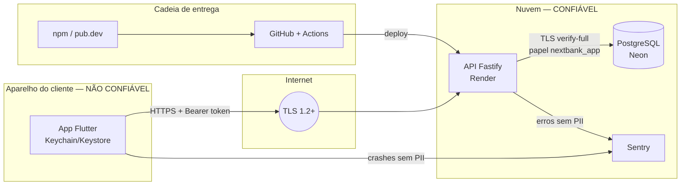

# next bank — Threat Model (V1)

- **Status:** Aprovado (2026-10-05), incluindo as decisões D4–D7
- **Método:** STRIDE por fluxo, sobre um diagrama de fluxo de dados com fronteiras de confiança
- **Referências:** OWASP ASVS (nível 2) para API, OWASP MASVS para o app — checklist em `checklist-asvs-masvs.md`; status consolidado dos controles em `controles-de-seguranca.md`
- **Base:** `docs/architecture/domain-model.md`, `docs/architecture/database.md`
- **Regra viva:** toda feature nova revisa este documento; ameaça nova vira uma linha aqui **e** um teste.

## 1. Escopo

Fase 1 (V1): app Flutter, API Fastify, PostgreSQL, Sentry, pipeline de CI/CD e repositório público.
Fora do escopo desta versão: simulador do Bacen (Fase 2) e backoffice (Fase 3), que terão revisões próprias. A da Fase 2 começou com o plano da `v1.2.0` (seção 5.8, ameaças propostas).

## 2. Ativos

| Ativo | Por que importa | Impacto se comprometido |
|---|---|---|
| Saldo e ledger | É o dinheiro do cliente | Crítico: perda financeira, perda de confiança |
| Credenciais (senha, PIN) | Dão acesso à conta e autorizam Pix | Crítico |
| Tokens de sessão (access e refresh) | Equivalem a estar logado | Crítico |
| Dados pessoais (CPF, nome, e-mail, chaves Pix) | LGPD; usados em golpes | Alto |
| Trilha de auditoria | Prova do que aconteceu (não repúdio) | Alto |
| Chaves de criptografia e de assinatura de JWT | Protegem todos os itens acima | Crítico |
| Disponibilidade da API | Cliente sem acesso ao próprio dinheiro | Médio (V1 é demonstração) |
| Repositório e pipeline | Código malicioso chegaria à produção | Alto |

## 3. Atores de ameaça

| Ator | Capacidade | Exemplo |
|---|---|---|
| **A1** Atacante externo anônimo | Requisições pela internet, automação, listas de senhas vazadas | Credential stuffing, varredura de chaves Pix |
| **A2** Cliente mal-intencionado autenticado | Conta válida, conhece a API, altera requisições | Acessar dados de outro cliente (IDOR), adulterar valores |
| **A3** Quem está com o aparelho da vítima | Aparelho desbloqueado ou roubado | Fazer Pix com a sessão aberta |
| **A4** App adulterado / malware no aparelho | Lê armazenamento inseguro, intercepta tráfego | Roubar tokens |
| **A5** Quem obtém dump, backup ou logs | Acesso de leitura a dados em repouso | Ler CPF, hashes, tokens em log |
| **A6** Cadeia de suprimentos | Dependência ou action comprometida | Pacote npm malicioso |
| **A7** Quem alcança o webhook do SPI (v1.2.0) | A rota pública que recebe as notificações do simulador do Bacen | Forjar ou repetir uma confirmação ou uma falha de Pix externo |

## 4. Fluxo de dados e fronteiras de confiança

**Fronteiras:**
- **F1 — App ↔ API:** tudo que vem do app é não confiável. O servidor revalida tudo (valores, dono do recurso, estado, limites).
- **F2 — API ↔ Banco:** papel de menor privilégio; ledger e auditoria não podem ser alterados.
- **F3 — Aplicação ↔ terceiros (Sentry):** nenhum dado pessoal ou segredo atravessa.
- **F4 — Cadeia de entrega:** dependências e actions são código de terceiros executando com acesso aos nossos segredos de CI.

## 5. Ameaças e mitigações

Legenda STRIDE: **S** falsificação de identidade · **T** adulteração · **R** repúdio · **I** vazamento de informação · **D** negação de serviço · **E** elevação de privilégio.

### 5.1 Autenticação e sessão

| ID | Ameaça | STRIDE | Ator | Mitigação | Teste | Sem. |
|---|---|---|---|---|---|---|
| AUTH-01 | Credential stuffing e força bruta no login | S | A1 | Rate limit por IP e por conta, com atraso progressivo; Argon2id; mensagem genérica | 6ª tentativa em 1 min → 429; contador por conta independe do IP | 3 |
| AUTH-02 | Descobrir quais e-mails/CPFs têm conta (enumeração) | I | A1 | Mensagens idênticas para usuário inexistente e senha errada; **hash fictício** quando o usuário não existe, para o tempo de resposta não denunciar; cadastro com erro genérico | Respostas e tempos equivalentes para os dois casos | 3 |
| AUTH-03 | Roubo e reuso de refresh token | S | A4 | Rotação a cada uso; reuso fora da janela de 10 s revoga a sessão inteira; token só no Keychain/Keystore; guardado como hash no banco | Reapresentar token antigo após 10 s → 401 e sessão revogada | 3 |
| AUTH-04 | Roubo de access token | S | A4 | Validade de 15 min; operações sensíveis (autorizar Pix, trocar PIN, trocar senha, listar e encerrar sessões) também verificam se a sessão ainda está ativa no banco | Token de sessão revogada → recusado no `AuthorizePix` e nas rotas de sessões, PIN e senha | 3, 5, 7 |
| AUTH-05 | Token forjado (algoritmo `none`, troca de algoritmo, chave errada) | S, E | A1 | Algoritmo fixo (EdDSA), lista de algoritmos aceitos, validação de `iss`, `aud`, `exp`, `nbf`; `kid` para rotação de chave | Tokens com `alg: none`, `HS256` e assinatura inválida → 401 | 3 |
| AUTH-06 | Sessão continua válida após logout ou troca de senha | S | A3 | Logout revoga a sessão; troca de senha revoga **todas** as outras, na mesma transação; o cliente encerra qualquer outra sessão na tela Segurança | Refresh após logout/troca → 401; login com a senha antiga durante a troca não abre sessão (F-24) | 3, 7 |
| AUTH-07 | Senha fraca ou vazada | S | A1 | Política D6 (mínimo 10, lista local de senhas comuns, sem regras de composição) | Senhas da lista → 422 | 3 |
| AUTH-08 | Quebra offline dos hashes após vazamento | I | A5 | Argon2id com parâmetros da OWASP (mínimo 19 MiB de memória, 2 iterações); senha máxima de 128 caracteres (evita DoS no hash) | Teste dos parâmetros; senha de 10.000 caracteres → 422 sem processar o hash | 3 |
| AUTH-09 | Criação de contas em massa por robôs | D, E | A1 | Rate limit no cadastro por IP; CPF único (índice cego) | 4º cadastro do mesmo IP em 1 h → 429 | 3 |

### 5.2 Pix

| ID | Ameaça | STRIDE | Ator | Mitigação | Teste | Sem. |
|---|---|---|---|---|---|---|
| PIX-01 | Autorizar ou ver o Pix de outro cliente (IDOR) | E, I | A2 | Pagador sempre derivado do token; todo acesso verifica o dono; recurso alheio → 404 | Cliente B tenta ler/autorizar Pix de A → 404 | 5 |
| PIX-02 | Pix duplicado por repetição de requisição (replay) | T | A2, rede | Idempotência (usuário, chave); máquina de estados; `UNIQUE` no lançamento por Pix | T-DB-05, T-DB-06; mesma requisição 2x → mesma resposta, 1 lançamento | 5 |
| PIX-03 | Gastar o mesmo saldo duas vezes com requisições simultâneas | T | A2 | Locks em ordem fixa + `CHECK` de saldo | T-DB-08, T-DB-09 | 5 |
| PIX-04 | Adulterar valor (negativo, fracionado, gigante) ou campos que não deveriam ser enviados | T, E | A2 | Schemas Zod estritos (campo desconhecido → 422); valor inteiro em centavos > 0; limites no servidor; conta de origem nunca vem do corpo | Valores `-1`, `0.001`, `1e20`, campo `payerAccountId` extra → 422 | 5 |
| PIX-05 | Força bruta no PIN | S | A3 | 5 erros → bloqueio de 30 min; 3º bloqueio em 24 h → PIN bloqueado até redefinir com a senha; contador por usuário (não por Pix) | 6ª tentativa → 423; contador sobrevive a Pix diferentes | 5 |
| PIX-06 | Pix feito por quem pegou o aparelho com sessão aberta | S | A3 | Desbloqueio do app após 5 min em segundo plano; PIN validado no servidor em todo Pix; limite noturno | Pix sem PIN → impossível pela API | 5, 6 |
| PIX-07 | Varredura de chaves Pix para coletar nomes e CPFs | I | A2 | 30 consultas/hora; chaves inexistentes contam em dobro; resposta com documento mascarado | 31ª consulta → 429 | 5 |
| PIX-08 | Autorizar Pix expirado ou fora de ordem | T | A2 | `expires_at` e status verificados com `FOR UPDATE` | Autorizar após 10 min → 409; autorizar duas vezes → 409 | 5 |
| PIX-09 | Cliente nega ter feito o Pix (repúdio) | R | A2 | Auditoria imutável com sessão, `requestId`, dispositivo e evento de verificação de PIN; ID E2E no comprovante | Evento `PIX_COMPLETED` contém sessão e `requestId` | 5 |
| PIX-10 | Horário do aparelho manipulado para fugir do limite noturno | T | A2 | Horário sempre do servidor (`Clock`, fuso São Paulo); horário do cliente ignorado | Teste com `Clock` às 21h → limite noturno aplicado | 5 |
| PIX-11 | QR Code com nome de recebedor forjado (o campo 59 do BR Code é texto livre) leva a pagar quem não se pretendia | S, T | A1 | O app descarta o nome do QR (`BrCodePayment` nem o guarda) e mostra o titular que a consulta da chave devolve, como no Pix por CPF | `send_pix_controller_test.dart` e `scan_pix_flow_test.dart`: QR com nome "LOJA FALSA" → a tela mostra o titular da chave; E2E `pay_qr_flow_test.dart` contra a API real | v1.1.0 |
| PIX-12 | QR Code de cobrança expõe o CPF de quem recebe | I | A1, A5 | "Receber" usa só a chave aleatória do cliente (UUID v4 de gerador criptográfico, uma por conta, criada na primeira vez); o BR Code é montado no app e recusa chave que não seja aleatória; o repositório recusa resposta com chave que não seja UUID v4 | `br_code_test.dart`: o código nunca leva CPF e recusa chave que não seja aleatória; `http_pix_repository_test.dart`: CPF na resposta → inesperado; `receiving-key-route.test.ts`: a resposta não traz o CPF | v1.1.0 |
| PIX-13 | QR Code adulterado (valor ou chave trocados) ou que não é um Pix estático | T | A1 | `parseBrCode` confere o CRC primeiro e depois toda a estrutura EMV, o formato, a moeda e o arranjo Pix, antes de qualquer tela; QR dinâmico, link ou texto qualquer é recusado e nunca aberto (MOB-06); o valor fixo chega travado; o servidor revalida tudo (PIX-04) | `br_code_test.dart`: valor ou chave trocados depois do CRC, CRC errado, estrutura quebrada, outro arranjo, outra moeda, QR dinâmico, link → `InvalidQrCode`; controller: código adulterado → nenhuma consulta; valor fixo não aceita digitação | v1.1.0 |

### 5.3 Consultas (saldo, extrato, comprovante)

| ID | Ameaça | STRIDE | Ator | Mitigação | Teste | Sem. |
|---|---|---|---|---|---|---|
| READ-01 | Ler saldo, extrato ou comprovante de outro cliente | I | A2 | Conta derivada do token; nenhum endpoint aceita ID de conta do cliente | Teste de IDOR em **todo** endpoint de leitura | 4, 6 |
| READ-02 | Resposta expõe dados demais | I | A2 | DTOs com lista de campos permitidos; documentos sempre mascarados | Teste de contrato falha se surgir campo novo não aprovado | 4, 6 |
| READ-03 | Cursor de paginação adulterado | T | A2 | Formato validado; filtro por conta feito no servidor | Cursor inválido → 422; cursor de outra conta não retorna dados alheios | 6 |
| READ-04 | Consultas caras para derrubar a API | D | A1, A2 | Página máxima de 20; índices; `statement_timeout`; busca do extrato de 2 a 60 caracteres, com `%` e `_` escapados (nunca curinga do cliente, v1.1.0) | Pedido de 10.000 itens → limitado a 20; `%%`, `__` e `%a` na busca não acham nada; busca de 1 ou 61 caracteres → 422 | 6, v1.1.0 |
| READ-05 | Números de conta sequenciais permitem adivinhar contas de outros clientes | I, E | A2 | Nenhuma rota aceita número ou ID de conta: a conta vem sempre do token; parâmetros desconhecidos → 422 | `my-account-route.test.ts` (ID e número de outra conta → 422); `openapi.test.ts` (nenhuma rota com ID no caminho) | 4 |
| READ-06 | O termo buscado no extrato (o nome de alguém) ou o cursor vazam nos logs ou no Sentry pela query string | I | A5 | O log das requisições grava só o caminho, sem a query string, em todas as rotas (`requestForLog`); o Sentry recebe a URL da requisição e a dos breadcrumbs HTTP também sem a query (`scrubEvent`) | `logging.test.ts`: depois de `?q=…&cursor=…`, o log tem a URL sem query e não contém o termo; `sentry-scrub.test.ts`: o evento e os breadcrumbs saem sem a query | v1.1.0 |

### 5.4 App mobile

| ID | Ameaça | STRIDE | Ator | Mitigação | Teste | Sem. |
|---|---|---|---|---|---|---|
| MOB-01 | Tokens extraídos do armazenamento do aparelho | I | A4 | Só Keychain/Keystore (`flutter_secure_storage`); nada sensível em `SharedPreferences` ou arquivos; iOS `first_unlock_this_device`, sem sincronizar com o iCloud; Android sem backup na nuvem nem transferência entre aparelhos (`allowBackup="false"` e regras de extração) | Teste de arquitetura proíbe `shared_preferences` no app; testes conferem as opções do Keychain e o manifesto do Android | 3 |
| MOB-02 | Dados sensíveis em logs ou relatórios de crash | I | A5 | Sem `print`; logger com filtro; Sentry com limpeza de PII antes do envio | Teste do filtro do Sentry com CPF e token no evento | 2 |
| MOB-03 | Interceptação do tráfego (MITM) | T, I | A4 | Só HTTPS; tráfego em texto puro desabilitado (Android e iOS) | Build não aceita `http://`; checkpoint da semana 8: com um proxy de interceptação e certificado de usuário, o APK de release recusa a conexão, e uma falha de TLS aparece como "Sem conexão" (`api_failure_test.dart`, F-31) | 2 |
| MOB-04 | App descompilado em busca de segredos | I | A4 | Nenhum segredo no app; release ofuscado; servidor é a única autoridade | Busca por chaves no binário de release: feita no checkpoint da semana 8, sem achados (só o endereço público da API); nomes de classes ilegíveis no binário | 8 |
| MOB-05 | Pessoa ao lado vê o saldo | I | A3 | Saldo escondido a cada abertura do app, com o olho para mostrar (Home e Pix); desbloqueio após 5 min em segundo plano. Desde a semana 8 (V14, a pedido do desenvolvedor) os valores das movimentações ficam sempre à vista: risco aceito, porque mostram parte do movimento, mas não o saldo | Saldo começa escondido; o olho alterna; movimentações com valor à vista (`home_screen_test.dart`, `statement_flow_test.dart`) | 4, 7, 8 |
| MOB-06 | Link externo ou intent abre uma tela interna direto, pulando o fluxo (o Flutter liga deep links por padrão) | T, E | A1, A4 | Deep links desligados no Android (`flutter_deeplinking_enabled`) e no iOS (`FlutterDeepLinkingEnabled`); o app sempre abre pela Splash e um redirect central decide a tela pela sessão | `deep_links_test.dart` confere o manifesto e o `Info.plist`; `redirect_test.dart` cobre cada estado de sessão × rota | 3 |
| MOB-07 | App repete a autorização de um Pix com uma `Idempotency-Key` nova depois de perder a resposta, e o servidor trata como outra tentativa | T | A2, rede | A chave nasce com cada tentativa (criação ou PIN digitado) e é reaproveitada em toda repetição da mesma tentativa; só um PIN novo gera chave nova (plano da semana 6, D11) | Notifier: falha de rede depois de o servidor processar → nova tentativa com a mesma chave; PIN novo → chave nova | 6 |
| MOB-08 | Chave de assinatura do APK vazada: alguém publica um APK falso que se instala por cima do verdadeiro e captura senha e PIN | S, T | A1, A4, A6 | A chave nasce na máquina do desenvolvedor e vive só no ambiente `release` do GitHub, que aceita apenas tags `v*`, e no backup do desenvolvedor; `*.jks` no `.gitignore` e gitleaks no CI e no pre-commit; o `release.yml` decodifica a chave num arquivo temporário apagado ao fim e nunca a interpola em scripts; cada Release publica o SHA-256 do APK. Chave vazada: novo app (outro `applicationId`), já que o Android não troca a chave de um app instalado | `release.yml` recusa publicar sem a chave; regra de tag do ambiente conferida (`gh api .../environments/release/deployment-branch-policies` → só `v*`); gitleaks | 8 |
| MOB-09 | Comprovante compartilhado leva mais dados que a tela, ou fica esquecido no aparelho | I | A3, A5 | Imagem montada dos mesmos campos mascarados do comprovante (CPF mascarado pelo servidor, só os 4 últimos dígitos da conta) e enviada sem texto; o arquivo gerado é apagado assim que o `share_plus` faz a cópia privada dele, que o plugin limpa a cada compartilhamento | Testes do comprovante: a imagem não traz CPF nem conta completos; teste do adaptador: o arquivo gerado não sobra | v1.1.0 |
| MOB-10 | Câmera usada fora do momento de ler o QR | I | A3 | A câmera (e o pedido de permissão) só liga na tela de leitura, aberta pelo "Pagar" da Home, e desliga ao sair dela; recusada, a tela oferece "Colar Copia e Cola"; a câmera fica atrás da porta `QrScanner`, só a traseira e só para QR | `scan_pix_flow_test.dart`: a câmera abre com a tela de leitura; colar funciona; permissão negada → aviso e colar | v1.1.0 |
| MOB-11 | PIN guardado no aparelho para a biometria: quem conhece o desbloqueio do celular cadastra a própria digital e passa a pagar, ou lê o PIN do armazenamento | I, E | A3, A4 | Chave AES do Keystore que exige biometria forte a cada leitura e é invalidada por digital ou rosto novo; espaço de armazenamento próprio; ativação só com o PIN conferido no servidor; desativar, sair, trocar o PIN, PIN bloqueado ou chave invalidada apagam o PIN guardado; o servidor continua conferindo o PIN em todo Pix (ADR 0004) | Testes dos controllers com um armazenamento falso: chave invalidada → PIN descartado e pedido de novo; sair e trocar o PIN → nada guardado; checkpoint no aparelho com uma digital nova | v1.1.0 |
| MOB-12 | Quem pega o celular bloqueado vê de quem é a conta | I | A3 | Só o primeiro nome na saudação do desbloqueio (decisão do desenvolvedor), guardado no armazenamento seguro e apagado ao sair; nenhum outro dado da conta e nenhuma chamada ao servidor antes do desbloqueio (F-16) | Teste de widget: só o primeiro nome aparece; teste do logout: o nome é apagado | v1.1.0 |
| MOB-13 | Rosto (biometria fraca) enganado por foto, vídeo ou pessoa parecida, ou um rosto ou uma digital novos cadastrados por quem conhece o desbloqueio do celular, abre o app (a digital nova invalida a chave do PIN, mas o desbloqueio só confere que há PIN guardado) | I | A3 | O rosto só abre o app: a checagem fraca destrava a tela localmente e nunca libera o PIN; o Pix exige a chave de biometria forte ou o PIN conferido no servidor; oferecido só com o PIN guardado (ativação com o PIN, MOB-11). Risco aceito pelo desenvolvedor: quem engana o rosto vê saldo, extrato e perfil, sem mover dinheiro (ADR 0013) | Teste da revisão do Pix: "Confirmar com biometria" nunca usa a checagem de rosto; teste do desbloqueio: checagem aprovada destrava sem o servidor, cancelada mostra o PIN; sem PIN guardado, nada é oferecido | v1.1.0 |
| MOB-14 | Saldo, extrato, CPF mascarado ou chaves saem do aparelho por um print, uma gravação de tela (inclusive de um app malicioso com permissão de gravar) ou a miniatura dos apps recentes | I | A3, A4, A5 | No build de release, a janela do app é segura (`FLAG_SECURE`, aplicada antes do primeiro quadro): o Android bloqueia o print com o aviso do sistema, a gravação mostra o app preto ou é recusada (no S21, recusada) e a miniatura não mostra o conteúdo. Debug e profile ficam livres para os vídeos da demo (D8). O ocultar saldo (MOB-05) continua para quem está ao lado | `tool/expect_secure_window.sh` no job do E2E: monta o release no emulador e lê a marca da janela no `dumpsys`; checkpoint no S21 | v1.1.0 |

### 5.5 API, dados e infraestrutura

| ID | Ameaça | STRIDE | Ator | Mitigação | Teste | Sem. |
|---|---|---|---|---|---|---|
| API-01 | SQL injection | T, I | A1, A2 | Só queries parametrizadas (`pg`); regra Semgrep contra SQL concatenado | Payloads de injeção nos campos de texto | 2+ |
| API-02 | Sobrecarga da API | D | A1 | Rate limit global e por rota; corpo máximo de 16 KB; timeouts | Corpo de 1 MB → 413 | 2 |
| API-03 | Erros revelando detalhes internos | I | A1 | RFC 7807 com mensagem genérica; stack só no log interno | Erro forçado não traz stack nem SQL | 2 |
| API-04 | Dados pessoais e segredos nos logs | I | A5 | `redact` do Pino (senha, PIN, tokens, CPF, chave Pix, `authorization`); no Sentry, desde a v1.2.0, nenhum breadcrumb de chamada HTTP de saída e o caminho do DICT sem a chave (F-42) | Teste que loga um payload sensível e verifica a saída; `sentry-scrub.test.ts` (chave do DICT por e-mail e telefone) | 2 |
| API-05 | Adulteração do ledger ou da auditoria (bug ou papel comprometido) | T, R | A5 | Append-only por `GRANT` e trigger; reconciliação | T-DB-03, T-DB-04, T-DB-14 | 4 |
| API-06 | Vazamento de dump ou backup | I | A5 | CPF e chaves Pix criptografados (AES-256-GCM); segredos só como hash | Coluna de CPF não contém o CPF em claro | 3 |
| API-07 | Credenciais do banco comprometidas | E | A5 | Papéis separados (migração × aplicação); TLS `verify-full`; senha só em secret store | T-DB-13 | 2 |
| API-08 | Segredo commitado no repositório público | I | A1 | `.gitignore` completo; gitleaks no CI e localmente; secret scanning e push protection do GitHub | Gitleaks bloqueia PR com segredo de teste | 2 |
| API-09 | Dependência ou GitHub Action maliciosa | T, E | A6 | Lockfile e instalação congelada; osv-scanner; Dependabot; actions fixadas por SHA; `GITHUB_TOKEN` com permissão mínima | CI falha com dependência vulnerável conhecida | 2 |
| API-10 | Injeção em logs | T | A2 | Logs estruturados em JSON (o valor nunca vira linha nova) | Campo com `\n` não quebra o log | 2 |
| API-11 | Papel da aplicação com privilégio excessivo no provedor (ex.: papel criado pelo painel do Neon entra no `neon_superuser`, com `pg_write_all_data`, e ignora os `GRANT`s) | E | A1, A2, A5 | `nextbank_app` criado via SQL, sem atributos especiais (`SUPERUSER`, `CREATEROLE`, `CREATEDB`, `REPLICATION`, `BYPASSRLS`) e sem associação a outros papéis | Teste lê `pg_roles` e `pg_auth_members` no ambiente e falha com qualquer atributo ou associação | 2 |
| API-12 | Transação travada segurando o lock de um saldo (API presa no meio da transação ou query lenta) | D | A1, A2 | `statement_timeout = 5s`, `lock_timeout = 3s` e `idle_in_transaction_session_timeout = 10s` no papel da aplicação | Teste lê as configurações efetivas do papel; transação ociosa é encerrada pelo banco | 2 |
| API-13 | Descobrir os PINs a partir de um dump do banco: com só 10 mil combinações, testar todas contra o hash Argon2id leva minutos por cliente, sem passar pelos bloqueios da API | I | A5 | Hash do PIN com **pepper** (chave secreta do servidor, `PIN_PEPPER`, 32 bytes, diferente das chaves do CPF, validada na inicialização); sem a chave, o dump não basta | Hash calculado sem o pepper ou com outro pepper não confere; configuração recusa pepper ausente, curto ou repetido | 3 |
| API-14 | Cliente forja o `X-Forwarded-For` para ganhar um contador de tentativas novo, ou faz todos os clientes dividirem o do proxy e bloqueia o login de todos (atrás do proxy do deploy) | S, D | A1 | `TRUST_PROXY` com o número exato de proxies (3 no Render: a Cloudflare e dois proxies do Render, medido em produção em 2026-10-13 com um login normal e outro com `X-Forwarded-For` forjado; F-29): o cliente é o salto antes deles, e um valor forjado antes desse salto é ignorado; sem proxy, o cabeçalho é ignorado | `http-proxy.test.ts`, `config.test.ts`, `client-ip.test.ts`; a cada deploy e reset da demo, o smoke test (`check-client-ip.sh`) confere a API publicada | 8, v1.1.0 |

### 5.6 Demo pública

A V1 fica publicada para avaliação por recrutadores. Uma demo aberta tem riscos próprios.

| ID | Ameaça | STRIDE | Ator | Mitigação | Teste | Sem. |
|---|---|---|---|---|---|---|
| DEMO-01 | Visitantes cadastram **dados pessoais reais** (CPF, nome, e-mail) numa demo pública | I | Visitante | O app gera um CPF fictício válido no cadastro, num campo **somente leitura** (o visitante não consegue digitar o próprio), com "Gerar outro"; aviso explícito para usar nome e e-mail fictícios; contas de demonstração prontas dispensam o cadastro | `cpf_test.dart` (gerador sempre válido), `registration_flow_test.dart` (campo somente leitura, aviso, "Gerar outro", a requisição leva o CPF da tela) | 3 |
| DEMO-02 | Dados de visitantes acumulados indefinidamente | I | A5 | Reset **diário** do banco da demo: o branch do Neon volta a um branch limpo com as migrations e as contas de demonstração (plano da semana 8, D5); retenção documentada no README | Seed idempotente deixa só as contas de demonstração; smoke test depois do reset | 8 |
| DEMO-03 | Contas de demonstração alteradas para prejudicar a experiência de outros visitantes (trocar PIN, encerrar sessões, zerar saldo) | T, D | Visitante | Contas de demonstração não trocam senha nem PIN e não encerram outras sessões (`DemoAccountRestricted`); saldo e PIN recompostos no reset diário; rate limit normal. Só o seed marca uma conta de demonstração, e o papel da API não escreve a coluna `is_demo`. Risco residual aceito: palpites errados podem bloquear por um tempo o PIN ou o login de uma conta de demonstração, porque a proteção contra força bruta continua valendo; o reset diário e o cadastro próprio em 30 s limitam o efeito | Trocar PIN, trocar senha e encerrar sessão numa conta de demonstração → 403, sem mudança no banco | 8 (prevista para a 7; F-27) |
| DEMO-04 | Uso da demo para hospedar conteúdo ofensivo (nomes, descrições de Pix) | T | Visitante | Limite de tamanho nos campos; reset diário | Descrição acima de 140 caracteres → 422 | 5 |
| DEMO-05 | Comprovante da demo usado como comprovante falso de um pagamento real (golpe do comprovante), ou comprovante de um Pix não concluído usado para fingir pagamento | S | Visitante | A imagem compartilhada traz no rodapé o aviso de que o next bank é fictício; o aviso também fica no comprovante na tela. Sem marca d'água nem legenda (decisões do desenvolvedor): um recorte pode tirar o aviso, risco aceito numa demo com dados fictícios; "Compartilhar" só existe para Pix concluído | Testes de widget e golden do comprovante: aviso sempre presente; sem botão fora do status concluído | v1.1.0 |

### 5.7 Recarga de celular (v1.1.0)

A recarga move dinheiro como o Pix: valem também PIX-04 (corpo estrito), PIX-05 (o mesmo PIN, com bloqueio), PIX-09 (auditoria na mesma transação), READ-01 e READ-02 (comprovante só do dono, com o número mascarado). A operadora é falsa e confirma na hora (plano da v1.1.0, D5).

| ID | Ameaça | STRIDE | Ator | Mitigação | Teste | Sem. |
|---|---|---|---|---|---|---|
| TOP-01 | Recarregar ou guardar o número de uma pessoa real | I | Visitante, A5 | Só o intervalo fictício `(DD) 90000-XXXX`, com DDD válido (`InvalidPhoneNumber` para o resto); o número é cifrado com AES-256-GCM sob uma chave só dele (`TOP_UP_PHONE_KEY`, decisão R6), preso à coluna pelo dado associado; respostas, extrato e auditoria só levam o número mascarado; logs e Sentry redigem a chave `phoneNumber` e o formato de celular | `phone-number.test.ts`; `top-up-routes.test.ts`: número real → 422, o cifrado no banco não contém os dígitos, o log não contém o número, a auditoria não o leva; `sentry-scrub.test.ts` e `error_reporting_test.dart`: número pela chave e pelo formato, na API e no app; `phone_number_test.dart` e `top_up_flow_test.dart` (app): número real recusado antes de qualquer chamada, com o aviso sempre visível; `http_top_up_repository_test.dart`: comprovante com número sem máscara → inesperado | v1.1.0 |
| TOP-02 | Recarga duplicada, ou o mesmo saldo e o mesmo limite do dia gastos duas vezes por requisições simultâneas | T | A2, rede | `Idempotency-Key` (a idempotência compartilhada, ADR 0015); travas na ordem do `database.md`, seção 7: a conta do ledger do cliente em `FOR UPDATE` antes de ler o saldo e a soma do dia | `top-up-routes.test.ts`: mesma chave → mesma resposta e um só débito; chave reusada com outro pedido → 422; 2 × R$ 30 sobre R$ 40 e 2 × R$ 50 com R$ 150 gastos no dia → um 201 e um 422, contra o Postgres real; no app, `confirm_top_up_controller_test.dart`: toque duplo → uma recarga, resposta perdida → mesma chave, inclusive depois de sair e reabrir a mesma recarga (MOB-07, F-39) | v1.1.0 |

### 5.8 Pix assíncrono (v1.2.0, propostas)

O Pix passa a sair para outros bancos (fictícios) por um simulador do Bacen que falha de propósito, e um executor em segundo plano roda os Pix agendados e recorrentes (plano `v1.2.0-pix-assincrono.md`). Novo ator: **A7** (seção 3), quem alcança a rota pública do webhook e tenta forjar ou repetir uma notificação do SPI. As linhas abaixo são propostas: cada fatia confirma a mitigação no desenho e marca o teste quando ele existir.

| ID | Ameaça | STRIDE | Ator | Mitigação | Teste | Sem. |
|---|---|---|---|---|---|---|
| EXT-01 | Webhook forjado confirma um Pix que não foi pago, ou falha um que foi | S, T | A7 | HMAC-SHA256 do corpo com segredo próprio, comparado em tempo constante, com carimbo de tempo e janela de 5 minutos | Assinatura errada, ausente, corpo alterado ou carimbo velho → 401, nada muda. Provado na tarefa 4: `webhook-signature.test.ts` (outro segredo, corpo alterado, carimbo velho ou adiantado, cabeçalho malformado) e `spi-webhook-route.test.ts` (401 em formato RFC 9457, Pix intacto; a assinatura é conferida antes de o corpo ser lido) | v1.2.0 |
| EXT-02 | Webhook repetido ou fora de ordem aplica duas vezes ou desfaz um estado final | T | A7, rede | Inbox com o id do evento único; Pix em estado final ignora eventos novos; eventos versionados | O mesmo webhook 10 vezes, em paralelo → um lançamento; "falhou" depois de "concluído" → ignorado e registrado. Provado na tarefa 4: `spi-webhook-route.test.ts` (o mesmo evento 10 vezes ao mesmo tempo → uma liquidação; recusa depois da liquidação → ignorada) e `pg-spi-status-check.test.ts` (webhook e consulta do mesmo Pix ao mesmo tempo → uma aplicação) | v1.2.0 |
| EXT-03 | Timeout leva a reenviar e pagar duas vezes | T | rede | Depois do timeout, consulta de status pelo id de ponta a ponta; reenvio só se o SPI não conhece o pagamento | Simulador que aceita e não responde → um pagamento só, Pix concluído. O lado do envio já provado na tarefa 3: o id nasce na autorização e vai em toda tentativa (`send-external-pix.test.ts`), e reenviar depois de uma resposta derrubada é um pagamento só no simulador real (`http-spi-client.test.ts`); a consulta de status da tarefa 4 fecha o Pix cujo webhook se perdeu e reenvia o que o SPI não conhece, sem pagar duas vezes (`pg-spi-status-check.test.ts`, `check-pending-pix.test.ts`) | v1.2.0 |
| EXT-04 | Divergência com o arquivo de liquidação passa despercebida | R, T | rede, A5 | Conciliação diária; cada diferença vira uma `ReconciliationException` | Divergências injetadas → 100% viram exceção; dia sem divergência → nenhuma | v1.2.0 |
| EXT-05 | Ocorrência de um agendamento paga duas vezes | T | — | `UNIQUE (schedule_id, occurrence_date)` e `FOR UPDATE SKIP LOCKED` | Dois workers no mesmo instante → uma ocorrência paga; reinício no meio → nada duplicado | v1.2.0 |
| EXT-06 | Agendamento executado depois de cancelado, ou criado sem o dono | E, T | A2, A3 | PIN no servidor ao agendar; cancelamento trava o agendamento e a ocorrência; dono do recurso | Cancelar durante a ocorrência → não é paga; outro cliente → 404 | v1.2.0 |
| EXT-07 | Trace ou log do worker vaza dados pessoais | I | A5 | Atributos do OpenTelemetry por lista de permitidos; nenhum corpo de requisição | O span não tem CPF, chave nem nome | v1.2.0 |
| EXT-08 | Fila do outbox cresce sem fim com o SPI fora, ou um Pix é estornado sem confirmação | D, T | rede | Retry com backoff e limite; depois, consulta de status e exceção manual; estorno só com a falha confirmada (D6) | SPI fora por 1 hora → nenhum Pix duplicado nem estornado sem confirmação; a fila drena quando ele volta. O lado do outbox já provado em `pg-outbox.test.ts` (esperas que dobram, `DEAD` e relato depois da décima tentativa, nenhuma trava durante o tratador). Na tarefa 4: a consulta que não obtém resposta não muda nada e tenta na próxima rodada, e só uma recusa confirmada estorna (`check-pending-pix.test.ts`) | v1.2.0 |
| EXT-09 | O simulador publicado é alcançado por qualquer um, que injeta pagamentos ou suja o arquivo de liquidação, gerando divergências falsas | T, D | A1 | Toda rota do simulador (DICT, SPI e liquidação) exige a chave do participante, comparada em tempo constante; o SPI de verdade usa mTLS | `dict-routes.test.ts`, `spi-routes.test.ts` e `participant-auth.test.ts` (simulador): sem a chave ou com a chave errada → 401, nada gravado nem mostrado. Montado no serviço da API (tarefa 3, ADR 0017): `mount-simulator.test.ts`, sem a chave → 401 mesmo com as rotas públicas para o token; `config.test.ts`, a API só manda a chave para o `127.0.0.1` ou por HTTPS | v1.2.0 |

## 6. Decisões de segurança

| # | Decisão | Proposta |
|---|---|---|
| D4 | Assinatura do access token | **EdDSA (Ed25519)** com a biblioteca `jose`; `kid` no cabeçalho para rotação; chave privada só na API (variável de ambiente, validada na inicialização). A troca para KMS acontece na porta `AccessTokenIssuer`: num KMS a chave nunca sai do serviço, então não existe uma porta separada para entregar a chave |
| D5 | Duração das sessões | Access token: **15 min**. Refresh: rotativo a cada uso. Sessão: expira após **7 dias sem uso** ou **30 dias no total**. App: pede desbloqueio após **5 min** em segundo plano |
| D6 | Política de senha | Mínimo **10**, máximo **128** caracteres; recusa senhas de uma lista local de senhas comuns; **sem** regras de composição (alinhado ao NIST SP 800-63B); troca exige a senha atual |
| D7 | PIN de transação | **4 dígitos**, sem sequências triviais; **5 erros → 30 min** de bloqueio; **3º bloqueio em 24 h → PIN bloqueado** até redefinição com a senha; troca exige a senha |

## 7. Riscos aceitos na V1

| Risco | Por que é aceito agora | Evolução |
|---|---|---|
| Sem vínculo do aparelho (device binding) | Exige chave no Secure Enclave/Keystore assinando requisições; complexo para a V1 | Segurança avançada (Próximos passos) |
| Sem certificate pinning | Risco de quebrar o app na rotação de certificados do provedor | Pinning da chave pública (SPKI) com chave reserva |
| Sem verificação de integridade do app (Play Integrity / App Attest) | Exige contas de loja e configuração de backend | Segurança avançada |
| Sem segundo fator no login (OTP) | Fora do escopo da V1 | Avaliar e-mail OTP em novo dispositivo |
| Access token válido por até 15 min após revogação | Leituras toleram o atraso; operações sensíveis verificam a sessão no banco | Lista de revogação em cache, se necessário |
| Contadores de tentativas de login em memória | Uma instância na V1 (D3); a chave é o hash do e-mail e o tamanho é limitado a 10 mil contas. Dentro do processo, contar e checar é atômico (F-11) | Um reinício zera os bloqueios; com várias instâncias, cada uma teria o próprio contador; uma enxurrada de e-mails aleatórios pode despejar o contador de uma conta real (o limite por IP reduz isso). Evolução: contadores no Postgres ou Redis, com incremento atômico |
| Uma só chave de assinatura de token ativa | O verificador já escolhe a chave pelo `kid`, mas a V1 configura uma | Aceitar também a chave anterior por 15 min ao rotacionar, para não derrubar sessões |
| Chaves de criptografia em variável de ambiente | KMS sem ganho para a demo | KMS/HSM nas portas `CpfProtector` e `AccessTokenIssuer` |
| ML Kit (leitura do QR no app) envia métricas de uso e diagnóstico ao Google | Declarado na documentação do ML Kit; nunca a imagem nem o conteúdo lido; a leitura acontece no aparelho (E1, v1.1.0 tarefa 4) | Leitor de QR sem serviço de terceiros, se a demo passar a exigir |
| Saldo de demonstração ganho no cadastro | Dinheiro fictício; cadastro com rate limit | Remover quando houver entrada real de recursos |

## 8. Ações de segurança no repositório (semana 2)

- [x] Ativar **secret scanning** e **push protection** no GitHub (2026-10-05)
- [x] Ativar **Dependabot alerts** e atualizações de segurança (2026-10-05)
- [x] **Proteção da `main`:** PR obrigatório, 6 checks obrigatórios, branch atualizada, sem force push (ruleset `protect-main`)
- [x] Gitleaks também como hook local de pré-commit (#31)

## 9. Testes de segurança: resumo

Cada linha das tabelas acima tem um teste. Eles formam a **suíte de segurança**, que roda no CI em todo PR e cresce a cada fatia. Na semana 8, soma-se uma varredura dinâmica básica (OWASP ZAP baseline) contra a API publicada.
