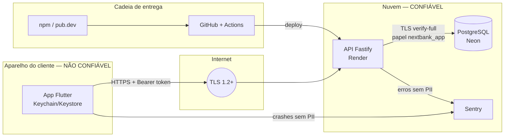

# next bank — Threat Model (V1)

- **Status:** Aprovado (2026-10-05), incluindo as decisões D4–D7
- **Método:** STRIDE por fluxo, sobre um diagrama de fluxo de dados com fronteiras de confiança
- **Referências:** OWASP ASVS (nível 2) para API, OWASP MASVS para o app — checklist em `checklist-asvs-masvs.md`; status consolidado dos controles em `controles-de-seguranca.md`
- **Base:** `docs/architecture/domain-model.md`, `docs/architecture/database.md`
- **Regra viva:** toda feature nova revisa este documento; ameaça nova vira uma linha aqui **e** um teste.

## 1. Escopo

Fase 1 (V1): app Flutter, API Fastify, PostgreSQL, Sentry, pipeline de CI/CD e repositório público.
Fora do escopo desta versão: simulador do Bacen (Fase 2) e backoffice (Fase 3), que terão revisões próprias.

## 2. Ativos

| Ativo | Por que importa | Impacto se comprometido |
|---|---|---|
| Saldo e ledger | É o dinheiro do cliente | Crítico: perda financeira, perda de confiança |
| Credenciais (senha, PIN) | Dão acesso à conta e autorizam Pix | Crítico |
| Tokens de sessão (access e refresh) | Equivalem a estar logado | Crítico |
| Dados pessoais (CPF, nome, e-mail, chaves Pix) | LGPD; usados em golpes | Alto |
| Trilha de auditoria | Prova do que aconteceu (não repúdio) | Alto |
| Chaves de criptografia e de assinatura de JWT | Protegem todos os itens acima | Crítico |
| Disponibilidade da API | Cliente sem acesso ao próprio dinheiro | Médio (V1 é demonstração) |
| Repositório e pipeline | Código malicioso chegaria à produção | Alto |

## 3. Atores de ameaça

| Ator | Capacidade | Exemplo |
|---|---|---|
| **A1** Atacante externo anônimo | Requisições pela internet, automação, listas de senhas vazadas | Credential stuffing, varredura de chaves Pix |
| **A2** Cliente mal-intencionado autenticado | Conta válida, conhece a API, altera requisições | Acessar dados de outro cliente (IDOR), adulterar valores |
| **A3** Quem está com o aparelho da vítima | Aparelho desbloqueado ou roubado | Fazer Pix com a sessão aberta |
| **A4** App adulterado / malware no aparelho | Lê armazenamento inseguro, intercepta tráfego | Roubar tokens |
| **A5** Quem obtém dump, backup ou logs | Acesso de leitura a dados em repouso | Ler CPF, hashes, tokens em log |
| **A6** Cadeia de suprimentos | Dependência ou action comprometida | Pacote npm malicioso |

## 4. Fluxo de dados e fronteiras de confiança

**Fronteiras:**
- **F1 — App ↔ API:** tudo que vem do app é não confiável. O servidor revalida tudo (valores, dono do recurso, estado, limites).
- **F2 — API ↔ Banco:** papel de menor privilégio; ledger e auditoria não podem ser alterados.
- **F3 — Aplicação ↔ terceiros (Sentry):** nenhum dado pessoal ou segredo atravessa.
- **F4 — Cadeia de entrega:** dependências e actions são código de terceiros executando com acesso aos nossos segredos de CI.

## 5. Ameaças e mitigações

Legenda STRIDE: **S** falsificação de identidade · **T** adulteração · **R** repúdio · **I** vazamento de informação · **D** negação de serviço · **E** elevação de privilégio.

### 5.1 Autenticação e sessão

| ID | Ameaça | STRIDE | Ator | Mitigação | Teste | Sem. |
|---|---|---|---|---|---|---|
| AUTH-01 | Credential stuffing e força bruta no login | S | A1 | Rate limit por IP e por conta, com atraso progressivo; Argon2id; mensagem genérica | 6ª tentativa em 1 min → 429; contador por conta independe do IP | 3 |
| AUTH-02 | Descobrir quais e-mails/CPFs têm conta (enumeração) | I | A1 | Mensagens idênticas para usuário inexistente e senha errada; **hash fictício** quando o usuário não existe, para o tempo de resposta não denunciar; cadastro com erro genérico | Respostas e tempos equivalentes para os dois casos | 3 |
| AUTH-03 | Roubo e reuso de refresh token | S | A4 | Rotação a cada uso; reuso fora da janela de 10 s revoga a sessão inteira; token só no Keychain/Keystore; guardado como hash no banco | Reapresentar token antigo após 10 s → 401 e sessão revogada | 3 |
| AUTH-04 | Roubo de access token | S | A4 | Validade de 15 min; operações sensíveis (autorizar Pix, trocar PIN) também verificam se a sessão ainda está ativa no banco | Token de sessão revogada → recusado no `AuthorizePix` | 3, 5 |
| AUTH-05 | Token forjado (algoritmo `none`, troca de algoritmo, chave errada) | S, E | A1 | Algoritmo fixo (EdDSA), lista de algoritmos aceitos, validação de `iss`, `aud`, `exp`, `nbf`; `kid` para rotação de chave | Tokens com `alg: none`, `HS256` e assinatura inválida → 401 | 3 |
| AUTH-06 | Sessão continua válida após logout ou troca de senha | S | A3 | Logout revoga a sessão; troca de senha revoga **todas** | Refresh após logout/troca → 401 | 3, 7 |
| AUTH-07 | Senha fraca ou vazada | S | A1 | Política D6 (mínimo 10, lista local de senhas comuns, sem regras de composição) | Senhas da lista → 422 | 3 |
| AUTH-08 | Quebra offline dos hashes após vazamento | I | A5 | Argon2id com parâmetros da OWASP (mínimo 19 MiB de memória, 2 iterações); senha máxima de 128 caracteres (evita DoS no hash) | Teste dos parâmetros; senha de 10.000 caracteres → 422 sem processar o hash | 3 |
| AUTH-09 | Criação de contas em massa por robôs | D, E | A1 | Rate limit no cadastro por IP; CPF único (índice cego) | 4º cadastro do mesmo IP em 1 h → 429 | 3 |

### 5.2 Pix

| ID | Ameaça | STRIDE | Ator | Mitigação | Teste | Sem. |
|---|---|---|---|---|---|---|
| PIX-01 | Autorizar ou ver o Pix de outro cliente (IDOR) | E, I | A2 | Pagador sempre derivado do token; todo acesso verifica o dono; recurso alheio → 404 | Cliente B tenta ler/autorizar Pix de A → 404 | 5 |
| PIX-02 | Pix duplicado por repetição de requisição (replay) | T | A2, rede | Idempotência (usuário, chave); máquina de estados; `UNIQUE` no lançamento por Pix | T-DB-05, T-DB-06; mesma requisição 2x → mesma resposta, 1 lançamento | 5 |
| PIX-03 | Gastar o mesmo saldo duas vezes com requisições simultâneas | T | A2 | Locks em ordem fixa + `CHECK` de saldo | T-DB-08, T-DB-09 | 5 |
| PIX-04 | Adulterar valor (negativo, fracionado, gigante) ou campos que não deveriam ser enviados | T, E | A2 | Schemas Zod estritos (campo desconhecido → 422); valor inteiro em centavos > 0; limites no servidor; conta de origem nunca vem do corpo | Valores `-1`, `0.001`, `1e20`, campo `payerAccountId` extra → 422 | 5 |
| PIX-05 | Força bruta no PIN | S | A3 | 5 erros → bloqueio de 30 min; 3º bloqueio em 24 h → PIN bloqueado até redefinir com a senha; contador por usuário (não por Pix) | 6ª tentativa → 423; contador sobrevive a Pix diferentes | 5 |
| PIX-06 | Pix feito por quem pegou o aparelho com sessão aberta | S | A3 | Desbloqueio do app após 5 min em segundo plano; PIN validado no servidor em todo Pix; limite noturno | Pix sem PIN → impossível pela API | 3, 5 |
| PIX-07 | Varredura de chaves Pix para coletar nomes e CPFs | I | A2 | 30 consultas/hora; chaves inexistentes contam em dobro; resposta com documento mascarado | 31ª consulta → 429 | 5 |
| PIX-08 | Autorizar Pix expirado ou fora de ordem | T | A2 | `expires_at` e status verificados com `FOR UPDATE` | Autorizar após 10 min → 409; autorizar duas vezes → 409 | 5 |
| PIX-09 | Cliente nega ter feito o Pix (repúdio) | R | A2 | Auditoria imutável com sessão, `requestId`, dispositivo e evento de verificação de PIN; ID E2E no comprovante | Evento `PIX_COMPLETED` contém sessão e `requestId` | 5 |
| PIX-10 | Horário do aparelho manipulado para fugir do limite noturno | T | A2 | Horário sempre do servidor (`Clock`, fuso São Paulo); horário do cliente ignorado | Teste com `Clock` às 21h → limite noturno aplicado | 5 |

### 5.3 Consultas (saldo, extrato, comprovante)

| ID | Ameaça | STRIDE | Ator | Mitigação | Teste | Sem. |
|---|---|---|---|---|---|---|
| READ-01 | Ler saldo, extrato ou comprovante de outro cliente | I | A2 | Conta derivada do token; nenhum endpoint aceita ID de conta do cliente | Teste de IDOR em **todo** endpoint de leitura | 4, 6 |
| READ-02 | Resposta expõe dados demais | I | A2 | DTOs com lista de campos permitidos; documentos sempre mascarados | Teste de contrato falha se surgir campo novo não aprovado | 4, 6 |
| READ-03 | Cursor de paginação adulterado | T | A2 | Formato validado; filtro por conta feito no servidor | Cursor inválido → 422; cursor de outra conta não retorna dados alheios | 6 |
| READ-04 | Consultas caras para derrubar a API | D | A1, A2 | Página máxima de 20; índices; `statement_timeout` | Pedido de 10.000 itens → limitado a 20 | 6 |

### 5.4 App mobile

| ID | Ameaça | STRIDE | Ator | Mitigação | Teste | Sem. |
|---|---|---|---|---|---|---|
| MOB-01 | Tokens extraídos do armazenamento do aparelho | I | A4 | Só Keychain/Keystore (`flutter_secure_storage`); nada sensível em `SharedPreferences` ou arquivos | Lint/verificação no CI proibindo `SharedPreferences` para tokens | 3 |
| MOB-02 | Dados sensíveis em logs ou relatórios de crash | I | A5 | Sem `print`; logger com filtro; Sentry com limpeza de PII antes do envio | Teste do filtro do Sentry com CPF e token no evento | 2 |
| MOB-03 | Interceptação do tráfego (MITM) | T, I | A4 | Só HTTPS; tráfego em texto puro desabilitado (Android e iOS) | Build não aceita `http://` | 2 |
| MOB-04 | App descompilado em busca de segredos | I | A4 | Nenhum segredo no app; release ofuscado; servidor é a única autoridade | Busca por chaves no binário de release | 8 |
| MOB-05 | Pessoa ao lado vê o saldo | I | A3 | Opção de ocultar saldo; desbloqueio após 5 min em segundo plano | Teste de widget do saldo oculto | 4, 7 |

### 5.5 API, dados e infraestrutura

| ID | Ameaça | STRIDE | Ator | Mitigação | Teste | Sem. |
|---|---|---|---|---|---|---|
| API-01 | SQL injection | T, I | A1, A2 | Só queries parametrizadas (`pg`); regra Semgrep contra SQL concatenado | Payloads de injeção nos campos de texto | 2+ |
| API-02 | Sobrecarga da API | D | A1 | Rate limit global e por rota; corpo máximo de 16 KB; timeouts | Corpo de 1 MB → 413 | 2 |
| API-03 | Erros revelando detalhes internos | I | A1 | RFC 7807 com mensagem genérica; stack só no log interno | Erro forçado não traz stack nem SQL | 2 |
| API-04 | Dados pessoais e segredos nos logs | I | A5 | `redact` do Pino (senha, PIN, tokens, CPF, chave Pix, `authorization`) | Teste que loga um payload sensível e verifica a saída | 2 |
| API-05 | Adulteração do ledger ou da auditoria (bug ou papel comprometido) | T, R | A5 | Append-only por `GRANT` e trigger; reconciliação | T-DB-03, T-DB-04, T-DB-14 | 4 |
| API-06 | Vazamento de dump ou backup | I | A5 | CPF e chaves Pix criptografados (AES-256-GCM); segredos só como hash | Coluna de CPF não contém o CPF em claro | 3 |
| API-07 | Credenciais do banco comprometidas | E | A5 | Papéis separados (migração × aplicação); TLS `verify-full`; senha só em secret store | T-DB-13 | 2 |
| API-08 | Segredo commitado no repositório público | I | A1 | `.gitignore` completo; gitleaks no CI e localmente; secret scanning e push protection do GitHub | Gitleaks bloqueia PR com segredo de teste | 2 |
| API-09 | Dependência ou GitHub Action maliciosa | T, E | A6 | Lockfile e instalação congelada; osv-scanner; Dependabot; actions fixadas por SHA; `GITHUB_TOKEN` com permissão mínima | CI falha com dependência vulnerável conhecida | 2 |
| API-10 | Injeção em logs | T | A2 | Logs estruturados em JSON (o valor nunca vira linha nova) | Campo com `\n` não quebra o log | 2 |
| API-11 | Papel da aplicação com privilégio excessivo no provedor (ex.: papel criado pelo painel do Neon entra no `neon_superuser`, com `pg_write_all_data`, e ignora os `GRANT`s) | E | A1, A2, A5 | `nextbank_app` criado via SQL, sem atributos especiais (`SUPERUSER`, `CREATEROLE`, `CREATEDB`, `REPLICATION`, `BYPASSRLS`) e sem associação a outros papéis | Teste lê `pg_roles` e `pg_auth_members` no ambiente e falha com qualquer atributo ou associação | 2 |
| API-12 | Transação travada segurando o lock de um saldo (API presa no meio da transação ou query lenta) | D | A1, A2 | `statement_timeout = 5s`, `lock_timeout = 3s` e `idle_in_transaction_session_timeout = 10s` no papel da aplicação | Teste lê as configurações efetivas do papel; transação ociosa é encerrada pelo banco | 2 |

### 5.6 Demo pública

A V1 fica publicada para avaliação por recrutadores. Uma demo aberta tem riscos próprios.

| ID | Ameaça | STRIDE | Ator | Mitigação | Teste | Sem. |
|---|---|---|---|---|---|---|
| DEMO-01 | Visitantes cadastram **dados pessoais reais** (CPF, nome, e-mail) numa demo pública | I | Visitante | O app gera um CPF fictício válido no cadastro; aviso explícito para não usar dados reais; contas de demonstração prontas dispensam o cadastro | Fluxo de cadastro oferece o CPF gerado por padrão | 3 |
| DEMO-02 | Dados de visitantes acumulados indefinidamente | I | A5 | Reset semanal do banco da demo (apaga contas de visitantes, recria as de demonstração); retenção documentada no README | Job de reset em ambiente de teste deixa só as contas de demonstração | 8 |
| DEMO-03 | Contas de demonstração alteradas para prejudicar a experiência de outros visitantes (trocar PIN, encerrar sessões, zerar saldo) | T, D | Visitante | Contas de demonstração não podem trocar senha ou PIN; saldo recomposto no reset; rate limit normal | Troca de PIN numa conta de demonstração → 403 | 7 |
| DEMO-04 | Uso da demo para hospedar conteúdo ofensivo (nomes, descrições de Pix) | T | Visitante | Limite de tamanho nos campos; reset semanal | Descrição acima de 140 caracteres → 422 | 5 |

## 6. Decisões de segurança

| # | Decisão | Proposta |
|---|---|---|
| D4 | Assinatura do access token | **EdDSA (Ed25519)** com a biblioteca `jose`; `kid` no cabeçalho para rotação; chave privada só na API (variável de ambiente, validada na inicialização). A troca para KMS acontece na porta `AccessTokenIssuer`: num KMS a chave nunca sai do serviço, então não existe uma porta separada para entregar a chave |
| D5 | Duração das sessões | Access token: **15 min**. Refresh: rotativo a cada uso. Sessão: expira após **7 dias sem uso** ou **30 dias no total**. App: pede desbloqueio após **5 min** em segundo plano |
| D6 | Política de senha | Mínimo **10**, máximo **128** caracteres; recusa senhas de uma lista local de senhas comuns; **sem** regras de composição (alinhado ao NIST SP 800-63B); troca exige a senha atual |
| D7 | PIN de transação | **4 dígitos**, sem sequências triviais; **5 erros → 30 min** de bloqueio; **3º bloqueio em 24 h → PIN bloqueado** até redefinição com a senha; troca exige a senha |

## 7. Riscos aceitos na V1

| Risco | Por que é aceito agora | Evolução |
|---|---|---|
| Sem vínculo do aparelho (device binding) | Exige chave no Secure Enclave/Keystore assinando requisições; complexo para a V1 | Segurança avançada (Próximos passos) |
| Sem certificate pinning | Risco de quebrar o app na rotação de certificados do provedor | Pinning da chave pública (SPKI) com chave reserva |
| Sem verificação de integridade do app (Play Integrity / App Attest) | Exige contas de loja e configuração de backend | Segurança avançada |
| Sem bloqueio de captura de tela | Baixo impacto na demo; há opção de ocultar saldo | `FLAG_SECURE` e proteção no app switcher |
| Sem segundo fator no login (OTP) | Fora do escopo da V1 | Avaliar e-mail OTP em novo dispositivo |
| Access token válido por até 15 min após revogação | Leituras toleram o atraso; operações sensíveis verificam a sessão no banco | Lista de revogação em cache, se necessário |
| Contadores de tentativas de login em memória | Uma instância na V1 (D3); a chave é o hash do e-mail e o tamanho é limitado a 10 mil contas | Um reinício zera os bloqueios, e uma enxurrada de e-mails aleatórios pode despejar o contador de uma conta real (o limite por IP reduz isso). Evolução: contadores no Postgres ou Redis |
| Uma só chave de assinatura de token ativa | O verificador já escolhe a chave pelo `kid`, mas a V1 configura uma | Aceitar também a chave anterior por 15 min ao rotacionar, para não derrubar sessões |
| Chaves de criptografia em variável de ambiente | KMS sem ganho para a demo | KMS/HSM nas portas `CpfProtector` e `AccessTokenIssuer` |
| Saldo de demonstração ganho no cadastro | Dinheiro fictício; cadastro com rate limit | Remover quando houver entrada real de recursos |

## 8. Ações de segurança no repositório (semana 2)

- [x] Ativar **secret scanning** e **push protection** no GitHub (2026-10-05)
- [x] Ativar **Dependabot alerts** e atualizações de segurança (2026-10-05)
- [x] **Proteção da `main`:** PR obrigatório, 6 checks obrigatórios, branch atualizada, sem force push (ruleset `protect-main`)
- [x] Gitleaks também como hook local de pré-commit (#31)

## 9. Testes de segurança: resumo

Cada linha das tabelas acima tem um teste. Eles formam a **suíte de segurança**, que roda no CI em todo PR e cresce a cada fatia. Na semana 8, soma-se uma varredura dinâmica básica (OWASP ZAP baseline) contra a API publicada.
